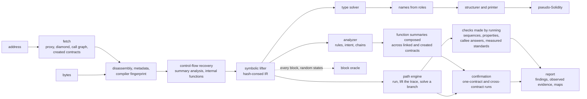
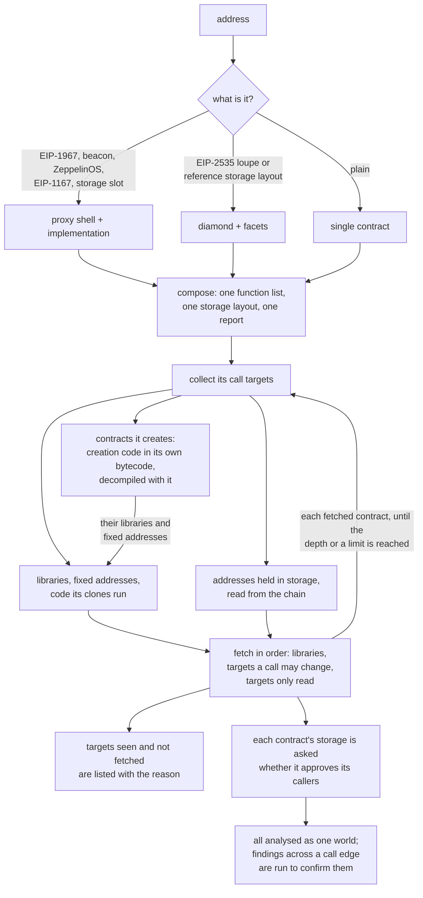

# evmdec

EVM bytecode decompiler and security analyzer, written from scratch in Rust.

Give it an address on any EVM chain, or the compiled bytecode of a contract that is not
deployed yet, and it returns readable pseudo-Solidity, a recovered interface and storage
layout, and a ranked security report. Proxies and diamonds are fetched and assembled with
their implementation or facets and analysed as one contract, and the contracts they call are
fetched and analysed too, so a token whose sender check trusts a hook contract is read
together with that hook.

The decompiler ships its own correctness oracle: a concrete interpreter executes every basic
block and the result is compared with the lifted code. The numbers in this file are measured
by scripts in `corpus/`, not asserted.

## Pipeline



Every stage is in `crates/decompiler`:

| module | role |
|---|---|
| `u256`, `keccak`, `hex`, `opcode`, `disasm`, `metadata` | arithmetic, hashing, instruction table, linear disassembly, CBOR metadata and compiler version |
| `cfg` | jump resolution by compositional summaries; dispatcher, internal functions, argument and return counts |
| `expr`, `lift`, `ssa`, `idiom` | hash-consed expression IR, symbolic execution of blocks, def-use index, compiler idioms |
| `types`, `type_rules` | type recovery as constraint solving over parameters, storage, helpers and merges |
| `structure`, `emit`, `function`, `sigs`, `sigdb`, `naming` | loops, conditionals and short-circuits; printing; signature dictionary and local index; names inferred from roles |
| `compiler` | compiler version and feature fingerprints when the metadata is missing |
| `analyze`, `confirm`, `exec` | security rules, concrete confirmation of reachable findings, the whole-frame executor |
| `path`, `solve`, `seq`, `abi`, `deploy` | the path engine: one concrete run lifted into its branch conditions and writes, a solver that inverts a condition back to an input word, a search over short call sequences, ABI-shaped starting inputs, and the storage a constructor leaves |
| `props`, `flow`, `signed`, `standard`, `origin`, `range`, `evidence` | checks made by running the code: properties inferred from behaviour, how a function takes a callee's answer, signed messages, the standard ledger interface as measured, where stored values come from, value ranges along a path, and what a confirming run was seen to do |
| `world`, `search` | every contract of a run with what surrounds them (code and storage at each address, each account's ether, the books of the assets called, the time), and one search over sequences of calls in that world |
| `interp`, `verify` | reference EVM interpreter and the block oracle |
| `rpc`, `fetch`, `decompile`, `slots`, `clock` | chain access, proxy and diamond resolution, the walk over call targets, composition, well-known storage slots, the time limit one dependency is given |

## What it recovers

- Any bytecode. Runtime or creation code, solc 0.4 to 0.8, Vyper 0.2 to 0.3, hand-written and
  minimal proxies, embedded `CREATE` and `CREATE2` payloads (decompiled with `--embedded`, and
  always when the contract is fetched by address). Unreferenced code is still printed
  as `orphan_<pc>` functions; anything unresolved is reported, not dropped.
- The interface. Linear, binary-search, `XOR` and `SUB` dispatchers and Vyper jump tables;
  parameter and return types from ABI head checks, masks, sign extension, dynamic offsets and
  the solc 0.8 decoder helpers, refined by a solver that follows values through phi merges,
  internal calls and storage; `view`, `pure` and `payable` from effects; events with `indexed`
  from the topic count; custom errors; `require(cond, "reason")` and `Panic(...)`.
- Storage. Mappings, dynamic and fixed arrays, packed fields (`uint112 reserve0; uint112
  reserve1; uint32 blockTimestampLast;`), strings, precomputed array slots, EIP-1967,
  ZeppelinOS, diamond and ERC-7201 namespaced slots by name. A mapping or array whose
  elements span several slots is declared with its struct (`struct Struct_264 { address
  field0; uint256 field1; bytes field2; }`) and read by member (`stor_264[key].field1`):
  members packed into one slot, byte strings, and arrays and mappings held inside the
  element each get their own type, and a member takes its name from the getter that returns
  it or from the setter that writes it (`struct Struct_0 { address owner; address resolver;
  uint64 ttl; }`).
- Readable code. Helpers (SafeMath, ABI coders, getters) inlined with their checks kept as
  `require` lines, checked arithmetic printed plain, `payable(to).transfer(v)`, `members.push(x)`,
  locals for values the source held in locals, the previous value of a slot read before it is
  overwritten, loops folded back together after control-flow recovery peeled an iteration.
- Memory. Each allocation at solc's free memory pointer is a named block (`ptr1`, `ptr2`), so
  two structs never read as one address; a run of stores that fills a block prints as one line
  (`ptr1 = memory(arg0, arg1, ptr2)`), a string built in memory as its text, and the
  allocator's own bookkeeping and overflow panics are left out. A call's payload prints as
  what it is: `abi.encodeWithSelector(...)` when its words are known, `msg.data` when a proxy
  forwards its calldata, `bytes(p)` for the byte string at a pointer, and the selector with
  the leading arguments when only the head is known. Precompiles are called by name.
  Vyper has no free pointer and keeps every variable at a fixed address, so there a word at
  one prints as a local (`loc_280`) and a word-scaled index from one as an element of the
  list that starts there (`loc_240[loc_280]`). A store to a fixed address is printed only
  when something that runs afterwards can read it: a later load, a byte range handed to a
  call, a hash or a return, or an internal function that loads the address before writing it
  itself (the lifter records, load by load, whether the function had already written those
  bytes on every path). In code without a free pointer the lifter also keeps what it knows
  of memory across a call to an internal function whose writes are all to fixed addresses.
- Names. A built-in dictionary of about 1,300 selectors, topics and errors; an optional local
  index of the whole public signature database; online lookup with `--lookup`. Where no
  signature gives a name, the code does: a variable is named by its getter, by the setter that
  writes it (`setFee` writes `fee`), by the event announcing its change, or by its role (the
  `owner` the guards compare the caller with, the `reentrancyLock` toggled around calls, the
  `balances` a transfer debits and credits with their `allowances` and `totalSupply`). An
  internal function is named by what it does (`_transfer` emits `Transfer`, `_callBalanceOf`
  makes one call, `_onlyOwner` checks the caller). A parameter is named by its use: `from`,
  `to` and `amount` on a ledger, `deadline`, the `v`, `r`, `s` given to `ecrecover`, a call
  `target`, a `recipient`, `newFee` for the value stored into `fee`. A name is given only
  where `stor_3`, `func_0x1fbb` or `arg0` would stand, and only when the type fits the role.

## Composites and linked contracts



Each function is marked with the address whose code holds it. Slots that two parts type
differently are reported as storage collisions, and a function the shell answers itself is
reported as shadowed. Linked contracts carry their own code and report; a rule on the root
can use what it learned from a linked callee (a hook that forwards calls, a pool interface).

The walk over call targets goes level by level. At each level the targets of every contract
fetched so far are collected and fetched in this order: libraries (their code runs in the
caller's storage), then targets some call may change, then targets that are only read. A
target is fetched once however many contracts call it, the same code at two addresses is
decompiled once, and every contract says how it was reached (which contract calls it, through
a fixed address, a library call or which storage slot, and how many calls away it is).

How far it goes: 2 call edges from the contract asked for by default (`--depth`, at most 3;
`depth` in the server's request), at most 8 targets fetched from one contract, at most 40 code
units per request across parts and dependencies, 20 seconds to decompile one dependency and
120 seconds for the whole walk. Whatever was seen and not fetched is listed with its reason
(a limit, the depth, an empty slot, no code, too slow), in the report and in the JSON
(`unfollowed`), so the edge of what was analysed is always stated.

Contracts a contract creates are part of the walk too. Creation code a contract copies out of
its own bytecode is decompiled with it (constructor and runtime), the libraries and fixed
addresses that created code calls are fetched like any other target, and the address a
minimal proxy forwards to is fetched as the code its clones run.

After the walk, each fetched contract's storage is read at the places its own access checks
look (the slots `msg.sender` is compared with, the mapping entries tested under `msg.sender`)
for the contracts that call it. The answer (`admits`) says whether the callee approves the
caller, which is what turns "this function is gated" into "and this contract gets through".
`--no-follow-proxy` turns all of this off.

## Security report

Findings are leads with a severity and a confidence, ranked, folded per defect, with evidence
lines that use the same names as the code and a recommendation. Rules read the lifted IR,
not opcode patterns, and see through internal helpers with the caller's arguments
substituted. No rule names a contract, a protocol, a token or an address.

| family | rules |
|---|---|
| calls | reentrancy (lock recognised only when a slot is tested, set and restored; ERC721, ERC1155 and ERC777 hooks; severity by reachability), unchecked call and token results, arbitrary and run-time dispatched `call` and `delegatecall`, `transferFrom` on a caller-chosen account, decisions trusted to a caller-supplied contract, calls in loops, blocking payout loops |
| value | reverse-quoted amounts, payouts without a slippage bound, spot balances as a price, fee-on-transfer assumptions, division before multiplication, `msg.value` reused in loops and multicalls, unbounded payout parameters, wrapping arithmetic on pre-0.8 compilers and inside `unchecked` blocks |
| authority | owner and initializer writes without access control, silent authorisation failures, `tx.origin`, `selfdestruct` by reachability, unprotected upgrades, ether withdrawable by anyone (sending back what the same call brought is a refund and is not counted), a caller check that is one half of a joined condition, access control by intent (`inconsistent-access-control`: a function that never reads its caller and writes what checked functions write, or stores a value its caller chooses where two or more checked functions do the same), attack chains (a write anyone can make paired with the function that trusts it) |
| trust | a gate that trusts a contract the token itself calls on a public path (`trusted-callee-loop`), a balance lowered on an account the caller neither owns nor has an allowance for (`third-party-balance-debit`, critical when the account is a market counterparty recognised by behaviour: singled out by transfer guards, returned by a factory, read as a ledger, or called with a pool interface), a pair `sync()` reachable after balances changed (`pair-sync-after-state-change`) |
| linked contracts | when the contracts this one calls were fetched with it, each edge is held against the other side's own code and report: a selector the called contract has no function for and nothing to catch (`linked-call-unanswered`); ether sent to a function that rejects it, or with no function selected to code without a payable receive or fallback (`value-to-non-payable`); a called function its own contract's report rates high or critical (`linked-callee-defect`); and an `approve` whose spender moves tokens from accounts its caller picks (`approval-to-open-spender`). The target is a fixed address or one read from a slot whose content was fetched |
| control passed on | each function's summary says whether it hands control to an address an ordinary caller can choose: a word of its call data, storage any caller can fill, an account it works out while running and pays with more than the stipend, or a function of another contract that does one of these. A caller that makes such a call and then writes storage or calls out again gets `control-handed-out-mid-update`, naming the chain. A callee that calls a word of its call data is not blamed when the caller fixes that word |
| libraries | high findings in the library functions a contract runs by delegatecall, and medium ones the library's own report holds at medium confidence or better, are counted in that contract's report and score, marked with the library's address, because that code acts on the contract's own storage and balance. Findings that say a function is open to any caller are counted only when a function that runs the library is itself open |
| words passed between contracts | every external function is summarised by what it does with each word of its call data: which words it ties to `msg.sender` (compared with it, or keying an entry compared with it or read under it), which name an account whose entry it lowers or whose tokens it moves, which it pays, which it writes whole to a fixed slot, and which it passes on to another contract, together with what gates the function. The summaries are composed across call edges: a function anyone can call that passes an untied account to a gated function that lowers that account's entry (`unbound-account-passed-on`), or passes an untied word into a slot the called contract's access checks read (`unbound-address-made-privileged`). The path is followed through further calls, a value computed by a linked library function that only does arithmetic is read through the call, and parameters a compiler keeps in fixed memory words are followed. When the called contract's storage was read, the finding is kept only if that storage approves this contract as a caller. A call made with `DELEGATECALL` to a linked library is folded into the function that makes it: what the library function stores, lowers, pays, passes on and checks becomes the caller's, with slots the library counts from a storage position it is handed placed at the position the caller passes. A call to an address returned by a function that creates a contract, or to the result of a creation in the same function, is read against the created code: creation code copied from the creator's own bytecode, or the code a minimal proxy (EIP-1167) forwards to. Writing a caller-chosen address into a new contract's own gate is ordinary and is reported only when the same call also lowers the entry of an account the caller names |
| accounting | two functions that each cap the amount they pay out by `credits - liabilities` over the same pooled storage, where one subtracts a proper subset of the liability fields the other subtracts (`inconsistent-liability-accounting`): the path subtracting fewer can release more than the shared balance backs. A field is a slot path plus a bit range, so packed halves stay apart; terms carry signed coefficients; the flagged limit must be compared with the amount that leaves, and the reference may be any limit the contract states, a view's returned value included. Two conservation checks over single-level mappings: an entry raised from a value read before another entry of the same mapping was lowered, with nothing comparing the two keys, so one key in both places ends higher than it began (`stale-ledger-write`); and an entry raised by an amount in a function that leaves alone the total every other path moves in step with that mapping (`ledger-total-mismatch`). Steps by a constant are counters and are ignored |
| types | wide values cut to `uintN` without a check, signed and unsigned comparison of one value, addresses built by arithmetic, hashes used as numbers, narrow counters |
| signatures and randomness | `ecrecover` zero address and malleability, signatures without a domain or a nonce, block attributes as randomness, whether hashed or taken as a plain remainder of their sum, Chainlink answers without staleness or positivity checks |
| compiler | known solc and Vyper bugs for the detected version, with triggers the bytecode cannot show marked informational; the Vyper 0.2.15 to 0.3.0 lock bug |
| structure | proxy and diamond kinds, storage collisions, shadowed functions, locked ether, storage-bounded loops |

What counts as an access check is decided per contract: `msg.sender == owner` always, and a
test of `mapping[msg.sender]` only when every function writing the mapping is itself gated. A
stake or balance mapping anyone can fill is accounting, not authorisation.

A finding that says the caller picks what the contract calls is a claim a run can settle. The
call data is changed four bytes at a time and the function or address called either follows
it or does not. One that follows is confirmed with the run. One that never moves is taken
out of the findings and listed in the report under "Tested by running and not reported", so
nothing a rule said goes missing without a word.

A last step reads each report as a whole and may rate a medium finding high on the weight
of everything found on the same contract. It never lowers a finding. It is described and
measured under "Rating a report as a whole".

Two passes run after the rules. The confirmation pass drives the concrete executor from a
fresh state into each reachable sink and marks a finding confirmed with a witness input when
the effect shows. A finding that spans a call edge is confirmed by running it across the
fetched contracts (`world`): calls run the callee's code in the callee's storage, library calls
run in the caller's storage, creations run their init code, and a frame that fails takes its
writes back. The state is only what was read from the chain: each contract's code, the
addresses its slots were read to hold, and gates set for the callers a contract's own storage
approved, so a gate nobody was read to pass stays shut. The function is run by an account
holding no role, once for each of two named accounts. A first round finds the slots of the far
contract written for one account and not the other; a second gives those slots a balance and
tries a few argument shapes. The finding is confirmed, with the input, when for both accounts
the call completes and the account's own slot ends lower.


### Checks made by running the code

The path engine runs a function on the reference interpreter, lifts the blocks that ran into
one straight line of branch conditions and storage writes, and solves a chosen condition the
other way to get an input that takes the other branch. The solver is a generator, not a
decision procedure: it inverts arithmetic back to a word of the call, the value sent or, when
asked, a storage slot, and every answer it gives is run again on the bytecode before anything
is built on it. On the 22 audited contracts the lifted conditions agree with the interpreter
on all 95,466 branches taken. When creation code is given, the constructor is run first and
every check starts from the storage it leaves; with runtime code only, they start from empty
storage and say so.

Runtime code does not say how its contract was set up, and a function that tests a flag, a
limit or the code behind a stored address stops there when that storage is empty. Before the
checks that measure what calls do, one set of values is taken for the contract: each function
any account may call is explored, and the storage it needs in order to run is chosen, among
the places no function open to every caller writes. Those places hold what a constructor or
an authorised account sets. A place is never given the caller's address or a value a call
answered, so no setting makes the caller an owner or makes a recovered signer match. The
search and the records check start from these settings, the report lists them under
"Assumed settings", and every finding measured from them says so.

A call the contract makes is answered with one word unless a check sets the answer on
purpose. When the code then tests the length of the answer or a word of it, the search may
lengthen the answer and fill the word, the way it sets a word of the call data. This is not
done in the pass that confirms what other rules found.

| check | what is run and what is reported |
|---|---|
| which function is called | a call whose target and selector are both worked out at run time is run, and the call data is then changed four bytes at a time. A payload whose first four bytes never follow the call data has its selector fixed by the code or by storage, and the finding is withdrawn. One whose first four bytes change is confirmed with the run attached (`dynamic-call`) |
| reachability | a sink no single input reaches is tried through up to three earlier calls that write the storage it needs; the earlier calls are attached to the finding |
| arithmetic | an input that takes a path ending normally and makes a stored sum, difference or product wrap; open when no such run exists from the starting storage. A small interval analysis reads the masks, the checks on each path and the orderings they prove; when every stored result on every finished path stays in range, the finding is kept at the lowest severity and says so |
| properties from behaviour | a mapping and a total that at least two functions move in step, then a path that moves them apart (`entries-total-out-of-step`); a slot toggled like a lock and left set on one path (`lock-left-set`); a storage slot picked by an untested word of the call (`input-picks-storage-slot`); input one byte short still accepted (`short-input-accepted`); work that grows with a count any caller can raise (`cost-grows-with-open-list`); a bound compared with the block clock that any caller can store (`time-bound-set-by-anyone`) and a time check on a slot nothing sets (`time-window-never-opens`); a payment of value to accounts read from storage that fails as a whole when one of them refuses (`one-refusal-blocks-all`, or confirms `blocking-payout-loop` and `fixed-payee-can-block`) |
| sequences of calls | one search over what calls do in order, in one world. The world holds the code and storage of the contract, each account's ether, and the books of every address spoken to in the standard transfer interface. A call to an address that has code runs that code, with delegated calls, created contracts and a failed call undone. Assets keep honest books: a transfer the sender cannot cover fails, a balance asked for is what was really sent, and an account that let a contract take an asset once leaves that approval standing. Two accounts with no role start with the same holdings, and when the contract has a balance function that reads one slot for each account, both start with an amount of its token written there. A sequence is kept and extended when it reaches code no earlier one reached, or leaves the two accounts' holdings, the slots that are set, the value the contract has no record of or an answer read differently in a combination not seen before. Inputs come from solving the function's own checks at the state reached, and a function still without an input is solved again from each new state that wrote a slot it reads. After every step that ends, the properties in the table below are checked on the state it leaves. No assumption stands in for a check: a call that recovers a signer answers with an account that is no one, a delegated call to code that is not in the run returns nothing, and an account of the run answers no question |
| draws from the block | a function that takes a hash or a remainder of block values and can pay ether is run with a payment, with storage chosen so that its own checks accept the call, until a run pays the caller more than it brought. The same call is then run one to three blocks later with nothing else changed: a payment that is no longer made shows the block decides who is paid (confirms `weak-randomness`). A remainder of the time alone, which places a moment in a schedule, is not taken for a draw |
| callee answers | each call the contract makes can be answered separately: a transfer that answers false and is treated as done (confirms `erc20-return-ignored`, or `refused-transfer-treated-as-done`); a transfer that returns nothing and makes the function fail (`transfer-without-answer-refused`); a payout that changes when a value read from outside is halved (confirms `no-slippage-bound` and `spot-balance-price`); a function that credits exactly the amount it asked an asset for without reading its own balance (confirms `fee-on-transfer`) |
| signed messages | a signed call is run, then run again unchanged from the state it left, with recovery answering the signer for the first digest only; accepted again means nothing takes the message out of use (`signed-message-accepted-twice`). Each argument word is then changed in turn: a word that changes what the call does while the digest stays the same is not signed (`signed-call-leaves-word-unsigned`) |
| the standard interface | a contract that shows `transfer`, `transferFrom` and `balanceOf` is not taken at its word: each is run and the entries it changes are measured against the amount asked (`transfer-creates-value`, `transfer-delivers-less`, `transfer-touches-third-entry`, `reported-balance-differs`, `transfer-changes-supply`, `transferfrom-ignores-allowance`, `allowance-not-spent`) |
| what a token holds for others | from a state in which a second account holds tokens, reached by a real transfer, every function any account may call is run by a third account. A balance entry that belongs to neither the caller nor the contract and falls is `call-lowers-another-accounts-balance`. A call that cannot be made a second time is taken for set-up and left out |
| where values come from | every store into a slot is followed back through the slots it is copied from; a call target that reads a slot any caller can fill (`stored-input-call-target`); a caller check against a record field that any caller fills with its own address names a party and does not lower a reentrancy finding |
| payout limits | the limits the accounting rule compares are read again from the checks of each run, where a record copied to memory and updated there resolves to the fields it came from, and a limit written as a sum compared with a sum is read too (feeds `inconsistent-liability-accounting`) |

What the search checks on every state it reaches:

| property | finding |
|---|---|
| the second account holds more of something and less of nothing than before its first call | `calls-leave-account-with-gain`, medium when the value came in with nothing written to storage, so that the contract keeps no record of whose it is |
| the same gain, when it needs the call made again from inside its own payment and the plain call leaves none | confirms `reentrancy`, or `reentered-call-pays-again` |
| the same gain, when it needs one outside answer to read about a thousand times higher or lower for one call, and the same calls with every answer as first given leave none | `one-call-reading-leaves-a-gain`, high when the answer is an asset's count of what another account holds or comes from a contract the call data names |
| the first account holds less of something and more of nothing through a call it did not make | `call-leaves-another-account-with-less`, high for a balance in the contract's own ledger |
| a call by the second account that moves no value, after which the first account's way out pays it less, where no argument of that way out set to the amount paid before makes it fail | `earlier-call-lowers-payout` |
| a take-out that lowers a record less when it is made in two parts than in one, with the caller holding the same either way | `rounding-favours-caller` |
| a call by the second account that sends nothing and asks no outside contract anything leaves its own address, or none, in a slot some function compares its caller with, and does so again when that slot first names another account | `caller-gives-itself-a-role`, high. `caller-clears-a-role`, medium |

Each part of the search is there because switching it off costs something that was measured.
The columns are labelled fixtures wrong of 50, known-vulnerable contracts found of 29, and
development incidents with the right kind of finding at high of 231. With everything on
they read 0, 26 and 83 at the time of the measurement, and a difference of one or two in the
last column is within what the order of the search moves by itself.

| part, and why it is there | off: fixtures wrong | known found | development |
|---|---|---|---|
| the next function is taken, three times in four, from those that read a slot the sequence wrote: a call matters to the calls that depend on it | 1 | 26 | 82 |
| a state is kept for where the holdings and set slots stand, not only for new code: paying in reaches no new code the second time, and is what a take-out needs | 2 | 26 | 80 |
| a function still without an input is solved again from each state that wrote what it reads: half the open functions the solver cannot enter are waiting for state | 0 | 26 | 81 |
| a call that left the other account with less is tried again with the caller named in each address word, from every state where the caller has not acted: what left went where the call named, and the caller's address lands there only by chance | 0 | 26 | 82 |
| both accounts start with some of the contract's own token: a token nobody holds shows nothing | 0 | 26 | 81 |
| a payment is resized to amounts already seen in the sequence: what a contract pays back is sized by what was paid | 0 | 26 | 81 |
| a word of the call is set to an amount seen, to twice that, or to what the contract holds: the most there is to ask for | 1 | 26 | 84 |
| a word typed as an address is set to one of the two accounts or the contract | 0 | 26 | 82 |
| value is sent straight to the contract, outside its functions: ether can be forced on a contract and an asset moves in the asset's own books | 1 | 26 | 81 |
| the paid account calls in again from inside the payment | 3 | 26 | 82 |
| one outside answer reads higher or lower for one call | 1 | 26 | 81 |
| a solved input is tried without its payment as well: this is how a function that needs a payment is told from one that takes it or leaves it | 0 | 26 | 83 |
| for a function the other account pays into, the actor pays under each reading and then asks for all the contract holds, and for one that needs a payment it pays twice at each pair of a few sizes: random sizes seldom meet the pair that matters | 1 | 25 | 84 |

Two more parts were measured the same way, cost nothing in any column, and were removed:
letting time pass between calls, and giving outside contracts the answers the solver chose.

Each pass that works by running the code was switched off in turn. With all of them on the
tool found 84 of the 231 development incidents at high, left 37 of the 55 sound contracts
with nothing at high, and found 26 of the 29 known-vulnerable contracts.

| pass switched off | incidents found | sound with nothing at high | known-vulnerable found |
|---|---|---|---|
| assumed settings | 78 | 37 | 26 |
| how a callee's answer is taken (`flow`) | 77 | 37 | 26 |
| the search over sequences of calls | 78 | 37 | 25 |
| the standard interface as measured (`standard`) | 83 | 37 | 26 |
| a draw from block values shown by two runs | 83 | 37 | 26 |
| a wrap shown by an input that causes it | 84 | 37 | 26 |
| properties from behaviour (`props`) | 84 | 37 | 26 |
| signed messages (`signed`) | 84 | 37 | 26 |
| the input that reaches a finding (`confirm`) | 84 | 37 | 26 |
| a balance credited with nothing paid | 83 | 41 | 26 |

The last four change no count. The first three of them stay for what they add to a report
and not to a score: `props` and `signed` hold rules that fire below high on real contracts
or are the check for a class in the public weakness registry, and `confirm` gives the input
that reaches a finding. The last was removed. It reported a balance credited for nothing
when the function had taken a token payment or was the contract's one-time set-up, the
search finds the same credit with honest books, and without it 4 more sound contracts have
nothing at high for 1 incident less. On the held-out set it found no incident alone. The
tool as it stood when this table was made is the last row: 83 of 231 and 41 of 55.

A confirmed finding carries the input, any earlier calls, and what the run was seen to do: who
sent it, the slots that changed and their values before and after, the calls made, and how it
ended. The report also has four sections that are not findings: what the constructor sets
(each slot, and whether it holds the deployer, a constructor argument or a constant), the
authority map (each slot a caller check reads, the functions it protects and the functions
that write it), the phases (small fields that functions test for equality, and the moves
between their values), and the standard interface as measured.

## Accuracy

Three measurements on 22 unmodified mainnet contracts, solc 0.4.18 to 0.8.17 and Vyper 0.2.4
and 0.3.9 (WETH, USDT, USDC proxy and implementation, Uniswap V2 router and pair, Uniswap V3
factory, Permit2, Universal Router, 1inch v5, Seaport 1.5, Gnosis Safe, Compound cETH, MakerDAO
Vat, Aave v3 pool proxy, ENS registry, Lido stETH proxy, Multicall3, Curve 3pool and
TriCrypto-NG, the CREATE2 deployer, UNI), and one on 26 exploited contracts.

### Interface recovery against verified ABIs

`python3 corpus/bench.py`, signature dictionary disabled.

| metric | result |
|---|---|
| external selectors found | 515 / 515 |
| state mutability | 509 / 515 |
| parameter count | 513 / 515 |
| return count | 514 / 515 |
| parameter types, exact Solidity type | 913 / 955 |
| parameters passed by pointer read as the right kind: byte string, array, struct | 108 / 108 |
| arrays and structs with the right layout of members and elements | 40 / 43 |
| arrays and structs with every member and element type exact | 24 / 43 |
| return types | 366 / 380 |
| events | 119 / 121 |
| code blocks covered by some function | 10,810 / 10,810 |
| unresolved jumps | 0 |
| time for the corpus | about 10 s |

The mutability misses are `view` functions that make external calls on a pre-0.5 compiler, or
proxy getters that fall through to `delegatecall`. Most type misses are `bytes32` mapping keys,
which the bytecode handles exactly like a number. A `bytes32` is recovered where the code shows
it: a hash or signature half passed to `ecrecover`, a block or code hash, a hash-like constant,
or a comparison with a text literal.

A parameter passed by pointer is typed by how the code decodes it. A struct is checked for
a fixed number of bytes after its pointer and read at fixed places after it, an array has
its length scaled by the size of one element, and a byte string has neither. Before this
every such parameter was `bytes`, right for the 65 byte strings and wrong for the 34 arrays
and 9 structs. A member or element is `address` where the code masks it to 160 bits and
`uint256` otherwise: a narrower mask may be one field taken out of a packed word. The three
layouts still missed are arrays whose elements the code walks with a moving pointer. With the
right shapes the search enters 9 more functions of the development set, 6,228 of 9,684.

With the signature dictionary on, the declared parameter
types are used directly (939 / 955) and flow on into the storage and helpers they reach.

### Block oracle

`RUNS=8 ./corpus/verify_all.sh`. Every basic block, reachable or not, is executed by the
reference interpreter and by the lifted statements from the same random state; stack, memory,
storage, logs, calls and the control decision are compared.

| | |
|---|---|
| blocks | 13,656 |
| runs | 109,003 |
| mismatches | 0 |
| inconclusive runs | 1,586 |
| instructions in verified blocks | 158,341 / 159,940 |

A mismatch is a decompiler bug by definition. An inconclusive run is one the reference cannot
execute from the drawn state, or one that makes two differently based memory accesses alias.

### Analyzer recall

`python3 corpus/vuln_bench.py`. `testdata/vuln` holds the runtime bytecode of 30 contracts
whose exploits are public, from The DAO to Balancer V1, with the rules that must fire in
`testdata/vuln/manifest.json`.

| | |
|---|---|
| known bugs found | 26 / 29 |
| missed | the Fence tranche pool on Avalanche. Its limits are computed from an in-memory copy of the record. Reading limits from runs now recovers one of the two, which was invisible before; the other is not in a form the rule recognises, so the pool is still missed |
| also missed | a swap library that records a gain twice when the asset in and the asset out are the same: the check for it needs the outside call to answer in the shape the code decodes, and the run engine answers with one word. A token whose rewards contract paid user-registered accounts in the middle of a transfer: the rule for it fires on a two-contract fixture, but the rewards contract that address points at today does not make those payments during the call |
| not counted | Nomad, an upgrade-time state error outside bytecode patterns |
| high or critical findings on the 22 audited contracts | 24, nearly all on contracts whose purpose is to execute caller-supplied calls |

The audited corpus is the running false-positive budget for every rule change. The TENDRIL
token on BSC, whose pool was drained through a hook contract the token trusted, is the case the
trust rules were built on and tested against.

### Labelled fixtures per rule

`python3 corpus/rule_bench.py`. `testdata/rules` holds a flawed and a sound hand-assembled
fixture for each of 23 rules that work by running the code, with the expected result in
`manifest.json`.

| | |
|---|---|
| fixtures | 50 |
| rules at precision 1.00 and recall 1.00 | 21 / 21 |
| results that change when the code is padded after every jump destination | 0 |
| rules whose sound fixture depends on a guard, and notice when it is removed | 5 / 5 |
| sound fixtures on which another rule of the table is confirmed without cause | 0 |

These fixtures are the nearest sound pattern to each flaw, not real contracts. On the 48 real
contracts 38 findings are confirmed by a run, and the checks added here raise only
low-severity findings of their own. `vuln_bench.py` prints the per-rule table for the real
corpora: labels, how many were caught, and how often each rule fires at medium or higher on
audited code.

### What each rule has found

Every rule was run over the 344 real contracts the rules were developed on: the 231 flawed
and 55 sound development incidents, and 58 more from the mainnet, known-vulnerable and
regression corpora. The last column counts the development incidents that are found at high
through that rule and no other of the right kind. A rule is here because of its row. Notes
that are not findings, such as the compiler version, are left out.

| rule | flawed of 231 | at high | sound of 55 | at high | other of 58 | found by it alone |
|---|---|---|---|---|---|---|
| `reentrancy` | 125 | 39 | 12 | 3 | 22 | 11 |
| `call-in-loop` | 67 | 0 | 10 | 0 | 19 | 0 |
| `division-before-multiplication` | 66 | 0 | 6 | 0 | 14 | 0 |
| `untrusted-return-data` | 48 | 0 | 5 | 0 | 13 | 0 |
| `unchecked-block-arithmetic` | 49 | 0 | 2 | 0 | 4 | 0 |
| `dynamic-call` | 37 | 26 | 7 | 6 | 10 | 11 |
| `inconsistent-access-control` | 42 | 0 | 2 | 0 | 4 | 0 |
| `unchecked-arithmetic` | 17 | 0 | 5 | 0 | 15 | 0 |
| `transfer-without-answer-refused` | 27 | 0 | 3 | 0 | 5 | 0 |
| `attack-chain` | 26 | 9 | 3 | 0 | 4 | 3 |
| `silent-auth-failure` | 18 | 0 | 4 | 0 | 10 | 0 |
| `unprotected-ether-withdrawal` | 16 | 0 | 2 | 0 | 9 | 0 |
| `unchecked-downcast` | 22 | 0 | 2 | 0 | 2 | 0 |
| `third-party-balance-debit` | 22 | 17 | 3 | 2 | 0 | 8 |
| `fixed-payee-can-block` | 18 | 0 | 2 | 0 | 4 | 0 |
| `fee-on-transfer` | 18 | 0 | 3 | 0 | 2 | 0 |
| `unchecked-call` | 14 | 0 | 2 | 0 | 8 | 0 |
| `narrow-counter` | 13 | 0 | 5 | 0 | 3 | 0 |
| `signature-malleability` | 9 | 0 | 3 | 0 | 7 | 0 |
| `delegatecall-dynamic-target` | 14 | 0 | 0 | 0 | 4 | 0 |
| `pair-sync-after-state-change` | 17 | 17 | 0 | 0 | 1 | 8 |
| `trusted-callee-loop` | 14 | 0 | 1 | 0 | 3 | 0 |
| `short-input-accepted` | 1 | 0 | 6 | 0 | 9 | 0 |
| `spot-balance-price` | 12 | 0 | 2 | 0 | 2 | 0 |
| `locked-ether` | 13 | 0 | 1 | 0 | 0 | 0 |
| `arbitrary-transferfrom` | 9 | 9 | 0 | 0 | 4 | 5 |
| `storage-bounded-loop` | 5 | 0 | 0 | 0 | 9 | 0 |
| `weak-randomness` | 7 | 2 | 2 | 0 | 4 | 0 |
| `calls-leave-account-with-gain` | 9 | 8 | 0 | 0 | 2 | 6 |
| `delegatecall-user-target` | 10 | 10 | 0 | 0 | 1 | 3 |
| `time-bound-set-by-anyone` | 11 | 0 | 0 | 0 | 0 | 0 |
| `msg-value-in-loop` | 6 | 0 | 1 | 0 | 3 | 0 |
| `no-slippage-bound` | 9 | 0 | 0 | 0 | 1 | 0 |
| `time-window-never-opens` | 9 | 0 | 0 | 0 | 1 | 0 |
| `arbitrary-call` | 5 | 5 | 0 | 0 | 4 | 2 |
| `address-from-arithmetic` | 7 | 0 | 1 | 0 | 0 | 0 |
| `erc20-return-ignored` | 5 | 0 | 2 | 0 | 1 | 0 |
| `refused-transfer-treated-as-done` | 8 | 8 | 0 | 0 | 0 | 7 |
| `arbitrary-delegatecall` | 2 | 2 | 2 | 2 | 2 | 0 |
| `oracle-unchecked` | 5 | 0 | 1 | 0 | 0 | 0 |
| `msg-value-multicall` | 3 | 0 | 0 | 0 | 2 | 0 |
| `ecrecover-zero` | 1 | 0 | 1 | 0 | 2 | 0 |
| `signature-replay-domain` | 2 | 0 | 1 | 0 | 1 | 0 |
| `signed-unsigned-confusion` | 4 | 0 | 0 | 0 | 0 | 0 |
| `stored-input-call-target` | 2 | 0 | 0 | 0 | 2 | 0 |
| `call-leaves-another-account-with-less` | 3 | 2 | 0 | 0 | 0 | 1 |
| `hash-as-number` | 2 | 0 | 1 | 0 | 0 | 0 |
| `signature-replay-nonce` | 0 | 0 | 1 | 0 | 2 | 0 |
| `transfer-delivers-less` | 2 | 0 | 1 | 0 | 0 | 0 |
| `transfer-touches-third-entry` | 1 | 0 | 2 | 0 | 0 | 0 |
| `unchecked-token-pull` | 1 | 1 | 1 | 1 | 1 | 0 |
| `unprotected-upgrade` | 3 | 3 | 0 | 0 | 0 | 0 |
| `allowance-not-spent` | 2 | 2 | 0 | 0 | 0 | 1 |
| `call-lowers-another-accounts-balance` | 2 | 2 | 0 | 0 | 0 | 1 |
| `inconsistent-liability-accounting` | 1 | 1 | 1 | 1 | 0 | 0 |
| `reverse-quote-rounding` | 1 | 0 | 0 | 0 | 2 | 0 |
| `rounding-favours-caller` | 2 | 0 | 0 | 0 | 0 | 0 |
| `selfdestruct` | 0 | 0 | 0 | 0 | 4 | 0 |
| `earlier-call-lowers-payout` | 0 | 0 | 0 | 0 | 1 | 0 |
| `entries-total-out-of-step` | 1 | 0 | 0 | 0 | 0 | 0 |
| `lock-left-set` | 1 | 0 | 0 | 0 | 0 | 0 |
| `reported-balance-differs` | 0 | 0 | 1 | 0 | 0 | 0 |
| `transferfrom-ignores-allowance` | 1 | 1 | 0 | 0 | 0 | 0 |
| `unbounded-payout-parameter` | 0 | 0 | 0 | 0 | 1 | 0 |
| `unprotected-owner-write` | 0 | 0 | 0 | 0 | 1 | 0 |
| `vyper-reentrancy-lock-bug` | 0 | 0 | 0 | 0 | 1 | 0 |
| `blocking-payout-loop` | 0 | 0 | 0 | 0 | 1 | 0 |

Some rules fire on none of the 344 and stay for a stated reason. 7 read the code of a linked
contract, and these corpora hold one contract each. By address they fire on 43 of the 231
flawed development contracts and 2 of the 55 sound ones: `approval-to-open-spender`,
`control-handed-out-mid-update`, `linked-call-unanswered`, `linked-callee-defect`,
`unbound-account-passed-on`, `unbound-address-made-privileged`, `value-to-non-payable`.
`storage-collision` fires by address too. 6 fire on a contract of the held-out set:
`cost-grows-with-open-list`, `ledger-total-mismatch`, `signed-call-leaves-word-unsigned`,
`stale-ledger-write`, `transfer-changes-supply`, `unprotected-initializer`. 4 are the check
for a class in the public weakness registry: `tx-origin` (SWC-115),
`input-picks-storage-slot` (SWC-124), `signed-message-accepted-twice` (SWC-121) and
`one-refusal-blocks-all` (SWC-113). 2 are properties of the search whose part of it has a
measured cost above: `one-call-reading-leaves-a-gain` and `reentered-call-pays-again`.
`transfer-creates-value` is one outcome of a measurement whose other outcomes fire.

A rule that met none of these was removed. Eleven went that way: the pass that compared the
records kept for two assets, which fired on neither the contract it was written for nor any
other of 679, and `changed-copy-dropped`, `clock-units-mixed`, `total-open-at-call`,
`phase-never-entered`, `input-picks-memory-offset`, `gate-never-set`, `gate-on-open-slot`,
`unbalanced-ledger-move` and `reported-balance-moved-by-another-account`, none of which
fired on a real contract in either mode. `unprivileged-balance-credit` went as a duplicate
of the search, as the table of passes above says.

### Development incidents

`python3 corpus/heldout_bench.py --set incidents`. `testdata/incidents` holds 231 contracts
from public incidents and 55 with no known flaw, collected like the held-out set below from
a different third of the same index. This is where misses are read and rules are shaped: 91
of the 231 get the right kind of finding at high or above, 83 before each report is rated
as a whole with weights that were fitted on this same set, and 42 of the 55 have nothing at
high. Read by root cause, the largest
groups among the misses are a token whose code changes a pool's balance outside a transfer,
an amount priced from a reading that one transaction can move, a swap of the contract's own
holdings that anyone can trigger with no minimum, and reward accounting that pays the same
claim twice. No one rule covers a group: each incident meets its conditions in its own way.

Four older checks each paid in and took out along one fixed shape. Measured on these
contracts, every function was run by an account with no role with settings and answers
chosen so that it can end, and 64% of 8,060 functions end. A function that brings value in
exists on 70 of the 231 contracts, and one that then sends value back to the same account
on 9. About a third of the contracts are tokens, whose value moves inside their own ledger.
So one fixed shape fits about one flawed contract in twenty, and on 340 contracts of the
development corpora those four checks fired only on their own fixtures.

They are now one statement checked by the search over sequences of calls: an account with
no role ends with more than it had. The search finds an input under which a function ends
on 223 of 229 of these contracts, runs linked contracts' code in the same world, and found
the gain on every fixture the four checks had. It took the count above from 78 to 84 and
adds no high finding on the 55 contracts with no known flaw.
Three more checks each built a pay-in of their own. Two of them, the call that lowers
another account's payout and the take-out that costs less in parts, are now checked on the
states the search reaches, by what accounts hold and by which records a call lowers. The
third reported a payment credited nothing, which cannot be told from a payment that stores
a value it already held without knowing which storage write is a credit. It had fired only
on its own fixture and is removed.

Two ratings were then tried on the strength of this set and the audited corpus, 231 flawed
contracts against 77 with no known flaw. `inconsistent-access-control` fires at medium on 43
of the first and 2 of the second, and was raised to high. `dynamic-call` fires at high with
low confidence on 26 and 8, which is the same rate, and was lowered to medium unless a run
confirmed it. Here both looked right: 84 became 89, and the sound contracts with nothing at
high went from 37 to 41 of 55. On the held-out set the first put a high finding on 11 of the
101 contracts with no known flaw, and the second took the flawed contracts found from 102
to 86 to clear 3 more. Both were reverted. A rating read off one set of contracts did not
carry to the next.

### Held-out set

`python3 corpus/heldout_bench.py`. `testdata/heldout` holds 234 contracts from public incidents
and 101 contracts in steady use for over three years with no known flaw. None of them was
used to build or tune a rule, and none may be: the rule of use and the way the set was
chosen are in `testdata/heldout/README.md`. This is the number to judge the analyzer by. The
recall above is measured on contracts the rules were developed on.

| | |
|---|---|
| flawed contracts with the right kind of finding at high or above | 107 / 234 = 46% |
| the same at medium or above | 139 / 234 = 59% |
| flawed contracts with any finding at high or above | 134 / 234 = 57% |
| contracts with no known flaw and nothing at high or above | 78 / 101 = 77% |

The label is the kind of flaw, not the function it is in, so the first row is an upper
bound. By kind, recall is 0.69 for calls that hand control out before state is settled, 0.54
for missing checks on who may call, 0.42 for accounting, 0.35 for prices read from outside
and 0.36 for arithmetic. On the contracts with no known flaw, 8 of the 23 that get a high
finding get it from `dynamic-call`.

The set was first scored at 96, 121 and 78 on the first, third and fourth rows. The assumed
settings and the chosen answers were built after that score, on the development corpus, where
they take more explorations to their end (62% against 57%). They did not raise recall here.
The test of who chooses a selector withdrew `dynamic-call` on six of the contracts with no
known flaw, and with it two flawed contracts that had counted as found through a selector the
caller does not choose. Getting further into a function is not yet finding more of what is
wrong in it.

The check on what a token holds for others, built on the development incidents, brought the
first row back to 96 and left the last row at 80. Three scores in a row within two contracts
of each other say the same thing: the rules that exist find about four in ten of the flaws
on contracts they were not built on, and each further kind of flaw has to be found for
itself.

The search over sequences of calls, built on fixtures and the development incidents, was
then scored here: 98 on the first row and 79 on the last with its first property, 100 and
79 with standing approvals and a second property, and 102 and 79 once it took over the four
older pay-in and take-out checks, the re-entry confirmation and the one-call reading check.
It stayed at 102 and 79 after two more checks were moved into it, token contracts were
started in use, the world stopped answering for code and signers it does not have, and the
two parts that measured as doing nothing were removed, with one high finding fewer on the
contracts with no known flaw. Its findings are high on three
of those contracts, one of which has no other high finding. Each step added a little and none took away, which
is the most that can be said of a search: it finds what it reaches, and what it reaches
moves with the order in which it tries things.

Two checks that state a law instead of a shape were scored here next. The first asks
whether every path to a balance write first found the caller to be the account, and left
the table where it was while removing a false report on a deployed token. The second asks
whether an account with no role can change who a caller check lets through. Its first form
took the first row to 104 and put a high finding on one more contract with no known flaw.
Empty storage cannot tell a first set-up from a takeover, so the call is now run again with
the role held by another account, and only a change that survives that is reported. That
form gave 104 on the first row and 79 on the last. Rating each report as a whole, described
under the fresh set below, then gave 108 and 78. The check of an allowance was then
corrected, as told under "False alarms kept". One contract here had counted as found through
that check alone, on a finding that was not true, which leaves the table above: 107 and 78.

### Both sets by address

The two sets above hold one contract each. Given an address, the tool also fetches the code
of the contracts that contract calls, two call edges deep, and the addresses its storage
holds for them. It reads no balance, price or reserve. Both sets were run that way on
2026-11-15, against the code each address has today. One held-out address no longer
returned code.

| | one contract | by address |
|---|---|---|
| development incidents with the right kind of finding at high | 83 / 231 | 90 / 231 |
| development contracts with no known flaw and nothing at high | 41 / 55 | 38 / 55 |
| held-out incidents with the right kind of finding at high | 102 / 234 | 107 / 233 |
| held-out contracts with no known flaw and nothing at high | 79 / 101 | 74 / 101 |

Linked code adds a few findings and marks a few more sound contracts. It does not close the
distance to the incidents that are missed.

The first run by address gave 87 and 33 of 55 on the development set, and 106 and 70 of 101
on the held-out set. Two faults showed in it. Both were found on the development set and
then checked on the held-out set.

A function that stores an address as the code the contract runs and then runs it was
reported at high. That is the upgrade path of an ordinary proxy, and whoever may upgrade
may already run any code there. It is now a note. By address, 16 sound contracts of the two
sets had the finding at high and 1 still does. All 21 flawed contracts that had it keep it.

The search ran the fetched code of linked contracts on empty storage, where it refuses most
calls. With that code placed the search found 87 of the 231 development incidents by
address, with a linked contract's transfers answered from honest books 90, and with a linked
contract treated as any other address 91. The last is what the search now does.

### Fresh set

`python3 corpus/heldout_bench.py --set fresh`. `testdata/fresh` holds 213 contracts from
public incidents, taken from the third of the same index that the two sets above leave
untouched. An incident is kept when one of its classes falls under logic, access control,
DeFi, arithmetic, reentrancy, authentication, loss of funds, accounting, data integrity,
economic or math. The set was collected after the checks of the next two sections were
designed, and like the held-out set it is only scored. How it was chosen is in
`testdata/fresh/README.md`.

| | before those checks | with the new checks | and each report rated as a whole |
|---|---|---|---|
| flawed contracts with the right kind of finding at high or above | 74 / 213 = 35% | 76 / 213 | 78 / 213 = 37% |
| the same at medium or above | 130 / 213 | 131 / 213 | 131 / 213 |
| flawed contracts with any finding at high or above | 102 / 213 | 103 / 213 | 105 / 213 |

By kind, recall today is 0.48 for calls that hand control out before state is settled, 0.44
for missing checks on who may call, 0.40 for unchecked input, 0.32 for accounting, 0.28 for
prices read from outside and 0.18 for arithmetic.

The corrected check of an allowance took one contract off the last column, which had
counted as found through a finding that was not true: 77 of 213 today.

Three sets of contracts now say much the same thing. The two the rules were not built on
give 107 of 234 and 77 of 213, 46% and 36%.

### Rating a report as a whole

`python3 corpus/evidence_fit.py`. Each rule rates its own finding from what it saw. Two
earlier attempts to change the rating of one rule from its record on one set did not carry
to the next set. This step rates the report instead of the rule.

Every rule that fires at medium or above has a weight: the logarithm of how much more often
it fires at that level on the 231 development incidents than on 77 contracts with no known
flaw, the 55 of the development set and the 22 audited ones. The weights of a report are
added. When the sum reaches 3.5, a medium finding whose own weight is positive is rated
high. A finding rated this way says so in its text, and `EVMDEC_AS_FOUND` switches the step
off. The 52 weights are in `crates/decompiler/src/weights.tsv`.

The bound was chosen on the development set alone, by scoring each fifth of it with weights
fitted on the other four fifths. It is the lowest bound at which no contract with no known
flaw gains a high finding.

| | each rule alone | report rated as a whole |
|---|---|---|
| development incidents found, cross-validated | 83.0 / 231 | 89.8 / 231 |
| contracts with no known flaw and nothing at high, cross-validated | 58.0 / 77 | 58.0 / 77 |
| held-out incidents found | 103 / 234 | 107 / 234 |
| held-out contracts with no known flaw and nothing at high | 79 / 101 | 78 / 101 |
| fresh incidents found | 75 / 213 | 77 / 213 |
| opened functions found at high (mutation bench) | 19 / 66 | 20 / 66 |

It carries to both sets it was not fitted on, by four and two contracts, and it marks one
held-out contract with no known flaw that was clean before. A contract with no known flaw
that already had a high finding also tends to gain more of them: the held-out ones carry 59
high findings where they carried 43.

The weights are fitted again whenever a rule changes what it reports, and the table is from
the last fit. Each count of incidents found was one higher before the fixes under "False
alarms kept" and the findings a run now withdraws. A contract counted as found through a
finding that was not true is no longer counted.

The same weights were first used both ways, so that a high finding with no run to show it
was rated medium when the sum was -2 or lower. On the held-out set that gave 107 and 79.
It also rated a true finding on the known-vulnerable corpus medium, because two unrelated
findings on the same contract are common on sound code. A step that can hide what a rule
found is not worth one cleared contract, so the report is only ever rated up.

### Checks removed on purpose

`python3 corpus/mutation_bench.py`. The incident sets say whether a flawed contract gets a
finding of the right family. They do not say which function is flawed. This bench makes its
own answers: it takes each contract with no known flaw, finds a test that compares the
caller with something, and rewrites it in place so that it always passes and no longer reads
the caller. The function behind that test is now open, and which one is known. A mutant
counts as found when its report gains a finding at high that the original did not have.

| | |
|---|---|
| mutants made from the 55 sound development contracts, up to 4 each | 95 |
| mutants that open something the analyzer can see | 66 |
| of those, a new finding at high | 20 |
| a new finding at medium only | 21 |
| nothing new at medium or above | 25 |

When the bench was first run the same rows read 63, 12, 9 and 42: two in three opened
functions got nothing, because an opened function was reported only when what it does
matches a rule. Two checks were then built against these mutants and kept because they add
no finding on the 55 contracts the mutants are made from. They gave 19, 22 and 25, and
rating each report as a whole moves one more to high.

The first is run by the search. Some function compares its caller with the address in a
slot. If a call by an account with no role, sending nothing and asking no outside contract
anything, leaves its own address or none in that slot, and still does when the slot first
names another account, the account has changed who that check lets through. It finds the
opened ownership transfers and the opened renouncements.

The second compares a function with its peers. A function that never reads its caller,
calls nothing, and stores a value its caller chooses is reported at medium when two or more
functions of the same contract do the same behind a caller check. It finds the opened fee,
limit and flag setters. It stays at medium: the bytecode shows that the function differs
from its peers, not what the value is worth.

The 25 that still get nothing are mostly a check on who owns one record among many, such as
one lock or one position, a mint or burn whose other checks still hold, and a write keyed
by an address the caller names.

### Laws tried and not kept

A check stays when it finds something on contracts it was not shaped on and marks no more
sound ones. These were built, measured on the development set, and removed.

| what was asked | what the measurement said |
|---|---|
| Does a paying call made twice, the same account in two parameters, or an amount one either side of a seen amount leave a gain the search had not found | 83 of 231 with all three, and 84, 84 and 83 with each one off |
| Does one call pay its caller more when an outside reading that a transaction can move is moved, against the same call with the reading as first given | seen on 2 of 286 contracts, one already found and one with no known flaw |
| Is a record written without the record that every other function writes with it for the same key | 65 of 231 flawed contracts and 15 of 55 sound ones, 28% against 27% |
| Does a call by an account with no role, which pays and receives nothing, let an outside contract have what the contract holds and still end when nothing comes back | 3 of 231 flawed contracts and none of 55 sound ones, none at the function its incident names, and no change to any count |
| Does the search find more when it favours the functions whose calls led somewhere new | 82 of 231 against 84 without it |
| Does a call made from inside a payment find more when it may go to another function | 83 of 231 against 84, and nothing new |
| Is the caller charged less than the same sum comes to when no remainder is dropped | seen on none of 286 contracts |
| Does a caller test count when it is one half of a joined condition | 308 more functions counted as checked, among them the function behind the best-known reentrancy of all: the code does not say which half is required and which is an alternative |
| Is a writer that needs a slot to be empty and then fills it a one-time set-up | did not clear the contract it was built for, and took a critical finding off one held-out incident |
| Is a balance taken by a role holder worth less than high | 11 incident contracts and 2 sound ones change, and what it says of them is true |
| Does the search settle more findings when it is aimed at the place each one points to | one more confirmed over all sets |

Of the 147 development incidents that are missed, 82 have no finding of the right kind at
medium or above and 55 have none at all. Rating what is already found differently cannot
reach those, and the two ratings tried earlier did not carry from one set to the next. The
largest groups
are an amount priced from a reading that one transaction can move and a function anyone can
call that makes the contract trade or burn what it holds. In both, what is lost goes to an
exchange outside the contract, and the bytecode of the one contract does not show it.

### False alarms kept

`testdata/false_alarms` holds deployed contracts on which a rule once reported something
that is not there, each with the rule that must stay silent and why. A test runs them. The
first is a token whose three-word transfer lowers the named account only on the branch where
that account is the caller, and leaves without reverting otherwise. Two rules looked at the
write and not at the path to it. Both now ask whether every path to the write first found
the caller to be the account.

The second is a token that never lowers an allowance. Its `transferFrom` adds what it moved
to a second record keyed by holder and caller and refuses once that record would pass the
allowance, so no spender moves more than it was allowed. The check on the standard
interface reported that the allowance was not lowered, at high. It now asks what an
allowance is for: the same call is made again three times, with everything put back but
what is keyed by holder and caller, and the finding is made only when every one of them
goes through. On this token the second call is refused. Seven incident contracts of the
three sets had the finding. Three keep it and four lose it, and two of those four had
counted as found through it alone, one on the held-out set and one on the fresh set.

The same token showed three more things that were not so. Its getters for name, symbol and
version were listed as functions that change state, their string copies were listed as
outside calls, and the copy loop was reported as one that can outgrow a block. A compiler of
that age copies memory through a built-in contract. A call to a built-in contract keeps no
state and runs nobody's code, so it is no longer an effect or an outside call, and a loop
whose bound no function of the runtime code writes cannot grow and is no longer reported.

The third is a token that burns what is sent to its own address. The entry it lowers is the
named account's only on the branch where that account is the contract, and it was reported
at high as a balance taken from another account. The path test that accepts a write reached
only when the account is the caller accepts the contract itself the same way.

### Every rule on contracts with no known flaw

Each fix above began with one wrong report. To find the rest without waiting for them, every
rule was run over the 77 contracts with no known flaw that may be read, the 55 of the
development set and the 22 audited ones, and every finding at high was read.

| rule | contracts it marks high | what the findings are |
|---|---|---|
| `dynamic-call` | 10 | the check of who picks the selector never reached the call, so the finding stayed with nothing behind it |
| `reentrancy` | 5 | a write after a call, stated from the order of the code and not shown by a run |
| `arbitrary-call` | 3 | one aggregator that calls what it is told, which is true of it, and two contracts that need a signature or a listed caller first |
| `arbitrary-delegatecall` | 3 | the same two contracts, and an upgrade path |
| `third-party-balance-debit` | 2 | the self-burning token above, and a role holder's own power, which is true of it |

Two things came out of it. Some findings were wrong in what they said, and those are fixed
and kept as tests. Most of the rest are not wrong in what they say but were never tested:
over all three incident sets and the audited contracts, the older pass that confirms a
finding by reaching it confirms 36 of 398, and the check of who picks a selector decided
four in ten. A finding nobody could test stays as its rule rated it.

The check of who picks what is called now also runs from the states the search reaches, where
the call is reached after earlier calls have set the contract up. Over all sets it settles
eight more findings as a selector fixed by the code and confirms two call targets, none of
them on a contract with no known flaw. One of the eight was the only high finding on a
development incident whose flaw is elsewhere, which had counted as found.

A rule's finding and a law the search checks are seldom about the same function. Of the 398
findings a run could confirm, a law of the search fires in the same function for 4. So the
laws do not stand in for the rules. They find other things, and a rule's finding is settled
only by a test aimed at it, which settles as much as it can reach. Aiming the search itself
at the place a finding points to reached one more. What would reach further is a contract
set up the way it is used, with the contracts around it set up through their own functions,
and that has not been built.

`python3 corpus/parity_bench.py` is how each of these changes was read: it dumps what every
rule finds on every contract of every set and says which findings two dumps differ in, by
rule and by set. The static passes take under a minute over 889 contracts.

### Random sample

`corpus/harvest.py` collects the `to` address of every transaction in random recent mainnet
blocks and `corpus/run_sample.sh` decompiles and verifies each one. The last run over 120
contracts (`corpus/sample_ids.txt`) decompiled all of them with no unresolved jumps and no
oracle mismatch in 589,349 instructions. The sample itself is not in the repository.
`corpus/harvest.py --ids corpus/sample_ids.txt --out sample` fetches the same addresses again,
with the code each one holds on the day it is fetched, and takes the multichain list the same
way.

A larger run takes 579 distinct contracts from mainnet, Base, BNB Chain, Arbitrum and Polygon
(`corpus/sample_ids_multichain.txt`, chain and address per line). 578 are decompiled, analysed
and checked by the oracle, which finds no mismatch in 2,848,768 instructions; the median
contract takes 0.09 s and the 99th percentile about 2 s. One contract with a hundred
unresolved jumps does not finish on its own within three minutes; fetched as another
contract's dependency it is given 20 seconds and then listed as not fetched. The first pass
over this set is what found an exponential walk in the printer, two quadratic scans in the
analyzer, a return-data size shared across calls, and the transparent proxy being reported as
an unguarded delegatecall. Walking the call graph of live contracts later found two more in
the analyzer: helpers inlined without a limit, and a loop search that ran once per node. All
are fixed. None of the three ledger rules fires on any of the 578, and the liability rule
fires once. Each of these contracts is analysed alone, from its bytecode, so this run says
nothing about the rules that need a second contract.

For those, 40 of the mainnet addresses in that list were fetched live and their call graphs
walked with the default limits. All 40 complete, the median in 1 s and the slowest in 38 s.
16 of them call other contracts: 61 dependencies are fetched (42 one call away, 19 two), 5
contracts they create are decompiled with them, and 58 call targets are left out, each listed
with its reason (the per-request limit on a large diamond, the depth, the per-contract limit,
no code, an empty slot). Neither rule over words passed between contracts fires;
`linked-callee-defect` fires six times and `value-to-non-payable` once.

## Quick start

```sh
cargo build --release

./target/release/evmdec decompile 0xdAC17F958D2ee523a2206206994597C13D831ec7 --report
./target/release/evmdec decompile 0xA0b86991c6218b36c1d19D4a2e9Eb0cE3606eB48 --chain mainnet
./target/release/evmdec decompile 0x... --chain arbitrum --rpc https://my.node/
./target/release/evmdec decompile 0x... --depth 3 --report

solc --bin MyContract.sol | tail -1 > my.hex
./target/release/evmdec decompile my.hex --report
./target/release/evmdec analyze my.hex --json
./target/release/evmdec decompile my.hex --lookup
./target/release/evmdec sigs 0xa9059cbb
./target/release/evmdec disasm my.hex
./target/release/evmdec verify my.hex --runs 8

PORT=8080 ./target/release/evmdec-server
```

The compiler release is pinned in `rust-toolchain.toml`; rustup installs it on the first build.

Chains: mainnet, sepolia, arbitrum, optimism, base, polygon, bsc, avalanche, gnosis, fantom,
linea, scroll, blast, classic. zkSync Era is not listed: its nodes return code for a different
machine, which would be decompiled as if it were EVM bytecode. Public endpoints are tried in order; an endpoint that
returns empty code or zero storage falls through to the next.

Docker: `docker build -t evmdec . && docker run -p 8080:8080 evmdec`. The image builds the full
signature index in its own stage; `--build-arg SIGS=0` skips it and leaves only the built-in
dictionary.

### Full signature index

The binary names about 1,300 signatures. The whole public database, 10.7 million function,
event and error signatures from Sourcify's export, installs as one local file:

```sh
pip install pyarrow numpy
python3 corpus/build_sigs.py --out sigs.idx
sudo install -D sigs.idx /var/lib/evmdec/sigs.idx
```

The index is a sorted table searched in place with positional reads, so nothing is loaded at
start-up and a lookup costs microseconds. `evmdec sigs` shows which index is in use, and the
server prints the same at start-up. Without an index most functions of an unverified contract
print as `func_<selector>`.

### Web app and API

The server serves a single-page UI: a title block, the function index, the code with numbered
callouts keyed to the findings beside it, a band of the trusted contracts the analysis followed
(each one opens in place), and tabs for the report, storage and events, the call graph,
disassembly and JSON. The call graph says how each contract was reached (which contract calls
it, how, how many calls away, and whether its storage approves that caller) and lists the call
targets that were seen and not fetched, each with its reason. Results are linkable as
`/?chain=mainnet&address=0x...`. The page meets WCAG 2.2 AA on both colour schemes and runs
no third-party scripts.

```
POST /api/decompile      {"address": "0x...", "chain": "mainnet"}  or  {"bytecode": "0x..."}
                         optional: "no_follow_proxy": true, "lookup": true, "depth": 0..3
GET  /api/address/{chain}/{address}
GET  /api/chains
GET  /api/status         {"signature_index": 10780428}, or 0 when no index is installed
GET  /healthz
```

Responses carry `contract`, `report`, `report_markdown`, `disassembly` and, when contracts
were followed, `linked` (one entry each with the same four fields) and `parts_disassembly`.
A linked contract says how it was reached (`link`: the calling contract, how it names this
one, and the number of calls away) and whom its storage approves (`admits`, with `gates_read`
when the lookup was made); the contract asked for lists what was not fetched (`unfollowed`)
and the contracts it creates (`embedded`). A report carries `summaries`: per external function,
what it does with each word of its call data and what gates it. `depth` is the number of call
edges to follow (default 2, at most 3, 0 for none). Requests are bounded: four decompilations
in flight, four minutes each, sixteen more waiting. One request makes at most 4,000 calls to
remote nodes in at most 240 seconds, and code over 1 MiB is refused.

### Configuration

| variable | effect |
|---|---|
| `EVMDEC_RPC_URL` | comma-separated JSON-RPC endpoints, used in place of the public list. The chain asked for has to be the chain they serve; a request for another chain is refused |
| `EVMDEC_SIGS` | path of the signature index; empty disables it. Default search: `./sigs.idx`, next to the binary, `/var/lib/evmdec/sigs.idx`, `~/.evmdec/sigs.idx` |
| `EVMDEC_NO_CONFIRM` | skip the checks made by running the code |
| `EVMDEC_AS_FOUND` | leave every finding at the severity its own rule gave it, without rating the report as a whole |
| `EVMDEC_TIMING` | print the time spent in each stage |
| `PORT` | listening port of the server, default 8080 |

## Development

```sh
cargo fmt --all
cargo clippy --workspace --all-targets --all-features
cargo test --workspace
python3 corpus/bench.py
python3 corpus/vuln_bench.py
python3 corpus/rule_bench.py
RUNS=8 ./corpus/verify_all.sh
```

Before and after a change to a rule, `python3 corpus/parity_bench.py dump OUT` and then
`diff BEFORE AFTER` show every finding the change added or removed, by rule and by set. The
known-vulnerable bench fails when a flaw it knows is no longer found, or when high findings
on the audited contracts rise above the number they have today. A contract on which a rule
was once wrong goes into `testdata/false_alarms`, where a test keeps that rule silent.

The Rust crates follow Google's Rust style guide with `rustfmt.toml` as committed, and clippy
is kept at zero warnings. Comments are few and only say why. There are no documentation
comments. `.claude/agents/rust-style-reviewer.md` reviews a change against the guide. See
`CONTRIBUTING.md` for the comment rules and for what a new analyzer rule has to meet.

## Known limitations

- Memory accesses through different symbolic bases are assumed not to alias. This holds for
  compiler output; a hand-written contract that relies on aliasing decompiles imprecisely, and
  the oracle reports such states as inconclusive rather than hiding them.
- Internal functions the code does not characterise keep the name `func_<pc>`, and parameters
  nothing narrows are `uint256`. Names inferred from roles describe what the code does, not
  what the author called it.
- A payload assembled with dynamic data the lifter does not follow prints its selector and
  leading arguments, then `...`; one with no known head prints as a memory range.
- Vyper internal calls pass arguments through fixed memory, so some values in Vyper output
  print as `mem[0x...]` reads where the analyzer, which replays the callee, sees the value.
- The confirmation pass inside one contract starts from the storage the constructor leaves, or
  from empty storage when only runtime code is known, and tries up to three earlier calls. The
  one across contracts starts from what was read from the chain: code, the addresses in the
  slots that were read, and the callers each contract's storage approved. A finding whose path
  needs more prior storage than that stays unconfirmed, not refuted.
- The solver finds inputs, it does not prove their absence. A branch it cannot invert, a hash
  it would have to reverse, or a path past its limits is simply not explored, so a check that
  reports nothing has not shown the property holds. Each check that runs code has a limit on
  the work it may do, counted in steps run and solver work and not in seconds, so the same
  input gives the same report on a slow or busy machine.
- Those checks run on the contract asked for. A contract fetched with it gets the rules that
  read the code and the reachability confirmation, from the same pass.
- The payout-order check compares what one way out pays before and after one call that
  moves no value, and tries that call only from a state where a way out was found. The
  rounding check sees a cost only where a call lowers a storage slot, so a division that
  favours the caller when crediting is not found by it.
- The signed-message and standard-interface checks choose storage so that the call can end
  normally, and say so in the finding. They show what the code does in that state, not that
  the state is reachable.
- The draw check chooses storage so that the call is accepted, and says so. It shows that the
  block decides the payment, not how much the deployed contract holds to pay with. A draw
  that needs a second call to settle, or a value fetched from another contract, is reported
  from the code alone and stays unconfirmed.
- The assumed settings are one configuration under which the open functions run, not the one
  a deployment has. A slot written by any function without a caller check is never assumed,
  so what an open initialiser sets stays empty, and a contract whose state lives behind a
  storage pointer passed as an argument gets no settings at all. A finding measured from
  assumed settings holds for that configuration and says which it is.
- An answer the search chose is one the code accepts, not one a real callee is known to give.
- The search over sequences of calls is a search, not a proof. It runs two accounts through
  at most six steps, stops when ten thousand rounds or an eighth of its work reach nothing
  new, and keeps the first state it meets of each kind, so a gain that needs a third
  account, a longer sequence or a rare input is not found. Keeping the state that leaves
  the actor better off instead of the first was tried and found nothing more on the
  development incidents. Its findings are what happened in
  a run: the calls are attached and can be made again.
- In those runs an asset keeps honest books and any other outside contract without code
  answers one word that reads as true. An asset that misreports, takes a fee or changes what
  it holds by itself is not modelled, and time does not pass between calls. The one answer
  that differs for one call is about a thousand times higher or lower. The search cannot
  know what moving an answer costs, only that the contract's own code turns a one-call
  change into a lasting gain.
- The search enters 64 in 100 functions of the development set, 6,219 of 9,684. Each of
  the other 3,465 was then given to the solver alone, with work of its own. 2,169 check
  their caller. 392 run once the solver may choose any storage, so they wait for a state
  that earlier calls have to build. 88 run under a setting the settings pass could have
  chosen and did not. 174 the solver enters as they are, and the world then refuses most
  of them whatever the contract holds, because they pass the call on to code that was not
  given. 642 run under no storage at all. Read from the check their deepest run stops at,
  about 250 of those wait on what an outside contract answers, 81 are a fallback the
  dispatcher always refuses, 62 take arrays or structs laid out other than the search
  guesses, and about 110, 1 in 100 of all functions, are stopped by arithmetic over their
  own arguments. That last group is all a decision procedure could add, and none was
  built. An answer of sixteen words in place of one entered 79 more functions, found
  nothing more on the flawed contracts and put a high finding on one more contract with no
  known flaw, so the answer stays one word. Sixteen more words of call data behind a
  shaped argument entered one more function. A settings pass with three times the work,
  twice the functions and three times the settings entered 15 fewer and found the same.
  Neither was kept.
- Value sent straight to the contract is tried only while the contract holds a payment it
  recorded. A gain taken from it is reported at medium, because the contract keeps no record
  of whose that value is.
- The search runs the code of the contract under test and of what that code creates. A
  contract it calls is an asset with honest books or answers one word, also when that
  contract's code was fetched. Its storage was not, and code run on empty storage refuses
  most calls: with it placed the search found 87 of the 231 development incidents in
  address mode, and 91 without.
- Whether a called contract passes control on is read from the code that contract has today.
  A payee taken from memory, a helper or another contract's answer is reported as worked out
  at run time, at low confidence, because its origin is not traced.
- The checks made by running the code have true positives on their fixtures and few on
  deployed contracts so far. On the audited corpus they add low-severity notes only.
- The two rules over words passed between contracts have one true positive on deployed
  contracts so far, besides their synthetic fixtures; on the 40 call graphs walked live they
  do not fire.
- What a creating contract passes to a constructor is not followed into the created
  contract's storage; only calls made to the created contract after it exists are.
- `pair-sync-after-state-change` looks for the Uniswap V2 `sync()` call; V3 and later pools
  have no equivalent, and the third-party debit rule covers them.
- `inconsistent-liability-accounting` compares limits built from storage reads, and from the
  checks of single runs where memory copies resolve. A limit that is neither a difference of
  fields compared with an amount nor a sum compared with a sum is not read. In the Fence pool
  one limit is recovered this way and the other is not, and the pool is listed as missed. Two limits that differ on purpose, because they cap
  different things, can read as an omission.
- Findings are heuristic and should be read as leads with a confidence level.

## License

MIT, see `LICENSE`.
