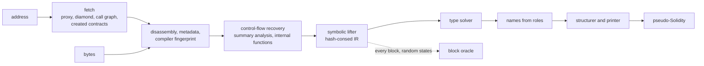
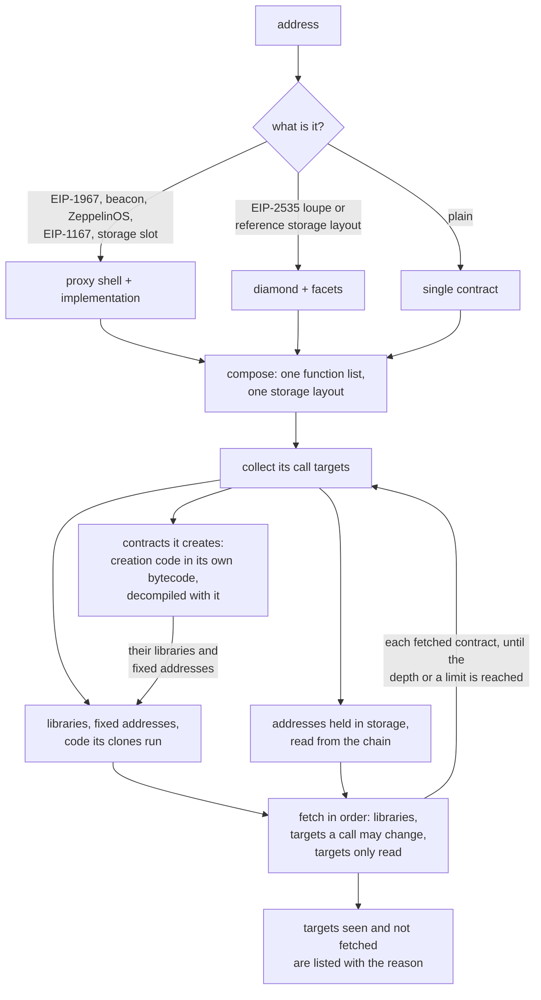

# evmdec

EVM bytecode decompiler, written from scratch in Rust.

Give it an address on any EVM chain, or the compiled bytecode of a contract that is not
deployed yet, and it returns readable pseudo-Solidity with a recovered interface and storage
layout. Proxies and diamonds are fetched and assembled with their implementation or facets
and decompiled as one contract, and the contracts they call are fetched and decompiled too,
so a token whose sender check trusts a hook contract is read together with that hook.

A security analyzer is planned and will be added later. An earlier one was removed, and the
web page keeps its place.

The decompiler ships its own correctness oracle: a concrete interpreter executes every basic
block and the result is compared with the lifted code. The numbers in this file are measured
by scripts in `corpus/`, not asserted.

## Pipeline



The decompiler is `crates/decompiler`, the command-line tool `crates/cli` and the web server
`crates/server`.

| module | role |
|---|---|
| `u256`, `keccak`, `hex`, `opcode`, `disasm`, `metadata` | arithmetic, hashing, instruction table, linear disassembly, CBOR metadata and compiler version |
| `cfg` | jump resolution by compositional summaries; dispatcher, internal functions, argument and return counts |
| `expr`, `lift`, `ssa`, `idiom` | hash-consed expression IR, symbolic execution of blocks, def-use index, compiler idioms |
| `types` | type recovery as constraint solving over parameters, storage, helpers and merges |
| `structure`, `emit`, `function`, `sigs`, `sigdb`, `naming` | loops, conditionals and short-circuits; printing; signature dictionary and local index; names inferred from roles |
| `compiler` | compiler version and feature fingerprints when the metadata is missing |
| `interp`, `verify` | reference EVM interpreter and the block oracle |
| `check`, `solc` | runs the original bytecode beside a compiled Solidity source and compares what they do; fetches the compiler a pragma asks for |
| `exact`, `solidity` | bytecode as an assembly block, instruction by instruction; the Solidity file around it |
| `rpc`, `fetch`, `decompile`, `slots`, `clock` | chain access, proxy and diamond resolution, the walk over call targets, composition, well-known storage slots, the time limit one dependency is given |

## What it recovers

- Any bytecode. Runtime or creation code, solc 0.4 to 0.8, Vyper 0.2 to 0.3, hand-written and
  minimal proxies, embedded `CREATE` and `CREATE2` payloads (decompiled with `--embedded`, and
  always when the contract is fetched by address). Unreferenced code is still printed
  as `orphan_<pc>` functions; anything unresolved is reported, not dropped.
- The interface. Linear, binary-search, `XOR` and `SUB` dispatchers and Vyper jump tables;
  parameter and return types from ABI head checks, masks, sign extension, dynamic offsets and
  the solc 0.8 decoder helpers, refined by a solver that follows values through phi merges,
  internal calls and storage; `view`, `pure` and `payable` from effects; events with `indexed`
  from the topic count; custom errors; `require(cond, "reason")` and `Panic(...)`.
- Storage. Mappings, dynamic and fixed arrays, packed fields (`uint112 reserve0; uint112
  reserve1; uint32 blockTimestampLast;`), strings, precomputed array slots, EIP-1967,
  ZeppelinOS, diamond and ERC-7201 namespaced slots by name. A mapping or array whose
  elements span several slots is declared with its struct (`struct Struct_264 { address
  field0; uint256 field1; bytes field2; }`) and read by member (`stor_264[key].field1`):
  members packed into one slot, byte strings, and arrays and mappings held inside the
  element each get their own type, and a member takes its name from the getter that returns
  it or from the setter that writes it (`struct Struct_0 { address owner; address resolver;
  uint64 ttl; }`).
- Readable code. Helpers (SafeMath, ABI coders, getters) inlined with their checks kept as
  `require` lines, checked arithmetic printed plain, `payable(to).transfer(v)`, `members.push(x)`,
  locals for values the source held in locals, the previous value of a slot read before it is
  overwritten, loops folded back together after control-flow recovery peeled an iteration.
- Memory. Each allocation at solc's free memory pointer is a named block (`ptr1`, `ptr2`), so
  two structs never read as one address; a run of stores that fills a block prints as one line
  (`ptr1 = memory(arg0, arg1, ptr2)`), a string built in memory as its text, and the
  allocator's own bookkeeping and overflow panics are left out. A call's payload prints as
  what it is: `abi.encodeWithSelector(...)` when its words are known, `msg.data` when a proxy
  forwards its calldata, `bytes(p)` for the byte string at a pointer, and the selector with
  the leading arguments when only the head is known. Precompiles are called by name.
  Vyper has no free pointer and keeps every variable at a fixed address, so there a word at
  one prints as a local (`loc_280`) and a word-scaled index from one as an element of the
  list that starts there (`loc_240[loc_280]`). A store to a fixed address is printed only
  when something that runs afterwards can read it: a later load, a byte range handed to a
  call, a hash or a return, or an internal function that loads the address before writing it
  itself (the lifter records, load by load, whether the function had already written those
  bytes on every path). In code without a free pointer the lifter also keeps what it knows
  of memory across a call to an internal function whose writes are all to fixed addresses.
- Names. A built-in dictionary of about 1,300 selectors, topics and errors; an optional local
  index of the whole public signature database; online lookup with `--lookup`. Where no
  signature gives a name, the code does: a variable is named by its getter, by the setter that
  writes it (`setFee` writes `fee`), by the event announcing its change, or by its role (the
  `owner` the guards compare the caller with, the `reentrancyLock` toggled around calls, the
  `balances` a transfer debits and credits with their `allowances` and `totalSupply`). An
  internal function is named by what it does (`_transfer` emits `Transfer`, `_callBalanceOf`
  makes one call, `_onlyOwner` checks the caller). A parameter is named by its use: `from`,
  `to` and `amount` on a ledger, `deadline`, the `v`, `r`, `s` given to `ecrecover`, a call
  `target`, a `recipient`, `newFee` for the value stored into `fee`. A name is given only
  where `stor_3`, `func_0x1fbb` or `arg0` would stand, and only when the type fits the role.

## Composites and linked contracts



Each function is marked with the address whose code holds it. Slots that two parts type
differently are reported as storage collisions, and a function the shell answers itself is
reported as shadowed. Linked contracts carry their own code.

The walk over call targets goes level by level. At each level the targets of every contract
fetched so far are collected and fetched in this order: libraries (their code runs in the
caller's storage), then targets some call may change, then targets that are only read. A
target is fetched once however many contracts call it, the same code at two addresses is
decompiled once, and every contract says how it was reached (which contract calls it, through
a fixed address, a library call or which storage slot, and how many calls away it is).

How far it goes: 2 call edges from the contract asked for by default (`--depth`, at most 3;
`depth` in the server's request), at most 8 targets fetched from one contract, at most 40 code
units per request across parts and dependencies, 20 seconds to decompile one dependency and
120 seconds for the whole walk. Whatever was seen and not fetched is listed with its reason
(a limit, the depth, an empty slot, no code, too slow) in the JSON (`unfollowed`), so the edge
of what was read is always stated.

Contracts a contract creates are part of the walk too. Creation code a contract copies out of
its own bytecode is decompiled with it (constructor and runtime), the libraries and fixed
addresses that created code calls are fetched like any other target, and the address a
minimal proxy forwards to is fetched as the code its clones run.

`--no-follow-proxy` turns all of this off.

## Accuracy

Two measurements of the decompiler on 22 unmodified mainnet contracts, solc 0.4.18 to 0.8.17
and Vyper 0.2.4 and 0.3.9 (WETH, USDT, USDC proxy and implementation, Uniswap V2 router and
pair, Uniswap V3 factory, Permit2, Universal Router, 1inch v5, Seaport 1.5, Gnosis Safe,
Compound cETH, MakerDAO Vat, Aave v3 pool proxy, ENS registry, Lido stETH proxy, Multicall3,
Curve 3pool and TriCrypto-NG, the CREATE2 deployer, UNI), and a comparison of its output with
verified source.

### Interface recovery against verified ABIs

`python3 corpus/bench.py`, signature dictionary disabled.

| metric | result |
|---|---|
| external selectors found | 515 / 515 |
| state mutability | 509 / 515 |
| parameter count | 513 / 515 |
| return count | 514 / 515 |
| parameter types, exact Solidity type | 913 / 955 |
| parameters passed by pointer read as the right kind: byte string, array, struct | 108 / 108 |
| arrays and structs with the right layout of members and elements | 40 / 43 |
| arrays and structs with every member and element type exact | 24 / 43 |
| return types | 366 / 380 |
| events | 119 / 121 |
| code blocks covered by some function | 10,810 / 10,810 |
| unresolved jumps | 0 |
| time for the corpus | about 10 s |

The mutability misses are `view` functions that make external calls on a pre-0.5 compiler, or
proxy getters that fall through to `delegatecall`. Most type misses are `bytes32` mapping keys,
which the bytecode handles exactly like a number. A `bytes32` is recovered where the code shows
it: a hash or signature half passed to `ecrecover`, a block or code hash, a hash-like constant,
or a comparison with a text literal.

A parameter passed by pointer is typed by how the code decodes it. A struct is checked for
a fixed number of bytes after its pointer and read at fixed places after it, an array has
its length scaled by the size of one element, and a byte string has neither. Before this
every such parameter was `bytes`, right for the 65 byte strings and wrong for the 34 arrays
and 9 structs. A member or element is `address` where the code masks it to 160 bits and
`uint256` otherwise: a narrower mask may be one field taken out of a packed word. The three
layouts still missed are arrays whose elements the code walks with a moving pointer. With the
right shapes the search enters 9 more functions of the development set, 6,228 of 9,684.

With the signature dictionary on, the declared parameter
types are used directly (939 / 955) and flow on into the storage and helpers they reach.

### Block oracle

`RUNS=8 ./corpus/verify_all.sh`. Every basic block, reachable or not, is executed by the
reference interpreter and by the lifted statements from the same random state; stack, memory,
storage, logs, calls and the control decision are compared.

| | |
|---|---|
| blocks | 13,656 |
| runs | 109,003 |
| mismatches | 0 |
| inconclusive runs | 1,586 |
| instructions in verified blocks | 158,341 / 159,940 |

A mismatch is a decompiler bug by definition. An inconclusive run is one the reference cannot
execute from the drawn state, or one that makes two differently based memory accesses alias.

### Source check

`evmdec check original.hex source.sol` compiles a Solidity file with the compiler its pragma
asks for and runs the result beside the original bytecode. Both get the same calls on the same
state: every function with arguments drawn for its types, as several callers, with and
without ether, on drawn storage and on storage nobody has used. Drawn storage is a mix of
empty words, small numbers and random words, and a quarter of the other accounts hold no
code, as on a chain. Each run must agree on what
another account can see: whether it returned, the data, every storage slot written, events,
outside calls in order, and contracts created. Gas and the layout of memory are left out,
since two builds of one source differ in both.

Where a run compared two values, the call is made again with the two made equal, so the edge
between `<` and `<=` is tried and a function open to one account is run as that account. On
the four source fixtures every one of 20 single changes to an operator or a check is caught.
The WETH contract on mainnet, built with solc 0.4.19, compares equal to its published source
built with 0.4.26 on all 12 functions with every branch reached.

This is the test the decompiler's own output has to pass. The pseudo-Solidity it prints by
default does not: none of the 22 corpus contracts decompiles to text a compiler accepts. The
Solidity file below does.

A source still running at many times the steps the original took to end is a difference,
not a run left unsettled. A run of the original longer than 50,000 steps is left out: it is
a loop over a length the drawn state made up.

It is evidence and not a proof. The last line of the output says how many branch outcomes of
the original the calls reached, and a function no call got to the end of is marked. With no
source, `evmdec check original.hex` reports that reach alone: 76 of 76 on WETH, 255 of 268 on
USDT, 414 of 984 on Compound cETH, whose paths depend on what other contracts answer.

### Solidity file

`evmdec decompile my.hex --sol` prints a Solidity file a compiler accepts, with a licence
line, a `pragma` (the contract's own compiler version when it was built with solc 0.8, a
current one otherwise), the events, and every function whose signature is known declared by
name. It is compiled and put through the source check before it is printed, and the result
is reported beside it.

Every function starts as a call to one private function that holds the bytecode translated
instruction by instruction into an assembly block, with no analysis in between, so it cannot
be wrong in the way a decompiled body can. That is the floor. From there each function is
written out as plain Solidity, with the state variables declared on the slots and bytes the
code uses, and the file is built and checked again. A function whose text the compiler
refuses, or that does not do what the bytecode does, goes back to the exact form, and so
does everything that calls it. What is printed is the file that survives, after one longer
comparison.

What Solidity has a word for is written with it. A failure reason longer than a word is
one string, whether the code copies it out of itself or stores it a word at a time. A
call to another contract is a low-level call that gives back a flag and the answer, and a
failure handed on from one is two lines of assembly, as authors write it. An event known
only by its first topic cannot be declared by a name, so it is declared anonymous with the
topic as its first indexed value. A write to memory that nothing reads any more, because
the event, call or return it fed is shown by what it means, is left out. A few things
Solidity has no word for go through a small private function added at the end of the
contract: a word of a call's answer, its length, a panic with its code, a failure whose
error has no known name, and a string taken as the place it lies at, which is how a helper
written for older compilers receives a reason. An error whose signature is known is declared
and failed with by name. Arithmetic the code does not test for overflow is put in an
`unchecked` block, one statement at a time.

A struct a function keeps in memory for itself is written as a struct in memory again, with
its words as fields. A struct of one word, which older code hands from helper to helper by
its address, is handed over as the word, in every helper and caller at once. Old code gives
a call a fixed stretch of memory to answer into and reads the answer from there: the file
keeps the answer the call gave and reads that. A value is declared in the block that gives
it, where everything that reads it lies in that block, and at the top of the function
otherwise.

Memory a function builds data in is written the way the code uses it. The code takes a block
by moving the start of free memory past it. The file does the same through two small
functions, names the block, and writes and reads it a word or a stretch at a time through
others. A new array, a text handed to a helper and an array returned from memory are plain
Solidity that way, and what a function returns from memory comes back as an array or as
bytes, whichever the code made. Where the code writes first and takes after, the file takes
first, so that nothing a compiler puts in memory between two lines lands in the block. Data
the code lays out by hand for a call, with a `bytes` or a `string` in it, is written into
free memory and taken as the call is made, and only where nothing between the first write
and the call could make the compiler use that memory. An argument of type `bytes`, `string`
or array that an older compiler copies into memory before the function's own code runs is
declared as held in memory, so the compiler makes the copy, and the place the code knows it
by is the argument's own. The file is checked for all this: a block named on some way that
does not pass its taking, or data laid out with anything in between, is put back in a
notation no compiler reads, so the function fails to build and stays exact.

A function that only returns one variable is not written at all: the variable is declared
`public` under the function's name, as an author would have, and the compiler writes the
function. When every function of a contract is plain, its fallback is written out too and
the exact block is dropped, which leaves a file with no assembly in it. The WETH contract
comes out that way, in 93 lines.

A function that keeps its exact form but whose arguments the compiler would decode
differently from the original, as code from before solc 0.8 does, is left out of the named
functions and answers through `fallback`.

A plain function from a contract built before solc 0.8 cannot match the original on every
input, because the file is written for a current compiler: that compiler refuses an argument
wider than its type where the old one cut it, and names its own failures with a panic code
where the old one gave no data. Such a function is compared on well-formed calls, and two
built-in failures count as the same failure. A run in which another contract answers with
fewer bytes than the old code gave it room for is left out as well: past the end of a
short answer that code reads whatever its compiler had left in memory, which no source
says. `evmdec check --loose` makes the same comparison. A contract built with solc 0.8 is
compared with no such allowance.

`./corpus/exact_all.sh` runs this over a directory. All 22 corpus contracts compile and
compare equal on every function, solc 0.4 to 0.8 and Vyper, and so do the 17 regression, 30
vulnerable and 5 source fixtures in `testdata`: 74 of 74. Those contracts answer 1,972
functions between them. With the signatures built into the binary and no index installed,
the files declare 890 of them by name, and 578 of the 890 are plain Solidity: all 11 of
WETH, 29 of 29 in USDT, 23 of 23 in the Uniswap V2 pair, 35 of 39 in USDC, 26 of 40 in
Compound cETH. The other 1,082 answer through `fallback` in their exact form: 932 have a
selector no built-in signature hashes to, so no header can be written for them, 28 take a
struct, and the rest are decoded differently by a current compiler than by the original.

With the full signature index installed (see below) the same run declares 1,605 of the
1,972 by name and 990 of those are plain Solidity. USDT, the BEC token and the
BOB pool then come out with no exact block at all, as WETH does without it.

What holds a named function back now is mostly not memory. Some long functions need more
values at once than a compiler can reach, a few keep a jump the printer could not turn into
a loop or a branch, and one helper in its exact form holds back every function that calls
it. In memory three things are still printed in a notation no compiler reads: memory an
older contract takes at a place it works out from the length of an argument copied before
it, which happens with a second `bytes` or array argument, memory cleared by copying from
past the end of the code, and the hand-written logging of older MakerDAO code. Vyper keeps
its values at fixed places in memory and not in blocks it takes, so a Vyper function that
copies through memory is not plain yet either.

On the WETH file, 52 of 55 single changes to an operator, a check or an event are caught, and
the other three change a value nothing reads. On the plain part of the USDT file, 66 of 80
are caught. Two of the other 14 remove a test of the call data's length that the compiler
now makes itself. The rest sit on paths that need several stored values to line up at
once, a fee that is not zero or an upgrade to a contract that holds no code, which the
drawn runs rarely reach. A change there would get past the check, so the check stays
evidence. On the MiniMe token file, whose plain part lays the data of a call out in memory,
45 of 57 are caught. The other 12 change a value nothing observes, or need the contract
that is called to answer in one particular way.

### Decompiler against verified source

Fresh verified contracts are fetched, decompiled from bytecode, and compared with their
source function by function on six points: storage, control flow, calls, transfers, access
checks and reverts. A function matches only when all six agree.

| batch | contracts | functions that match |
|---|---|---|
| first, as found | 14 (solc 0.4.24 to 0.8.30, via-IR, five proxies, one diamond) | 65 of 99 |
| first, after ten causes were fixed | the same 14 | 73 of 99 |
| second, fresh | 8 (Vyper 0.2.8 and 0.4.3, solc 0.4.21 to 0.8.36, a beacon proxy) | 55 of 83 |
| both, after a second round of fixes | all 22 | 136 of 182, no regressions |
| both, after a third round of fixes | all 22 | 157 of 182, 4 regressions from one cause |
| both, after a fourth round of fixes | all 22 | 179 of 182, no regressions |
| third, fresh, as found | 8 (Vyper 0.2.4 and 0.3.10, solc 0.4.24 to 0.8.23, via-IR, optimizer off, a proxy) | 51 of 89 |
| first and second, after a fifth round of fixes | all 22 | 180 of 182, no regressions |
| third, after the fifth round | the same 8 | 77 of 89, no regressions |
| fourth, fresh, as found | 8 (Vyper 0.3.7, solc 0.4.24, 0.6.12, 0.7.6, 0.8.7 optimizer off, 0.8.24 and 0.8.26 via-IR, a proxy) | 64 of 89 |
| first and second, after a sixth round of fixes | all 22 | 180 of 182, 2 regressions found by the check and fixed |
| third, after the sixth round | the same 8 | 77 of 89, no regressions |
| fourth, after the sixth round | the same 8 | 78 of 89 |
| first and second, after a seventh round of fixes | all 22 | 179 of 182, one verdict made stricter |
| third, after the seventh round | the same 8 | 77 of 89, no change |
| fourth, after the seventh round | the same 8 | 80 of 89, no regressions |
| fifth, fresh, as found | 8 (Vyper 0.4.3 and 0.3.7, solc 0.5.7, 0.7.6, 0.8.19 optimizer off, 0.8.21 and 0.8.17 via-IR, a diamond) | 51 of 86 |
| sixth, fresh, as found | 8 (Vyper 0.3.10, solc 0.4.14 optimizer off, 0.6.11, 0.7.1, 0.8.19, 0.8.21, 0.8.26 via-IR, a deployer) | 38 of 96 |

The number that says where the decompiler stands is the one measured on contracts it had
never been checked on: 57% in the third batch as found, 72% in the fourth, 59% in the
fifth and 40% in the sixth. Over the 38 contracts it was fixed against it is 336 of 360, 93.3%, after the seventh
round. The target is 95 to 99% on both, and neither is met. Every function of every contract
is found with the right selector, and the block oracle passes every one: it checks lifting,
and these faults are made after it, in inlining, typing and printing. Each mismatch is traced
to a cause in the decompiler, and each cause gets a general fix and a test.

One contract of the fifth batch, a Uniswap V3 pool, runs the same code as a pool in the
second batch apart from a few fixed values, so it is not fresh. Without it the fifth batch
is 43 of 74, 58.1%. The fifth batch was also judged more strictly on one point: a helper
parameter declared narrower than the full word it is passed, which read as Solidity would cut
the value, counts as wrong there. The earlier batches let that pass where the body used the
full value, so their numbers would be lower on that reading.

Open after the seventh round, wrong output in 15 functions of the 38 and 35 of the fifth
batch, from these causes: a word saved before a store that partly overlaps it printed after
that store (Seaport 9, and one function elsewhere), helper parameters typed narrower than the
words they are passed (about 10), a value kept on the stack and a fresh read of the same slot
after a call given one name, so a re-entry check prints as always true (9), a memory store
printed at the wrong free-memory offset (7), Vyper 0.4 zero-fills of memory dropped (2), an
address argument in packed call data printed 20 bytes wide (1), and the Vyper 0.2 save and
restore around internal calls (4). Unclear in 10: calls whose arguments a helper encodes. An
eighth round of fixes is being made against these.

## Quick start

```sh
cargo build --release

./target/release/evmdec decompile 0xdAC17F958D2ee523a2206206994597C13D831ec7
./target/release/evmdec decompile 0xA0b86991c6218b36c1d19D4a2e9Eb0cE3606eB48 --chain mainnet
./target/release/evmdec decompile 0x... --chain arbitrum --rpc https://my.node/
./target/release/evmdec decompile 0x... --depth 3 --json

solc --bin MyContract.sol | tail -1 > my.hex
./target/release/evmdec decompile my.hex
./target/release/evmdec decompile my.hex --lookup
./target/release/evmdec sigs 0xa9059cbb
./target/release/evmdec disasm my.hex
./target/release/evmdec verify my.hex --runs 8
./target/release/evmdec check my.hex MyContract.sol
./target/release/evmdec decompile my.hex --sol > My.sol

PORT=8080 ./target/release/evmdec-server
```

The compiler release is pinned in `rust-toolchain.toml`; rustup installs it on the first build.

Chains: mainnet, sepolia, arbitrum, optimism, base, polygon, bsc, avalanche, gnosis, fantom,
linea, scroll, blast, pulsechain, classic. zkSync Era is not listed: its nodes return code for a different
machine, which would be decompiled as if it were EVM bytecode. Public endpoints are tried in order; an endpoint that
returns empty code or zero storage falls through to the next.

Docker: `docker build -t evmdec . && docker run -p 8080:8080 evmdec`. The image builds the full
signature index in its own stage; `--build-arg SIGS=0` skips it and leaves only the built-in
dictionary.

### Full signature index

The binary names about 1,300 signatures. The whole public database, 10.7 million function,
event and error signatures from Sourcify's export, installs as one local file:

```sh
pip install pyarrow numpy
python3 corpus/build_sigs.py --out sigs.idx
sudo install -D sigs.idx /var/lib/evmdec/sigs.idx
```

The index is a sorted table searched in place with positional reads, so nothing is loaded at
start-up and a lookup costs microseconds. `evmdec sigs` shows which index is in use, and the
server prints the same at start-up. Without an index most functions of an unverified contract
print as `func_<selector>`.

### Web app and API

The server serves a single-page UI: a title block, the function index, the code, a band of
the contracts that were followed (each one opens in place), and tabs for storage and events,
the call graph, disassembly and JSON. The Report tab and the Analyzer column hold the place
of the security analyzer, which is coming later. The call graph says how each contract was
reached (which contract calls it, how, and how many calls away) and lists the call targets
that were seen and not fetched, each with its reason. Results are linkable as `/?chain=mainnet&address=0x...`. The page meets
WCAG 2.2 AA on both colour schemes and runs no third-party scripts.

The code the page shows is the [Solidity file](#solidity-file) in the form it is first
written: a licence line, a `pragma`, the state variables on their slots, the events and
every function as plain Solidity, with a function no signature names written under the name
of its selector. The server runs no compiler, so this text is not checked. A function a
compiler would refuse, or that does not do what the bytecode does, is still in it as it was
written. `evmdec decompile --sol` on the command line gives the checked file.

```
POST /api/decompile      {"address": "0x...", "chain": "mainnet"}  or  {"bytecode": "0x..."}
                         optional: "no_follow_proxy": true, "lookup": true, "depth": 0..3
GET  /api/address/{chain}/{address}
GET  /api/chains
GET  /api/status         {"signature_index": 10780428}, or 0 when no index is installed
GET  /healthz
```

Responses carry `contract`, `disassembly` and, when contracts were followed, `linked` (one
entry each with the same two fields) and `parts_disassembly`.
A linked contract says how it was reached (`link`: the calling contract, how it names this
one, and the number of calls away); the contract asked for lists what was not fetched
(`unfollowed`) and the contracts it creates (`embedded`). `depth` is the number of call
edges to follow (default 2, at most 3, 0 for none). Requests are bounded: four decompilations
in flight, four minutes each, sixteen more waiting. One request makes at most 4,000 calls to
remote nodes in at most 240 seconds, and code over 1 MiB is refused.

### Configuration

| variable | effect |
|---|---|
| `EVMDEC_RPC_URL` | comma-separated JSON-RPC endpoints, used in place of the public list. The chain asked for has to be the chain they serve; a request for another chain is refused |
| `EVMDEC_SIGS` | path of the signature index; empty disables it. Default search: `./sigs.idx`, next to the binary, `/var/lib/evmdec/sigs.idx`, `~/.evmdec/sigs.idx` |
| `EVMDEC_TIMING` | print the time spent in each stage |
| `SOLC`, `EVMDEC_SOLC_DIR` | a compiler binary for `check` and `--sol` to use as it is, and where downloaded compilers are kept (default `~/.cache/evmdec/solc`). A download is the build for the machine's processor, x86-64 or ARM64, and is checked against the hash its list gives. The ARM64 builds start at 0.8.31, so there a contract built with an older 0.8 compiler gets its file under the pragma any current compiler takes |
| `PORT` | listening port of the server, default 8080 |

## Development

```sh
cargo fmt --all
cargo clippy --workspace --all-targets --all-features
cargo test --workspace
python3 corpus/bench.py
RUNS=8 ./corpus/verify_all.sh
./corpus/exact_all.sh
```

The Rust crates follow Google's Rust style guide with `rustfmt.toml` as committed, and clippy
is kept at zero warnings. Comments are few and only say why. There are no documentation
comments. `.claude/agents/rust-style-reviewer.md` reviews a change against the guide. See
`CONTRIBUTING.md` for the comment rules.

## Known limitations

- Memory accesses through different symbolic bases are assumed not to alias. This holds for
  compiler output; a hand-written contract that relies on aliasing decompiles imprecisely, and
  the oracle reports such states as inconclusive rather than hiding them.
- Internal functions the code does not characterise keep the name `func_<pc>`, and parameters
  nothing narrows are `uint256`. Names inferred from roles describe what the code does, not
  what the author called it.
- A payload assembled with dynamic data the lifter does not follow prints its selector and
  leading arguments, then `...`; one with no known head prints as a memory range.
- Vyper internal calls pass arguments through fixed memory, so some values in Vyper output
  print as `mem[0x...]` reads.

## License

MIT, see `LICENSE`.
