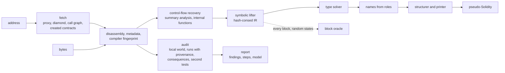
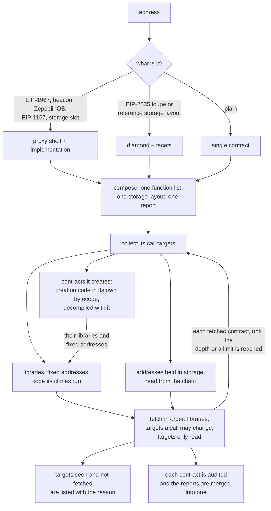
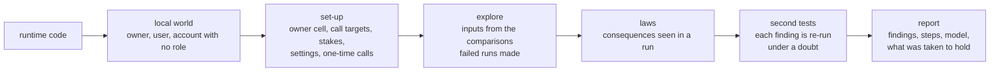

# evmdec

EVM bytecode decompiler and security analyzer, written from scratch in Rust.

Give it an address on any EVM chain, or the compiled bytecode of a contract that is not
deployed yet, and it returns readable pseudo-Solidity, a recovered interface and storage
layout, and an audit report of what an account with no role was seen to bring about. Proxies and diamonds are fetched and assembled with
their implementation or facets and analysed as one contract, and the contracts they call are
fetched and analysed too, so a token whose sender check trusts a hook contract is read
together with that hook.

The decompiler ships its own correctness oracle: a concrete interpreter executes every basic
block and the result is compared with the lifted code. The numbers in this file are measured
by scripts in `corpus/`, not asserted.

## Pipeline



The decompiler is `crates/decompiler`. The analyzer is `crates/audit` and is described under "Audit".

| module | role |
|---|---|
| `u256`, `keccak`, `hex`, `opcode`, `disasm`, `metadata` | arithmetic, hashing, instruction table, linear disassembly, CBOR metadata and compiler version |
| `cfg` | jump resolution by compositional summaries; dispatcher, internal functions, argument and return counts |
| `expr`, `lift`, `ssa`, `idiom` | hash-consed expression IR, symbolic execution of blocks, def-use index, compiler idioms |
| `types` | type recovery as constraint solving over parameters, storage, helpers and merges |
| `structure`, `emit`, `function`, `sigs`, `sigdb`, `naming` | loops, conditionals and short-circuits; printing; signature dictionary and local index; names inferred from roles |
| `compiler` | compiler version and feature fingerprints when the metadata is missing |
| `interp`, `verify` | reference EVM interpreter and the block oracle |
| `rpc`, `fetch`, `decompile`, `slots`, `clock` | chain access, proxy and diamond resolution, the walk over call targets, composition, well-known storage slots, the time limit one dependency is given |

## What it recovers

- Any bytecode. Runtime or creation code, solc 0.4 to 0.8, Vyper 0.2 to 0.3, hand-written and
  minimal proxies, embedded `CREATE` and `CREATE2` payloads (decompiled with `--embedded`, and
  always when the contract is fetched by address). Unreferenced code is still printed
  as `orphan_<pc>` functions; anything unresolved is reported, not dropped.
- The interface. Linear, binary-search, `XOR` and `SUB` dispatchers and Vyper jump tables;
  parameter and return types from ABI head checks, masks, sign extension, dynamic offsets and
  the solc 0.8 decoder helpers, refined by a solver that follows values through phi merges,
  internal calls and storage; `view`, `pure` and `payable` from effects; events with `indexed`
  from the topic count; custom errors; `require(cond, "reason")` and `Panic(...)`.
- Storage. Mappings, dynamic and fixed arrays, packed fields (`uint112 reserve0; uint112
  reserve1; uint32 blockTimestampLast;`), strings, precomputed array slots, EIP-1967,
  ZeppelinOS, diamond and ERC-7201 namespaced slots by name. A mapping or array whose
  elements span several slots is declared with its struct (`struct Struct_264 { address
  field0; uint256 field1; bytes field2; }`) and read by member (`stor_264[key].field1`):
  members packed into one slot, byte strings, and arrays and mappings held inside the
  element each get their own type, and a member takes its name from the getter that returns
  it or from the setter that writes it (`struct Struct_0 { address owner; address resolver;
  uint64 ttl; }`).
- Readable code. Helpers (SafeMath, ABI coders, getters) inlined with their checks kept as
  `require` lines, checked arithmetic printed plain, `payable(to).transfer(v)`, `members.push(x)`,
  locals for values the source held in locals, the previous value of a slot read before it is
  overwritten, loops folded back together after control-flow recovery peeled an iteration.
- Memory. Each allocation at solc's free memory pointer is a named block (`ptr1`, `ptr2`), so
  two structs never read as one address; a run of stores that fills a block prints as one line
  (`ptr1 = memory(arg0, arg1, ptr2)`), a string built in memory as its text, and the
  allocator's own bookkeeping and overflow panics are left out. A call's payload prints as
  what it is: `abi.encodeWithSelector(...)` when its words are known, `msg.data` when a proxy
  forwards its calldata, `bytes(p)` for the byte string at a pointer, and the selector with
  the leading arguments when only the head is known. Precompiles are called by name.
  Vyper has no free pointer and keeps every variable at a fixed address, so there a word at
  one prints as a local (`loc_280`) and a word-scaled index from one as an element of the
  list that starts there (`loc_240[loc_280]`). A store to a fixed address is printed only
  when something that runs afterwards can read it: a later load, a byte range handed to a
  call, a hash or a return, or an internal function that loads the address before writing it
  itself (the lifter records, load by load, whether the function had already written those
  bytes on every path). In code without a free pointer the lifter also keeps what it knows
  of memory across a call to an internal function whose writes are all to fixed addresses.
- Names. A built-in dictionary of about 1,300 selectors, topics and errors; an optional local
  index of the whole public signature database; online lookup with `--lookup`. Where no
  signature gives a name, the code does: a variable is named by its getter, by the setter that
  writes it (`setFee` writes `fee`), by the event announcing its change, or by its role (the
  `owner` the guards compare the caller with, the `reentrancyLock` toggled around calls, the
  `balances` a transfer debits and credits with their `allowances` and `totalSupply`). An
  internal function is named by what it does (`_transfer` emits `Transfer`, `_callBalanceOf`
  makes one call, `_onlyOwner` checks the caller). A parameter is named by its use: `from`,
  `to` and `amount` on a ledger, `deadline`, the `v`, `r`, `s` given to `ecrecover`, a call
  `target`, a `recipient`, `newFee` for the value stored into `fee`. A name is given only
  where `stor_3`, `func_0x1fbb` or `arg0` would stand, and only when the type fits the role.

## Composites and linked contracts



Each function is marked with the address whose code holds it. Slots that two parts type
differently are reported as storage collisions, and a function the shell answers itself is
reported as shadowed. Linked contracts carry their own code and report, and the reports are
merged into one.

The walk over call targets goes level by level. At each level the targets of every contract
fetched so far are collected and fetched in this order: libraries (their code runs in the
caller's storage), then targets some call may change, then targets that are only read. A
target is fetched once however many contracts call it, the same code at two addresses is
decompiled once, and every contract says how it was reached (which contract calls it, through
a fixed address, a library call or which storage slot, and how many calls away it is).

How far it goes: 2 call edges from the contract asked for by default (`--depth`, at most 3;
`depth` in the server's request), at most 8 targets fetched from one contract, at most 40 code
units per request across parts and dependencies, 20 seconds to decompile one dependency and
120 seconds for the whole walk. Whatever was seen and not fetched is listed with its reason
(a limit, the depth, an empty slot, no code, too slow), in the report and in the JSON
(`unfollowed`), so the edge of what was analysed is always stated.

Contracts a contract creates are part of the walk too. Creation code a contract copies out of
its own bytecode is decompiled with it (constructor and runtime), the libraries and fixed
addresses that created code calls are fetched like any other target, and the address a
minimal proxy forwards to is fetched as the code its clones run.

`--no-follow-proxy` turns all of this off.

## Audit

The analyzer has no rule book. It does not match shapes in the code, look for known function
names or assume a standard. It runs the contract and reports what a run showed.



**The world.** The contract's code is placed in a local world and run on the interpreter the
decompiler's oracle is built on. A shadow follows every word and records where it came from:
the caller, a word of the call data, the ether sent, a storage cell, an answer from another
contract, the clock. Three kinds of account act. The owner holds every role and only sets
things up. A user uses the contract honestly. An account with no role, with a second address
of its own that has code, is the adversary. A contract the code calls and that is not there
keeps honest books when it is spoken to as an asset, and otherwise answers one word.

**Set-up.** Runtime code does not say how a contract was deployed, so the world is brought to
a state a contract in use could be in. The cell the code compares its caller with names the
owner. Cells the code calls through name a contract. Accounts hold a stake in the ledgers the
code checks, and the total covers them. A setting the owner's own calls are refused without
is filled, unless that shuts a call that worked. A call the owner can make once and not again
is made. Everything taken to hold is listed in the report.

**Explore.** Inputs are not guessed. A run that fails made comparisons, and the next input is
built from them: a call data word, the value sent, the length of the call data, the time, the
answer of an outside contract. The owner and the user build state. The account with no role
then makes up to a few calls from every state kept, a contract that already holds value is
tried, a user goes on using the contract after the account acted, and when the contract hands
control to the account, the account calls back in.

**Laws.** A finding is one of eight consequences, seen in a run:

| consequence | what the run showed |
|---|---|
| gain | the account ends with more ether or assets than it started with and gave nothing for it |
| loss | another account ends with less of what it holds outside the contract and made no call |
| credit | the contract's records credit the account with value it did not pay for, and the credit can be spent |
| debit | the contract's record of another account is lowered |
| takeover | a cell the contract compares its caller with now names the account |
| role cleared | the same cell names nobody |
| foreign code | the contract ran, as itself, code at an address the account chose |
| destroyed | the contract's code was removed |

**Second tests.** A consequence is re-run under a doubt before it is reported. A gain has to
show again with unset prices and rates filled. A credit has to be spendable afterwards and
not before. A lowered record has to withhold from its holder. A finding that needed the
contract to call back has to show more than the same calls made apart. An outside contract
that was asked about the caller is tried with the other answer. A flag that a call raises and
lowers again is put back down. A one-time call that the account merely made first is not a
finding, since on a live contract it has been made.

**The report.** Each finding gives the function, the consequence, the reason in terms of where
the values came from, what the run showed, and the steps to make the run again. Findings that
follow from one another are linked into paths. The report also holds the model the runs
built: for each function who it ended for, whether it tests its caller, takes value, pays out
or calls out, and what stopped it when it never ended; for each storage variable what it is
used for and who can write it. Beside it stands a model read from the code alone, with every
helper followed: whether a function tests its caller, which slots it writes, whether it calls
out, sends value, runs other code or destroys the contract. That one covers the functions no
run got through. Functions the account with no role never got through, whose code tests no
caller and can change state or move value, are listed as not settled. They are where to look,
not findings: on the development set the list holds 8 in 100 functions of flawed and of
sound contracts alike, and the flawed function of 72 of 212 missed incidents is on it. A report with no finding says what was tried and is not a
proof.

```sh
evmdec audit my.hex            # runtime bytecode
evmdec audit My.sol            # source, compiled with the compiler its pragma asks for
evmdec audit input.json        # solc standard JSON
evmdec audit my.hex --json
evmdec audit 0x... --chain bsc --block 22280853   # a deployed contract, on the state it had at that block
evmdec decompile 0x... --report
```

Given an address, the world is not guessed. The contract's storage, and the code, storage and
ether of every account its calls reach, are read from the chain at one block as the run asks
for them, at most 4,000 reads in 240 seconds, and the report says when a read got no answer.
The owner stands in for the account the code compares its caller with. The owner, a user and
the account with no role are given a purse of each token the calls move, written into the
token's own balance cells where those can be found, and the report lists each. The account
with no role is also tried as a holder of the contract's own ledger, as anyone who bought
some would be. The real holders the chain has are accounts too: a record the contract keeps
for one of them, lowered by a call it did not make, is a finding. A block other than the
newest needs a node that keeps old state.

An address is also run in a world guessed from its code, because one block may lack the
holders or settings a flaw needs. A finding only that world shows says so, and so does each
thing that world took to hold. What one run shows is one finding: a payer's loss and a
receiver's gain in the same call are listed together.

From source the compiler is downloaded for the pragma, the same runtime code is analysed as
from bytecode, and each finding carries the file and line from the source map. The two inputs
cannot disagree on a finding.

Work is counted in interpreter steps, 40 million per contract, so a report is the same on a
slow or busy machine.

## Accuracy

Two measurements of the decompiler on 22 unmodified mainnet contracts, solc 0.4.18 to 0.8.17
and Vyper 0.2.4 and 0.3.9 (WETH, USDT, USDC proxy and implementation, Uniswap V2 router and
pair, Uniswap V3 factory, Permit2, Universal Router, 1inch v5, Seaport 1.5, Gnosis Safe,
Compound cETH, MakerDAO Vat, Aave v3 pool proxy, ENS registry, Lido stETH proxy, Multicall3,
Curve 3pool and TriCrypto-NG, the CREATE2 deployer, UNI), a comparison of its output with
verified source, and the analyzer's score on exploited and safe contracts.

### Interface recovery against verified ABIs

`python3 corpus/bench.py`, signature dictionary disabled.

| metric | result |
|---|---|
| external selectors found | 515 / 515 |
| state mutability | 509 / 515 |
| parameter count | 513 / 515 |
| return count | 514 / 515 |
| parameter types, exact Solidity type | 913 / 955 |
| parameters passed by pointer read as the right kind: byte string, array, struct | 108 / 108 |
| arrays and structs with the right layout of members and elements | 40 / 43 |
| arrays and structs with every member and element type exact | 24 / 43 |
| return types | 366 / 380 |
| events | 119 / 121 |
| code blocks covered by some function | 10,810 / 10,810 |
| unresolved jumps | 0 |
| time for the corpus | about 10 s |

The mutability misses are `view` functions that make external calls on a pre-0.5 compiler, or
proxy getters that fall through to `delegatecall`. Most type misses are `bytes32` mapping keys,
which the bytecode handles exactly like a number. A `bytes32` is recovered where the code shows
it: a hash or signature half passed to `ecrecover`, a block or code hash, a hash-like constant,
or a comparison with a text literal.

A parameter passed by pointer is typed by how the code decodes it. A struct is checked for
a fixed number of bytes after its pointer and read at fixed places after it, an array has
its length scaled by the size of one element, and a byte string has neither. Before this
every such parameter was `bytes`, right for the 65 byte strings and wrong for the 34 arrays
and 9 structs. A member or element is `address` where the code masks it to 160 bits and
`uint256` otherwise: a narrower mask may be one field taken out of a packed word. The three
layouts still missed are arrays whose elements the code walks with a moving pointer. With the
right shapes the search enters 9 more functions of the development set, 6,228 of 9,684.

With the signature dictionary on, the declared parameter
types are used directly (939 / 955) and flow on into the storage and helpers they reach.

### Block oracle

`RUNS=8 ./corpus/verify_all.sh`. Every basic block, reachable or not, is executed by the
reference interpreter and by the lifted statements from the same random state; stack, memory,
storage, logs, calls and the control decision are compared.

| | |
|---|---|
| blocks | 13,656 |
| runs | 109,003 |
| mismatches | 0 |
| inconclusive runs | 1,586 |
| instructions in verified blocks | 158,341 / 159,940 |

A mismatch is a decompiler bug by definition. An inconclusive run is one the reference cannot
execute from the drawn state, or one that makes two differently based memory accesses alias.

### Analyzer

A finding is correct only at the right function for the right reason. A separate reviewer
reads every report against the public write-up of the incident and judges each finding and
each known flaw. Findings on contracts with no known flaw are false positives. The held-out
set was split off once, its answer key and reports are never read during development, and
its reviewers return counts only.

The target is 95 to 99% precision and recall. It is not met. Measured on the held-out set,
234 exploited contracts and 101 with no known flaw, scored three times by separate reviewers:

| | first score | second score | third score, by address |
|---|---|---|---|
| known flaws found at the right place for the right reason | 13 of 234, 5.6% | 12 of 234, 5.1% | 20 of 234, 8.5% |
| more at the right place with the wrong reason | 6 | 4 | 10 |
| findings that are correct | 25 of 49, 51.0% | 23 of 48, 47.9% | 45 of 88, 51.1% |
| contracts with no known flaw that got a finding | 1 of 101 | 1 of 101 | 4 of 101 |
| time per contract | median 0.7 s | median 0.7 s, slowest 10.2 s | median 7.9 s, 90% under 29.6 s, with chain reads |

The third score ran each contract by address on the chain's state at the block before its
incident, plus the guessed world. On chain state 38 of 56 findings were correct, in the
guessed world 7 of 32. By kind of flaw, among those in the analysed contract: access control
8 of 47, input validation 5 of 28, initialization 5 of 9, accounting 1 of 68, unchecked
external call 1 of 1, price or reading 0 of 43, re-entry 0 of 11, signature or replay 0 of 6,
arithmetic 0 of 5.

On the development set, where every false finding was read and its cause fixed, the latest
reviewed build finds 31 of 231 known flaws (13.4%) by address, 48 of its 60 findings are
correct (80%), and none of 55 contracts with no known flaw gets a finding. The held-out set
does not follow at the same rate: what is fixed on one set of contracts is general in form
and reaches fewer of the other set's flaws. That gap is the honest measure of where the
tool stands.

Why recall is where it is: 145 of the 234 held-out flaws only show with a real outside
contract in a particular state, and the account with no role can only call the contract
under test. It cannot trade in a pool, call a pair's skim or sync, or act in a lending market.
Of the flaws that show on the contract alone, a fresh diagnosis of the 74 development misses
put 41 down to a flawed function that never ran to its end for the account with no role, 18
to state the run lacked, and 9 to steps the search did not try. The pull request that
introduced this analyzer logs every run and what was changed after it.

### Decompiler against verified source

Fresh verified contracts are fetched, decompiled from bytecode, and compared with their
source function by function on six points: storage, control flow, calls, transfers, access
checks and reverts. A function matches only when all six agree.

| batch | contracts | functions that match |
|---|---|---|
| first, as found | 14 (solc 0.4.24 to 0.8.30, via-IR, five proxies, one diamond) | 65 of 99 |
| first, after ten causes were fixed | the same 14 | 73 of 99 |
| second, fresh | 8 (Vyper 0.2.8 and 0.4.3, solc 0.4.21 to 0.8.36, a beacon proxy) | 55 of 83 |
| both, after a second round of fixes | all 22 | 136 of 182, no regressions |
| both, after a third round of fixes | all 22 | 157 of 182, 4 regressions from one cause |

That is 86% against a target of 95 to 99%. Every mismatch was traced to its cause in the
decompiler, and each cause gets a general fix and a test. The block oracle passed every one
of these functions: it checks lifting, and these faults are made after it, in inlining,
structuring and printing. Still wrong in 13 functions: an addition not marked unchecked in a
helper printed apart (4), a copy into memory by the identity precompile or a call's output
not printed (5), a transfer printed before a checked subtraction that runs first (1), a
revert that reads names never assigned (2), a stray division (1). Right but unclear in 12: a
loop printed several times with jumps into the middle of its copies, and calls shown only as
raw memory writes.

## Quick start

```sh
cargo build --release

./target/release/evmdec decompile 0xdAC17F958D2ee523a2206206994597C13D831ec7 --report
./target/release/evmdec decompile 0xA0b86991c6218b36c1d19D4a2e9Eb0cE3606eB48 --chain mainnet
./target/release/evmdec decompile 0x... --chain arbitrum --rpc https://my.node/
./target/release/evmdec decompile 0x... --depth 3 --report

solc --bin MyContract.sol | tail -1 > my.hex
./target/release/evmdec decompile my.hex --report
./target/release/evmdec audit my.hex --json
./target/release/evmdec audit MyContract.sol
./target/release/evmdec decompile my.hex --lookup
./target/release/evmdec sigs 0xa9059cbb
./target/release/evmdec disasm my.hex
./target/release/evmdec verify my.hex --runs 8

PORT=8080 ./target/release/evmdec-server
```

The compiler release is pinned in `rust-toolchain.toml`; rustup installs it on the first build.

Chains: mainnet, sepolia, arbitrum, optimism, base, polygon, bsc, avalanche, gnosis, fantom,
linea, scroll, blast, classic. zkSync Era is not listed: its nodes return code for a different
machine, which would be decompiled as if it were EVM bytecode. Public endpoints are tried in order; an endpoint that
returns empty code or zero storage falls through to the next.

Docker: `docker build -t evmdec . && docker run -p 8080:8080 evmdec`. The image builds the full
signature index in its own stage; `--build-arg SIGS=0` skips it and leaves only the built-in
dictionary.

### Full signature index

The binary names about 1,300 signatures. The whole public database, 10.7 million function,
event and error signatures from Sourcify's export, installs as one local file:

```sh
pip install pyarrow numpy
python3 corpus/build_sigs.py --out sigs.idx
sudo install -D sigs.idx /var/lib/evmdec/sigs.idx
```

The index is a sorted table searched in place with positional reads, so nothing is loaded at
start-up and a lookup costs microseconds. `evmdec sigs` shows which index is in use, and the
server prints the same at start-up. Without an index most functions of an unverified contract
print as `func_<selector>`.

### Web app and API

The server serves a single-page UI: a title block, the function index, the code, the
findings with the steps of the run behind each, a band of the contracts the analysis followed
(each one opens in place), and tabs for the report, storage and events, the call graph,
disassembly and JSON. The call graph says how each contract was reached (which contract calls
it, how, and how many calls away) and lists the call targets that were seen and not fetched,
each with its reason. Results are linkable as `/?chain=mainnet&address=0x...`. The page meets
WCAG 2.2 AA on both colour schemes and runs no third-party scripts.

```
POST /api/decompile      {"address": "0x...", "chain": "mainnet"}  or  {"bytecode": "0x..."}
                         optional: "no_follow_proxy": true, "lookup": true, "depth": 0..3
GET  /api/address/{chain}/{address}
GET  /api/chains
GET  /api/status         {"signature_index": 10780428}, or 0 when no index is installed
GET  /healthz
```

Responses carry `contract`, `report`, `report_markdown`, `disassembly` and, when contracts
were followed, `linked` (one entry each with the same four fields) and `parts_disassembly`.
A linked contract says how it was reached (`link`: the calling contract, how it names this
one, and the number of calls away); the contract asked for lists what was not fetched
(`unfollowed`) and the contracts it creates (`embedded`). A report carries `findings`,
`chains`, the model of every function and storage variable the runs built (`functions`,
`cells`), and what was taken to hold (`assumed`). `depth` is the number of call
edges to follow (default 2, at most 3, 0 for none). Requests are bounded: four decompilations
in flight, four minutes each, sixteen more waiting. One request makes at most 4,000 calls to
remote nodes in at most 240 seconds, and code over 1 MiB is refused.

### Configuration

| variable | effect |
|---|---|
| `EVMDEC_RPC_URL` | comma-separated JSON-RPC endpoints, used in place of the public list. The chain asked for has to be the chain they serve; a request for another chain is refused |
| `EVMDEC_STATE_CACHE` | directory that keeps what `audit` reads at a fixed block, by chain, block and account. A second run of the same block reads it from there and asks no node |
| `EVMDEC_SIGS` | path of the signature index; empty disables it. Default search: `./sigs.idx`, next to the binary, `/var/lib/evmdec/sigs.idx`, `~/.evmdec/sigs.idx` |
| `EVMDEC_TIMING` | print the time spent in each stage |
| `EVMDEC_AUDIT_TRACE` | `1` prints one line per run the analyzer tries, `2` adds every comparison, store and outside call |
| `SOLC`, `EVMDEC_SOLC_DIR` | a compiler binary to use for source input, and where downloaded compilers are kept (default `~/.cache/evmdec/solc`) |
| `PORT` | listening port of the server, default 8080 |

## Development

```sh
cargo fmt --all
cargo clippy --workspace --all-targets --all-features
cargo test --workspace
python3 corpus/bench.py
RUNS=8 ./corpus/verify_all.sh
```

A change to the analyzer is measured before and after on the development sets
(`testdata/incidents`, `testdata/vuln`) and on the contracts with no known flaw, and every
finding that came or went is read. `testdata/heldout` is only scored.

The Rust crates follow Google's Rust style guide with `rustfmt.toml` as committed, and clippy
is kept at zero warnings. Comments are few and only say why. There are no documentation
comments. `.claude/agents/rust-style-reviewer.md` reviews a change against the guide. See
`CONTRIBUTING.md` for the comment rules and for what a change to the analyzer has to meet.

## Known limitations

- Memory accesses through different symbolic bases are assumed not to alias. This holds for
  compiler output; a hand-written contract that relies on aliasing decompiles imprecisely, and
  the oracle reports such states as inconclusive rather than hiding them.
- Internal functions the code does not characterise keep the name `func_<pc>`, and parameters
  nothing narrows are `uint256`. Names inferred from roles describe what the code does, not
  what the author called it.
- A payload assembled with dynamic data the lifter does not follow prints its selector and
  leading arguments, then `...`; one with no known head prints as a memory range.
- Vyper internal calls pass arguments through fixed memory, so some values in Vyper output
  print as `mem[0x...]` reads where the analyzer, which replays the callee, sees the value.
- The analyzer runs one contract. A contract it calls is an asset with honest books or a
  stand-in that answers one word. A flaw that needs a real pool, price source or lending
  market in a particular state does not show.
- The starting world is one a contract in use could be in, not the one a deployment is in.
  What was taken to hold is listed in every report, and a finding holds for that world.
- A finding is a run, so it can be made again step by step. No finding is not a proof: the
  search tries a few calls by the account with no role from each state it kept, within a
  fixed amount of work.
- A consequence the laws do not name is not reported. A contract that burns its own
  reserve, moves a price it reports, or accepts a signature twice shows nothing unless a
  gain, a loss or a changed record follows within the calls tried.
- Source input is Solidity. Vyper is analysed from bytecode.
- An asset that takes a fee, rebases or misreports is not modelled, and time passes only
  where a run asked for it.

## License

MIT, see `LICENSE`.
