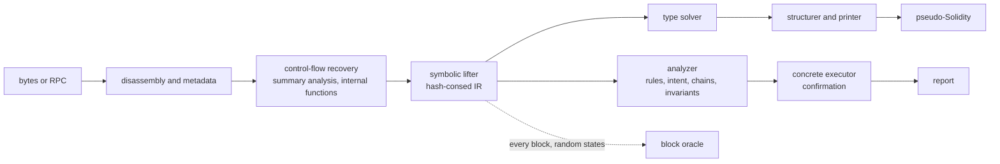
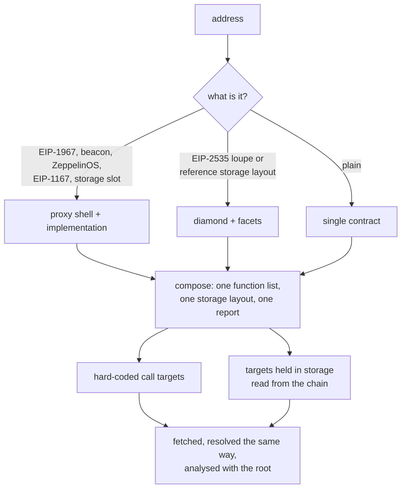

# evmdec

EVM bytecode decompiler and security analyzer, written from scratch in Rust.

Give it an address on any EVM chain, or the compiled bytecode of a contract that is not
deployed yet, and it returns readable pseudo-Solidity, a recovered interface and storage
layout, and a ranked security report. Proxies and diamonds are fetched and assembled with
their implementation or facets and analysed as one contract, and the contracts they call are
fetched and analysed too, so a token whose sender check trusts a hook contract is read
together with that hook.

The decompiler ships its own correctness oracle: a concrete interpreter executes every basic
block and the result is compared with the lifted code. The numbers in this file are measured
by scripts in `corpus/`, not asserted.

## Pipeline



Every stage is in `crates/decompiler`:

| module | role |
|---|---|
| `u256`, `keccak`, `hex`, `opcode`, `disasm`, `metadata` | arithmetic, hashing, instruction table, linear disassembly, CBOR metadata and compiler version |
| `cfg` | jump resolution by compositional summaries; dispatcher, internal functions, argument and return counts |
| `expr`, `lift`, `ssa`, `idiom` | hash-consed expression IR, symbolic execution of blocks, def-use index, compiler idioms |
| `types`, `type_rules` | type recovery as constraint solving over parameters, storage, helpers and merges |
| `structure`, `emit`, `function`, `sigs`, `sigdb` | loops, conditionals and short-circuits; printing; signature dictionary and local index |
| `compiler` | compiler version and feature fingerprints when the metadata is missing |
| `analyze`, `confirm`, `invariant`, `exec` | security rules, concrete confirmation of reachable findings, invariant search, whole-frame executor |
| `interp`, `verify` | reference EVM interpreter and the block oracle |
| `rpc`, `fetch`, `decompile`, `slots` | chain access, proxy and diamond resolution, composition, well-known storage slots |

## What it recovers

- Any bytecode. Runtime or creation code, solc 0.4 to 0.8, Vyper 0.2 to 0.3, hand-written and
  minimal proxies, embedded `CREATE` and `CREATE2` payloads. Unreferenced code is still printed
  as `orphan_<pc>` functions; anything unresolved is reported, not dropped.
- The interface. Linear, binary-search, `XOR` and `SUB` dispatchers and Vyper jump tables;
  parameter and return types from ABI head checks, masks, sign extension, dynamic offsets and
  the solc 0.8 decoder helpers, refined by a solver that follows values through phi merges,
  internal calls and storage; `view`, `pure` and `payable` from effects; events with `indexed`
  from the topic count; custom errors; `require(cond, "reason")` and `Panic(...)`.
- Storage. Mappings, dynamic and fixed arrays, packed fields (`uint112 reserve0; uint112
  reserve1; uint32 blockTimestampLast;`), strings, precomputed array slots, EIP-1967,
  ZeppelinOS, diamond and ERC-7201 namespaced slots by name.
- Readable code. Helpers (SafeMath, ABI coders, getters) inlined with their checks kept as
  `require` lines, checked arithmetic printed plain, `payable(to).transfer(v)`, `members.push(x)`,
  locals for values the source held in locals, the previous value of a slot read before it is
  overwritten, loops folded back together after control-flow recovery peeled an iteration.
- Names. A built-in dictionary of about 1,300 selectors, topics and errors; an optional local
  index of the whole public signature database; online lookup with `--lookup`.

## Composites and linked contracts



Each function is marked with the address whose code holds it. Slots that two parts type
differently are reported as storage collisions, and a function the shell answers itself is
reported as shadowed. Linked contracts carry their own code and report; a rule on the root
can use what it learned from a linked callee (a hook that forwards calls, a pool interface).
Budgets: 8 linked contracts per part, 24 code units per request, one level of dependencies.
`--no-follow-proxy` turns all of this off.

## Security report

Findings are leads with a severity and a confidence, ranked, folded per defect, with evidence
lines that use the same names as the code and a recommendation. Rules read the lifted IR,
not opcode patterns, and see through internal helpers with the caller's arguments
substituted. No rule names a contract, a protocol, a token or an address.

| family | rules |
|---|---|
| calls | reentrancy (lock recognised only when a slot is tested, set and restored; ERC721, ERC1155 and ERC777 hooks; severity by reachability), unchecked call and token results, arbitrary and run-time dispatched `call` and `delegatecall`, `transferFrom` on a caller-chosen account, decisions trusted to a caller-supplied contract, calls in loops, blocking payout loops |
| value | reverse-quoted amounts, payouts without a slippage bound, spot balances as a price, fee-on-transfer assumptions, division before multiplication, `msg.value` reused in loops and multicalls, unbounded payout parameters, wrapping arithmetic on pre-0.8 compilers and inside `unchecked` blocks |
| authority | owner and initializer writes without access control, silent authorisation failures, `tx.origin`, `selfdestruct` by reachability, unprotected upgrades, ether withdrawable by anyone, access control by intent (`inconsistent-access-control`), attack chains (a write anyone can make paired with the function that trusts it) |
| trust | a gate that trusts a contract the token itself calls on a public path (`trusted-callee-loop`), a balance lowered on an account the caller neither owns nor has an allowance for (`third-party-balance-debit`, critical when the account is a market counterparty recognised by behaviour: singled out by transfer guards, returned by a factory, read as a ledger, or called with a pool interface), a pair `sync()` reachable after balances changed (`pair-sync-after-state-change`) |
| types | wide values cut to `uintN` without a check, signed and unsigned comparison of one value, addresses built by arithmetic, hashes used as numbers, narrow counters |
| signatures and randomness | `ecrecover` zero address and malleability, signatures without a domain or a nonce, block attributes as randomness, Chainlink answers without staleness or positivity checks |
| compiler | known solc and Vyper bugs for the detected version, with triggers the bytecode cannot show marked informational; the Vyper 0.2.15 to 0.3.0 lock bug |
| structure | proxy and diamond kinds, storage collisions, shadowed functions, locked ether, storage-bounded loops |

What counts as an access check is decided per contract: `msg.sender == owner` always, and a
test of `mapping[msg.sender]` only when every function writing the mapping is itself gated. A
stake or balance mapping anyone can fill is accounting, not authorisation.

Two passes run after the rules. The confirmation pass drives the concrete executor from a
fresh state into each reachable sink and marks a finding confirmed with a witness input when
the effect shows. The invariant pass searches for an unprivileged path that credits a balance
without a debit or a payment (`unprivileged-balance-credit`).

## Accuracy

Three measurements on 22 unmodified mainnet contracts, solc 0.4.18 to 0.8.17 and Vyper 0.2.4
and 0.3.9 (WETH, USDT, USDC proxy and implementation, Uniswap V2 router and pair, Uniswap V3
factory, Permit2, Universal Router, 1inch v5, Seaport 1.5, Gnosis Safe, Compound cETH, MakerDAO
Vat, Aave v3 pool proxy, ENS registry, Lido stETH proxy, Multicall3, Curve 3pool and
TriCrypto-NG, the CREATE2 deployer, UNI), and one on 25 exploited contracts.

### Interface recovery against verified ABIs

`python3 corpus/bench.py`, signature dictionary disabled.

| metric | result |
|---|---|
| external selectors found | 515 / 515 |
| state mutability | 509 / 515 |
| parameter count | 513 / 515 |
| return count | 514 / 515 |
| parameter types, exact Solidity type | 840 / 955 |
| return types | 339 / 380 |
| events | 119 / 121 |
| code blocks covered by some function | 10,810 / 10,810 |
| unresolved jumps | 0 |
| time for the corpus | about 6 s |

The mutability misses are `view` functions that make external calls on a pre-0.5 compiler, or
proxy getters that fall through to `delegatecall`. Most type misses are `bytes32` declared where
the code treats the word as a number, which nothing in the bytecode tells apart.

### Block oracle

`RUNS=8 ./corpus/verify_all.sh`. Every basic block, reachable or not, is executed by the
reference interpreter and by the lifted statements from the same random state; stack, memory,
storage, logs, calls and the control decision are compared.

| | |
|---|---|
| blocks | 13,656 |
| runs | 109,011 |
| mismatches | 0 |
| inconclusive runs | 1,553 |
| instructions in verified blocks | 158,380 / 159,940 |

A mismatch is a decompiler bug by definition. An inconclusive run is one the reference cannot
execute from the drawn state, or one that makes two differently based memory accesses alias.

### Analyzer recall

`python3 corpus/vuln_bench.py`. `testdata/vuln` holds the runtime bytecode of 25 contracts
whose exploits are public, from The DAO to Balancer V1, with the rules that must fire in
`testdata/vuln/manifest.json`.

| | |
|---|---|
| known bugs found | 24 / 24 |
| not counted | Nomad, an upgrade-time state error outside bytecode patterns |
| high or critical findings on the 22 audited contracts | 28, nearly all on contracts whose purpose is to execute caller-supplied calls |

The audited corpus is the running false-positive budget for every rule change. The TENDRIL
token on BSC, whose pool was drained through a hook contract the token trusted, is the case the
trust rules were built on and tested against.

### Random sample

`corpus/harvest.py` collects the `to` address of every transaction in random recent mainnet
blocks and `corpus/run_sample.sh` decompiles and verifies each one. The last run over 120
contracts (`corpus/sample_ids.txt`) decompiled all of them with no unresolved jumps and no
oracle mismatch in 592,999 instructions. The sample itself is not in the repository; the two
scripts regenerate it.

## Quick start

```sh
cargo build --release

./target/release/evmdec decompile 0xdAC17F958D2ee523a2206206994597C13D831ec7 --report
./target/release/evmdec decompile 0xA0b86991c6218b36c1d19D4a2e9Eb0cE3606eB48 --chain mainnet
./target/release/evmdec decompile 0x... --chain arbitrum --rpc https://my.node/

solc --bin MyContract.sol | tail -1 > my.hex
./target/release/evmdec decompile my.hex --report
./target/release/evmdec analyze my.hex --json
./target/release/evmdec decompile my.hex --lookup
./target/release/evmdec sigs 0xa9059cbb
./target/release/evmdec disasm my.hex
./target/release/evmdec verify my.hex --runs 8

PORT=8080 ./target/release/evmdec-server
```

Chains: mainnet, sepolia, arbitrum, optimism, base, polygon, bsc, avalanche, gnosis, fantom,
linea, scroll, blast, zksync, classic. Public endpoints are tried in order; an endpoint that
returns empty code or zero storage falls through to the next.

Docker: `docker build -t evmdec . && docker run -p 8080:8080 evmdec`. Build with
`--build-arg SIGS=1` to include the full signature index.

### Full signature index

The binary names about 1,300 signatures. The whole public database, 10.7 million function,
event and error signatures from Sourcify's export, installs as one local file:

```sh
pip install pyarrow numpy
python3 corpus/build_sigs.py --out sigs.idx
sudo install -D sigs.idx /var/lib/evmdec/sigs.idx
```

The index is a sorted table searched in place with positional reads, so nothing is loaded at
start-up and a lookup costs microseconds. `evmdec sigs` shows which index is in use.

### Web app and API

The server serves a single-page UI: a title block, the function index, the code with numbered
callouts keyed to the findings beside it, a band of the trusted contracts the analysis followed
(each one opens in place), and tabs for the report, storage and events, the call graph,
disassembly and JSON. Results are linkable as `/?chain=mainnet&address=0x...`. The page meets
WCAG 2.2 AA on both colour schemes and runs no third-party scripts.

```
POST /api/decompile      {"address": "0x...", "chain": "mainnet"}  or  {"bytecode": "0x..."}
                         optional: "no_follow_proxy": true, "lookup": true
GET  /api/address/{chain}/{address}
GET  /api/chains
GET  /healthz
```

Responses carry `contract`, `report`, `report_markdown`, `disassembly` and, when contracts
were followed, `linked` (one entry each with the same four fields) and `parts_disassembly`.
Requests are bounded: four decompilations in flight, five minutes each.

### Configuration

| variable | effect |
|---|---|
| `EVMDEC_RPC_URL` | comma-separated JSON-RPC endpoints, tried before the public list |
| `EVMDEC_SIGS` | path of the signature index; empty disables it. Default search: `./sigs.idx`, next to the binary, `/var/lib/evmdec/sigs.idx`, `~/.evmdec/sigs.idx` |
| `EVMDEC_NO_CONFIRM` | skip the confirmation and invariant passes |
| `EVMDEC_TIMING` | print the time spent in each stage |
| `PORT` | listening port of the server, default 8080 |

Variables starting with `EVMDEC_DEBUG_` print traces of one stage and are for development.

## Development

```sh
cargo fmt --all
cargo clippy --workspace --all-targets --all-features
cargo test --workspace
python3 corpus/bench.py
python3 corpus/vuln_bench.py
RUNS=8 ./corpus/verify_all.sh
```

The Rust crates follow Google's Rust style guide with `rustfmt.toml` as committed, the crate
root turns on `#![warn(missing_docs)]`, and clippy is kept at zero warnings.
`.claude/agents/rust-style-reviewer.md` reviews a change against the guide. See
`CONTRIBUTING.md` for the rules a new analyzer rule has to meet.

## Known limitations

- Memory accesses through different symbolic bases are assumed not to alias. This holds for
  compiler output; a hand-written contract that relies on aliasing decompiles imprecisely, and
  the oracle reports such states as inconclusive rather than hiding them.
- Internal functions are named `func_<pc>`, and parameters nothing narrows are `uint256`.
- Dynamic ABI encodings the printer does not recognise appear as the memory operations the
  compiler emitted rather than as `abi.encode`.
- Vyper internal calls pass arguments through fixed memory, so some values in Vyper output
  print as `mem[0x...]` reads where the analyzer, which replays the callee, sees the value.
- The confirmation pass starts from a fresh state. A finding whose path needs prior storage
  stays unconfirmed, not refuted.
- `pair-sync-after-state-change` looks for the Uniswap V2 `sync()` call; V3 and later pools
  have no equivalent, and the third-party debit rule covers them.
- Findings are heuristic and should be read as leads with a confidence level.

## License

MIT, see `LICENSE`.
