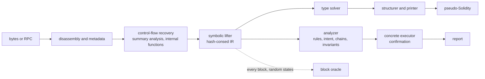
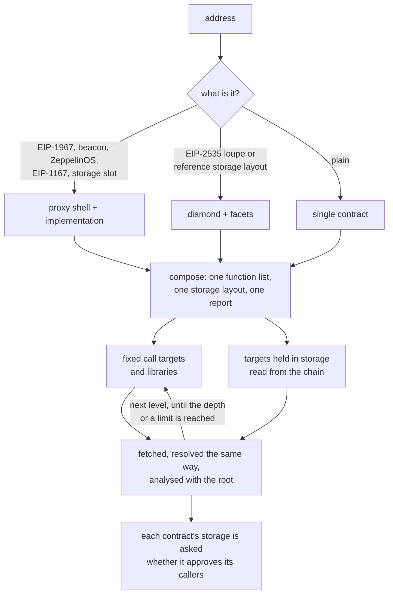

# evmdec

EVM bytecode decompiler and security analyzer, written from scratch in Rust.

Give it an address on any EVM chain, or the compiled bytecode of a contract that is not
deployed yet, and it returns readable pseudo-Solidity, a recovered interface and storage
layout, and a ranked security report. Proxies and diamonds are fetched and assembled with
their implementation or facets and analysed as one contract, and the contracts they call are
fetched and analysed too, so a token whose sender check trusts a hook contract is read
together with that hook.

The decompiler ships its own correctness oracle: a concrete interpreter executes every basic
block and the result is compared with the lifted code. The numbers in this file are measured
by scripts in `corpus/`, not asserted.

## Pipeline



Every stage is in `crates/decompiler`:

| module | role |
|---|---|
| `u256`, `keccak`, `hex`, `opcode`, `disasm`, `metadata` | arithmetic, hashing, instruction table, linear disassembly, CBOR metadata and compiler version |
| `cfg` | jump resolution by compositional summaries; dispatcher, internal functions, argument and return counts |
| `expr`, `lift`, `ssa`, `idiom` | hash-consed expression IR, symbolic execution of blocks, def-use index, compiler idioms |
| `types`, `type_rules` | type recovery as constraint solving over parameters, storage, helpers and merges |
| `structure`, `emit`, `function`, `sigs`, `sigdb`, `naming` | loops, conditionals and short-circuits; printing; signature dictionary and local index; names inferred from roles |
| `compiler` | compiler version and feature fingerprints when the metadata is missing |
| `analyze`, `confirm`, `invariant`, `exec`, `cross` | security rules, concrete confirmation of reachable findings, invariant search, whole-frame and cross-contract executors |
| `interp`, `verify` | reference EVM interpreter and the block oracle |
| `rpc`, `fetch`, `decompile`, `slots` | chain access, proxy and diamond resolution, composition, well-known storage slots |

## What it recovers

- Any bytecode. Runtime or creation code, solc 0.4 to 0.8, Vyper 0.2 to 0.3, hand-written and
  minimal proxies, embedded `CREATE` and `CREATE2` payloads. Unreferenced code is still printed
  as `orphan_<pc>` functions; anything unresolved is reported, not dropped.
- The interface. Linear, binary-search, `XOR` and `SUB` dispatchers and Vyper jump tables;
  parameter and return types from ABI head checks, masks, sign extension, dynamic offsets and
  the solc 0.8 decoder helpers, refined by a solver that follows values through phi merges,
  internal calls and storage; `view`, `pure` and `payable` from effects; events with `indexed`
  from the topic count; custom errors; `require(cond, "reason")` and `Panic(...)`.
- Storage. Mappings, dynamic and fixed arrays, packed fields (`uint112 reserve0; uint112
  reserve1; uint32 blockTimestampLast;`), strings, precomputed array slots, EIP-1967,
  ZeppelinOS, diamond and ERC-7201 namespaced slots by name. A mapping or array whose
  elements span several slots is declared with its struct (`struct Struct_264 { address
  field0; uint256 field1; bytes field2; }`) and read by member (`stor_264[key].field1`):
  members packed into one slot, byte strings, and arrays and mappings held inside the
  element each get their own type, and a member takes its name from the getter that returns
  it or from the setter that writes it (`struct Struct_0 { address owner; address resolver;
  uint64 ttl; }`).
- Readable code. Helpers (SafeMath, ABI coders, getters) inlined with their checks kept as
  `require` lines, checked arithmetic printed plain, `payable(to).transfer(v)`, `members.push(x)`,
  locals for values the source held in locals, the previous value of a slot read before it is
  overwritten, loops folded back together after control-flow recovery peeled an iteration.
- Memory. Each allocation at solc's free memory pointer is a named block (`ptr1`, `ptr2`), so
  two structs never read as one address; a run of stores that fills a block prints as one line
  (`ptr1 = memory(arg0, arg1, ptr2)`), a string built in memory as its text, and the
  allocator's own bookkeeping and overflow panics are left out. A call's payload prints as
  what it is: `abi.encodeWithSelector(...)` when its words are known, `msg.data` when a proxy
  forwards its calldata, `bytes(p)` for the byte string at a pointer, and the selector with
  the leading arguments when only the head is known. Precompiles are called by name.
  Vyper has no free pointer and keeps every variable at a fixed address, so there a word at
  one prints as a local (`loc_280`) and a word-scaled index from one as an element of the
  list that starts there (`loc_240[loc_280]`). A store to a fixed address is printed only
  when something that runs afterwards can read it: a later load, a byte range handed to a
  call, a hash or a return, or an internal function that loads the address before writing it
  itself (the lifter records, load by load, whether the function had already written those
  bytes on every path). In code without a free pointer the lifter also keeps what it knows
  of memory across a call to an internal function whose writes are all to fixed addresses.
- Names. A built-in dictionary of about 1,300 selectors, topics and errors; an optional local
  index of the whole public signature database; online lookup with `--lookup`. Where no
  signature gives a name, the code does: a variable is named by its getter, by the setter that
  writes it (`setFee` writes `fee`), by the event announcing its change, or by its role (the
  `owner` the guards compare the caller with, the `reentrancyLock` toggled around calls, the
  `balances` a transfer debits and credits with their `allowances` and `totalSupply`). An
  internal function is named by what it does (`_transfer` emits `Transfer`, `_callBalanceOf`
  makes one call, `_onlyOwner` checks the caller). A parameter is named by its use: `from`,
  `to` and `amount` on a ledger, `deadline`, the `v`, `r`, `s` given to `ecrecover`, a call
  `target`, a `recipient`, `newFee` for the value stored into `fee`. A name is given only
  where `stor_3`, `func_0x1fbb` or `arg0` would stand, and only when the type fits the role.

## Composites and linked contracts



Each function is marked with the address whose code holds it. Slots that two parts type
differently are reported as storage collisions, and a function the shell answers itself is
reported as shadowed. Linked contracts carry their own code and report; a rule on the root
can use what it learned from a linked callee (a hook that forwards calls, a pool interface).

The walk over call targets goes level by level. At each level the targets of every contract
fetched so far are collected and fetched in this order: libraries (their code runs in the
caller's storage), then targets some call may change, then targets that are only read. A
target is fetched once however many contracts call it, the same code at two addresses is
decompiled once, and every contract says how it was reached (which contract calls it, through
a fixed address, a library call or which storage slot, and how many calls away it is).

How far it goes: 2 call edges from the contract asked for by default (`--depth`, at most 3;
`depth` in the server's request), at most 8 targets fetched from one contract, at most 40 code
units per request across parts and dependencies, 20 seconds to decompile one dependency and
120 seconds for the whole walk. Whatever was seen and not fetched is listed with its reason
(a limit, the depth, an empty slot, no code, too slow), in the report and in the JSON
(`unfollowed`), so the edge of what was analysed is always stated.

Contracts a contract creates are part of the walk too. Creation code a contract copies out of
its own bytecode is decompiled with it (constructor and runtime), the libraries and fixed
addresses that created code calls are fetched like any other target, and the address a
minimal proxy forwards to is fetched as the code its clones run.

After the walk, each fetched contract's storage is read at the places its own access checks
look (the slots `msg.sender` is compared with, the mapping entries tested under `msg.sender`)
for the contracts that call it. The answer (`admits`) says whether the callee approves the
caller, which is what turns "this function is gated" into "and this contract gets through".
`--no-follow-proxy` turns all of this off.

## Security report

Findings are leads with a severity and a confidence, ranked, folded per defect, with evidence
lines that use the same names as the code and a recommendation. Rules read the lifted IR,
not opcode patterns, and see through internal helpers with the caller's arguments
substituted. No rule names a contract, a protocol, a token or an address.

| family | rules |
|---|---|
| calls | reentrancy (lock recognised only when a slot is tested, set and restored; ERC721, ERC1155 and ERC777 hooks; severity by reachability), unchecked call and token results, arbitrary and run-time dispatched `call` and `delegatecall`, `transferFrom` on a caller-chosen account, decisions trusted to a caller-supplied contract, calls in loops, blocking payout loops |
| value | reverse-quoted amounts, payouts without a slippage bound, spot balances as a price, fee-on-transfer assumptions, division before multiplication, `msg.value` reused in loops and multicalls, unbounded payout parameters, wrapping arithmetic on pre-0.8 compilers and inside `unchecked` blocks |
| authority | owner and initializer writes without access control, silent authorisation failures, `tx.origin`, `selfdestruct` by reachability, unprotected upgrades, ether withdrawable by anyone, access control by intent (`inconsistent-access-control`), attack chains (a write anyone can make paired with the function that trusts it) |
| trust | a gate that trusts a contract the token itself calls on a public path (`trusted-callee-loop`), a balance lowered on an account the caller neither owns nor has an allowance for (`third-party-balance-debit`, critical when the account is a market counterparty recognised by behaviour: singled out by transfer guards, returned by a factory, read as a ledger, or called with a pool interface), a pair `sync()` reachable after balances changed (`pair-sync-after-state-change`) |
| linked contracts | when the contracts this one calls were fetched with it, each edge is held against the other side's own code and report: a selector the called contract has no function for and nothing to catch (`linked-call-unanswered`); ether sent to a function that rejects it, or with no function selected to code without a payable receive or fallback (`value-to-non-payable`); a called function its own contract's report rates high or critical (`linked-callee-defect`); and an `approve` whose spender moves tokens from accounts its caller picks (`approval-to-open-spender`). The target is a fixed address or one read from a slot whose content was fetched |
| words passed between contracts | every external function is summarised by what it does with each word of its call data: which words it ties to `msg.sender` (compared with it, or keying an entry compared with it or read under it), which name an account whose entry it lowers or whose tokens it moves, which it pays, which it writes whole to a fixed slot, and which it passes on to another contract, together with what gates the function. The summaries are composed across call edges: a function anyone can call that passes an untied account to a gated function that lowers that account's entry (`unbound-account-passed-on`), or passes an untied word into a slot the called contract's access checks read (`unbound-address-made-privileged`). The path is followed through further calls, a value computed by a linked library function that only does arithmetic is read through the call, and parameters a compiler keeps in fixed memory words are followed. When the called contract's storage was read, the finding is kept only if that storage approves this contract as a caller. A call made with `DELEGATECALL` to a linked library is folded into the function that makes it: what the library function stores, lowers, pays, passes on and checks becomes the caller's, with slots the library counts from a storage position it is handed placed at the position the caller passes. A call to an address returned by a function that creates a contract, or to the result of a creation in the same function, is read against the created code: creation code copied from the creator's own bytecode, or the code a minimal proxy (EIP-1167) forwards to. Writing a caller-chosen address into a new contract's own gate is ordinary and is reported only when the same call also lowers the entry of an account the caller names |
| accounting | two functions that each cap the amount they pay out by `credits - liabilities` over the same pooled storage, where one subtracts a proper subset of the liability fields the other subtracts (`inconsistent-liability-accounting`): the path subtracting fewer can release more than the shared balance backs. A field is a slot path plus a bit range, so packed halves stay apart; terms carry signed coefficients; the flagged limit must be compared with the amount that leaves, and the reference may be any limit the contract states, a view's returned value included. Three conservation checks over single-level mappings: an entry raised from a value read before another entry of the same mapping was lowered, with nothing comparing the two keys, so one key in both places ends higher than it began (`stale-ledger-write`); a chain of writes that leaves a mapping's entries higher than it found them by terms no entry pays for, while no total rises (`unbalanced-ledger-move`); and an entry raised by an amount in a function that leaves alone the total every other path moves in step with that mapping (`ledger-total-mismatch`). Steps by a constant are counters and are ignored |
| types | wide values cut to `uintN` without a check, signed and unsigned comparison of one value, addresses built by arithmetic, hashes used as numbers, narrow counters |
| signatures and randomness | `ecrecover` zero address and malleability, signatures without a domain or a nonce, block attributes as randomness, Chainlink answers without staleness or positivity checks |
| compiler | known solc and Vyper bugs for the detected version, with triggers the bytecode cannot show marked informational; the Vyper 0.2.15 to 0.3.0 lock bug |
| structure | proxy and diamond kinds, storage collisions, shadowed functions, locked ether, storage-bounded loops |

What counts as an access check is decided per contract: `msg.sender == owner` always, and a
test of `mapping[msg.sender]` only when every function writing the mapping is itself gated. A
stake or balance mapping anyone can fill is accounting, not authorisation.

Two passes run after the rules. The confirmation pass drives the concrete executor from a
fresh state into each reachable sink and marks a finding confirmed with a witness input when
the effect shows. A finding that spans a call edge is confirmed by running it across the
fetched contracts (`cross`): calls run the callee's code in the callee's storage, library calls
run in the caller's storage, creations run their init code, and a frame that fails takes its
writes back. The state is only what was read from the chain: each contract's code, the
addresses its slots were read to hold, and gates set for the callers a contract's own storage
approved, so a gate nobody was read to pass stays shut. The function is run by an account
holding no role, once for each of two named accounts. A first round finds the slots of the far
contract written for one account and not the other; a second gives those slots a balance and
tries a few argument shapes. The finding is confirmed, with the input, when for both accounts
the call completes and the account's own slot ends lower. The invariant pass searches for an unprivileged
path that credits a balance without a debit or a payment (`unprivileged-balance-credit`).

## Accuracy

Three measurements on 22 unmodified mainnet contracts, solc 0.4.18 to 0.8.17 and Vyper 0.2.4
and 0.3.9 (WETH, USDT, USDC proxy and implementation, Uniswap V2 router and pair, Uniswap V3
factory, Permit2, Universal Router, 1inch v5, Seaport 1.5, Gnosis Safe, Compound cETH, MakerDAO
Vat, Aave v3 pool proxy, ENS registry, Lido stETH proxy, Multicall3, Curve 3pool and
TriCrypto-NG, the CREATE2 deployer, UNI), and one on 26 exploited contracts.

### Interface recovery against verified ABIs

`python3 corpus/bench.py`, signature dictionary disabled.

| metric | result |
|---|---|
| external selectors found | 515 / 515 |
| state mutability | 509 / 515 |
| parameter count | 513 / 515 |
| return count | 514 / 515 |
| parameter types, exact Solidity type | 913 / 955 |
| return types | 366 / 380 |
| events | 119 / 121 |
| code blocks covered by some function | 10,810 / 10,810 |
| unresolved jumps | 0 |
| time for the corpus | about 6 s |

The mutability misses are `view` functions that make external calls on a pre-0.5 compiler, or
proxy getters that fall through to `delegatecall`. Most type misses are `bytes32` mapping keys,
which the bytecode handles exactly like a number. A `bytes32` is recovered where the code shows
it: a hash or signature half passed to `ecrecover`, a block or code hash, a hash-like constant,
or a comparison with a text literal. With the signature dictionary on, the declared parameter
types are used directly (939 / 955) and flow on into the storage and helpers they reach.

### Block oracle

`RUNS=8 ./corpus/verify_all.sh`. Every basic block, reachable or not, is executed by the
reference interpreter and by the lifted statements from the same random state; stack, memory,
storage, logs, calls and the control decision are compared.

| | |
|---|---|
| blocks | 13,656 |
| runs | 109,011 |
| mismatches | 0 |
| inconclusive runs | 1,553 |
| instructions in verified blocks | 158,380 / 159,940 |

A mismatch is a decompiler bug by definition. An inconclusive run is one the reference cannot
execute from the drawn state, or one that makes two differently based memory accesses alias.

### Analyzer recall

`python3 corpus/vuln_bench.py`. `testdata/vuln` holds the runtime bytecode of 26 contracts
whose exploits are public, from The DAO to Balancer V1, with the rules that must fire in
`testdata/vuln/manifest.json`.

| | |
|---|---|
| known bugs found | 24 / 25 |
| missed | the Fence tranche pool on Avalanche: one of its two limits is computed from an in-memory copy of the record, which the accounting rule does not read |
| not counted | Nomad, an upgrade-time state error outside bytecode patterns |
| high or critical findings on the 22 audited contracts | 28, nearly all on contracts whose purpose is to execute caller-supplied calls |

The audited corpus is the running false-positive budget for every rule change. The TENDRIL
token on BSC, whose pool was drained through a hook contract the token trusted, is the case the
trust rules were built on and tested against.

### Random sample

`corpus/harvest.py` collects the `to` address of every transaction in random recent mainnet
blocks and `corpus/run_sample.sh` decompiles and verifies each one. The last run over 120
contracts (`corpus/sample_ids.txt`) decompiled all of them with no unresolved jumps and no
oracle mismatch in 592,999 instructions. The sample itself is not in the repository; the two
scripts regenerate it.

A larger run takes 579 distinct contracts from mainnet, Base, BNB Chain, Arbitrum and Polygon
(`corpus/sample_ids_multichain.txt`, chain and address per line). 578 are decompiled, analysed
and checked by the oracle, which finds no mismatch in 2,848,768 instructions; the median
contract takes 0.09 s and the 99th percentile 3 s. One contract with a hundred unresolved
jumps does not finish. The first pass over this set is what found an exponential walk in the
printer, two quadratic scans in the analyzer, a return-data size shared across calls, and the
transparent proxy being reported as an unguarded delegatecall; all are fixed. None of the
three ledger rules fires on any of the 578, and the liability rule fires once.

## Quick start

```sh
cargo build --release

./target/release/evmdec decompile 0xdAC17F958D2ee523a2206206994597C13D831ec7 --report
./target/release/evmdec decompile 0xA0b86991c6218b36c1d19D4a2e9Eb0cE3606eB48 --chain mainnet
./target/release/evmdec decompile 0x... --chain arbitrum --rpc https://my.node/

solc --bin MyContract.sol | tail -1 > my.hex
./target/release/evmdec decompile my.hex --report
./target/release/evmdec analyze my.hex --json
./target/release/evmdec decompile my.hex --lookup
./target/release/evmdec sigs 0xa9059cbb
./target/release/evmdec disasm my.hex
./target/release/evmdec verify my.hex --runs 8

PORT=8080 ./target/release/evmdec-server
```

Chains: mainnet, sepolia, arbitrum, optimism, base, polygon, bsc, avalanche, gnosis, fantom,
linea, scroll, blast, zksync, classic. Public endpoints are tried in order; an endpoint that
returns empty code or zero storage falls through to the next.

Docker: `docker build -t evmdec . && docker run -p 8080:8080 evmdec`. The image builds the full
signature index in its own stage; `--build-arg SIGS=0` skips it and leaves only the built-in
dictionary.

### Full signature index

The binary names about 1,300 signatures. The whole public database, 10.7 million function,
event and error signatures from Sourcify's export, installs as one local file:

```sh
pip install pyarrow numpy
python3 corpus/build_sigs.py --out sigs.idx
sudo install -D sigs.idx /var/lib/evmdec/sigs.idx
```

The index is a sorted table searched in place with positional reads, so nothing is loaded at
start-up and a lookup costs microseconds. `evmdec sigs` shows which index is in use, and the
server prints the same at start-up. Without an index most functions of an unverified contract
print as `func_<selector>`.

### Web app and API

The server serves a single-page UI: a title block, the function index, the code with numbered
callouts keyed to the findings beside it, a band of the trusted contracts the analysis followed
(each one opens in place), and tabs for the report, storage and events, the call graph,
disassembly and JSON. Results are linkable as `/?chain=mainnet&address=0x...`. The page meets
WCAG 2.2 AA on both colour schemes and runs no third-party scripts.

```
POST /api/decompile      {"address": "0x...", "chain": "mainnet"}  or  {"bytecode": "0x..."}
                         optional: "no_follow_proxy": true, "lookup": true
GET  /api/address/{chain}/{address}
GET  /api/chains
GET  /api/status         {"signature_index": 10780428}, or 0 when no index is installed
GET  /healthz
```

Responses carry `contract`, `report`, `report_markdown`, `disassembly` and, when contracts
were followed, `linked` (one entry each with the same four fields) and `parts_disassembly`.
Requests are bounded: four decompilations in flight, five minutes each.

### Configuration

| variable | effect |
|---|---|
| `EVMDEC_RPC_URL` | comma-separated JSON-RPC endpoints, tried before the public list |
| `EVMDEC_SIGS` | path of the signature index; empty disables it. Default search: `./sigs.idx`, next to the binary, `/var/lib/evmdec/sigs.idx`, `~/.evmdec/sigs.idx` |
| `EVMDEC_NO_CONFIRM` | skip the confirmation and invariant passes |
| `EVMDEC_TIMING` | print the time spent in each stage |
| `PORT` | listening port of the server, default 8080 |

Variables starting with `EVMDEC_DEBUG_` print traces of one stage and are for development.

## Development

```sh
cargo fmt --all
cargo clippy --workspace --all-targets --all-features
cargo test --workspace
python3 corpus/bench.py
python3 corpus/vuln_bench.py
RUNS=8 ./corpus/verify_all.sh
```

The Rust crates follow Google's Rust style guide with `rustfmt.toml` as committed, the crate
root turns on `#![warn(missing_docs)]`, and clippy is kept at zero warnings.
`.claude/agents/rust-style-reviewer.md` reviews a change against the guide. See
`CONTRIBUTING.md` for the rules a new analyzer rule has to meet.

## Known limitations

- Memory accesses through different symbolic bases are assumed not to alias. This holds for
  compiler output; a hand-written contract that relies on aliasing decompiles imprecisely, and
  the oracle reports such states as inconclusive rather than hiding them.
- Internal functions the code does not characterise keep the name `func_<pc>`, and parameters
  nothing narrows are `uint256`. Names inferred from roles describe what the code does, not
  what the author called it.
- A payload assembled with dynamic data the lifter does not follow prints its selector and
  leading arguments, then `...`; one with no known head prints as a memory range.
- Vyper internal calls pass arguments through fixed memory, so some values in Vyper output
  print as `mem[0x...]` reads where the analyzer, which replays the callee, sees the value.
- The confirmation pass starts from a fresh state. A finding whose path needs prior storage
  stays unconfirmed, not refuted.
- `pair-sync-after-state-change` looks for the Uniswap V2 `sync()` call; V3 and later pools
  have no equivalent, and the third-party debit rule covers them.
- `inconsistent-liability-accounting` compares limits built from storage reads. Memory is
  resolved where the analyzer can replay it safely; a copy of the record that a helper updates
  and returns is not mapped back to storage, because its values no longer equal the stored
  fields. In the Fence pool those copies measure how far a time-based update moved each field,
  and the defect is that reclassification over time, which a comparison of limits does not
  model; the pool is listed as missed. Two limits that differ on purpose, because they cap
  different things, can read as an omission.
- Findings are heuristic and should be read as leads with a confidence level.

## License

MIT, see `LICENSE`.
