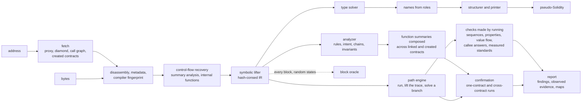
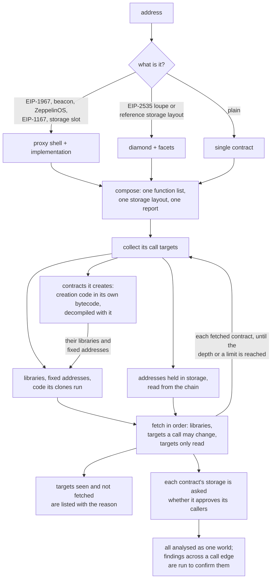

# evmdec

EVM bytecode decompiler and security analyzer, written from scratch in Rust.

Give it an address on any EVM chain, or the compiled bytecode of a contract that is not
deployed yet, and it returns readable pseudo-Solidity, a recovered interface and storage
layout, and a ranked security report. Proxies and diamonds are fetched and assembled with
their implementation or facets and analysed as one contract, and the contracts they call are
fetched and analysed too, so a token whose sender check trusts a hook contract is read
together with that hook.

The decompiler ships its own correctness oracle: a concrete interpreter executes every basic
block and the result is compared with the lifted code. The numbers in this file are measured
by scripts in `corpus/`, not asserted.

## Pipeline



Every stage is in `crates/decompiler`:

| module | role |
|---|---|
| `u256`, `keccak`, `hex`, `opcode`, `disasm`, `metadata` | arithmetic, hashing, instruction table, linear disassembly, CBOR metadata and compiler version |
| `cfg` | jump resolution by compositional summaries; dispatcher, internal functions, argument and return counts |
| `expr`, `lift`, `ssa`, `idiom` | hash-consed expression IR, symbolic execution of blocks, def-use index, compiler idioms |
| `types`, `type_rules` | type recovery as constraint solving over parameters, storage, helpers and merges |
| `structure`, `emit`, `function`, `sigs`, `sigdb`, `naming` | loops, conditionals and short-circuits; printing; signature dictionary and local index; names inferred from roles |
| `compiler` | compiler version and feature fingerprints when the metadata is missing |
| `analyze`, `confirm`, `invariant`, `exec`, `cross` | security rules, concrete confirmation of reachable findings, invariant search, whole-frame and cross-contract executors |
| `path`, `solve`, `seq`, `abi`, `deploy` | the path engine: one concrete run lifted into its branch conditions and writes, a solver that inverts a condition back to an input word, a search over short call sequences, ABI-shaped starting inputs, and the storage a constructor leaves |
| `props`, `flow`, `signed`, `standard`, `origin`, `range`, `evidence` | checks made by running the code: properties inferred from behaviour, what calls take and return, signed messages, the standard ledger interface as measured, where stored values come from, value ranges along a path, and what a confirming run was seen to do |
| `interp`, `verify` | reference EVM interpreter and the block oracle |
| `rpc`, `fetch`, `decompile`, `slots`, `clock` | chain access, proxy and diamond resolution, the walk over call targets, composition, well-known storage slots, the time limit one dependency is given |

## What it recovers

- Any bytecode. Runtime or creation code, solc 0.4 to 0.8, Vyper 0.2 to 0.3, hand-written and
  minimal proxies, embedded `CREATE` and `CREATE2` payloads (decompiled with `--embedded`, and
  always when the contract is fetched by address). Unreferenced code is still printed
  as `orphan_<pc>` functions; anything unresolved is reported, not dropped.
- The interface. Linear, binary-search, `XOR` and `SUB` dispatchers and Vyper jump tables;
  parameter and return types from ABI head checks, masks, sign extension, dynamic offsets and
  the solc 0.8 decoder helpers, refined by a solver that follows values through phi merges,
  internal calls and storage; `view`, `pure` and `payable` from effects; events with `indexed`
  from the topic count; custom errors; `require(cond, "reason")` and `Panic(...)`.
- Storage. Mappings, dynamic and fixed arrays, packed fields (`uint112 reserve0; uint112
  reserve1; uint32 blockTimestampLast;`), strings, precomputed array slots, EIP-1967,
  ZeppelinOS, diamond and ERC-7201 namespaced slots by name. A mapping or array whose
  elements span several slots is declared with its struct (`struct Struct_264 { address
  field0; uint256 field1; bytes field2; }`) and read by member (`stor_264[key].field1`):
  members packed into one slot, byte strings, and arrays and mappings held inside the
  element each get their own type, and a member takes its name from the getter that returns
  it or from the setter that writes it (`struct Struct_0 { address owner; address resolver;
  uint64 ttl; }`).
- Readable code. Helpers (SafeMath, ABI coders, getters) inlined with their checks kept as
  `require` lines, checked arithmetic printed plain, `payable(to).transfer(v)`, `members.push(x)`,
  locals for values the source held in locals, the previous value of a slot read before it is
  overwritten, loops folded back together after control-flow recovery peeled an iteration.
- Memory. Each allocation at solc's free memory pointer is a named block (`ptr1`, `ptr2`), so
  two structs never read as one address; a run of stores that fills a block prints as one line
  (`ptr1 = memory(arg0, arg1, ptr2)`), a string built in memory as its text, and the
  allocator's own bookkeeping and overflow panics are left out. A call's payload prints as
  what it is: `abi.encodeWithSelector(...)` when its words are known, `msg.data` when a proxy
  forwards its calldata, `bytes(p)` for the byte string at a pointer, and the selector with
  the leading arguments when only the head is known. Precompiles are called by name.
  Vyper has no free pointer and keeps every variable at a fixed address, so there a word at
  one prints as a local (`loc_280`) and a word-scaled index from one as an element of the
  list that starts there (`loc_240[loc_280]`). A store to a fixed address is printed only
  when something that runs afterwards can read it: a later load, a byte range handed to a
  call, a hash or a return, or an internal function that loads the address before writing it
  itself (the lifter records, load by load, whether the function had already written those
  bytes on every path). In code without a free pointer the lifter also keeps what it knows
  of memory across a call to an internal function whose writes are all to fixed addresses.
- Names. A built-in dictionary of about 1,300 selectors, topics and errors; an optional local
  index of the whole public signature database; online lookup with `--lookup`. Where no
  signature gives a name, the code does: a variable is named by its getter, by the setter that
  writes it (`setFee` writes `fee`), by the event announcing its change, or by its role (the
  `owner` the guards compare the caller with, the `reentrancyLock` toggled around calls, the
  `balances` a transfer debits and credits with their `allowances` and `totalSupply`). An
  internal function is named by what it does (`_transfer` emits `Transfer`, `_callBalanceOf`
  makes one call, `_onlyOwner` checks the caller). A parameter is named by its use: `from`,
  `to` and `amount` on a ledger, `deadline`, the `v`, `r`, `s` given to `ecrecover`, a call
  `target`, a `recipient`, `newFee` for the value stored into `fee`. A name is given only
  where `stor_3`, `func_0x1fbb` or `arg0` would stand, and only when the type fits the role.

## Composites and linked contracts



Each function is marked with the address whose code holds it. Slots that two parts type
differently are reported as storage collisions, and a function the shell answers itself is
reported as shadowed. Linked contracts carry their own code and report; a rule on the root
can use what it learned from a linked callee (a hook that forwards calls, a pool interface).

The walk over call targets goes level by level. At each level the targets of every contract
fetched so far are collected and fetched in this order: libraries (their code runs in the
caller's storage), then targets some call may change, then targets that are only read. A
target is fetched once however many contracts call it, the same code at two addresses is
decompiled once, and every contract says how it was reached (which contract calls it, through
a fixed address, a library call or which storage slot, and how many calls away it is).

How far it goes: 2 call edges from the contract asked for by default (`--depth`, at most 3;
`depth` in the server's request), at most 8 targets fetched from one contract, at most 40 code
units per request across parts and dependencies, 20 seconds to decompile one dependency and
120 seconds for the whole walk. Whatever was seen and not fetched is listed with its reason
(a limit, the depth, an empty slot, no code, too slow), in the report and in the JSON
(`unfollowed`), so the edge of what was analysed is always stated.

Contracts a contract creates are part of the walk too. Creation code a contract copies out of
its own bytecode is decompiled with it (constructor and runtime), the libraries and fixed
addresses that created code calls are fetched like any other target, and the address a
minimal proxy forwards to is fetched as the code its clones run.

After the walk, each fetched contract's storage is read at the places its own access checks
look (the slots `msg.sender` is compared with, the mapping entries tested under `msg.sender`)
for the contracts that call it. The answer (`admits`) says whether the callee approves the
caller, which is what turns "this function is gated" into "and this contract gets through".
`--no-follow-proxy` turns all of this off.

## Security report

Findings are leads with a severity and a confidence, ranked, folded per defect, with evidence
lines that use the same names as the code and a recommendation. Rules read the lifted IR,
not opcode patterns, and see through internal helpers with the caller's arguments
substituted. No rule names a contract, a protocol, a token or an address.

| family | rules |
|---|---|
| calls | reentrancy (lock recognised only when a slot is tested, set and restored; ERC721, ERC1155 and ERC777 hooks; severity by reachability), unchecked call and token results, arbitrary and run-time dispatched `call` and `delegatecall`, `transferFrom` on a caller-chosen account, decisions trusted to a caller-supplied contract, calls in loops, blocking payout loops |
| value | reverse-quoted amounts, payouts without a slippage bound, spot balances as a price, fee-on-transfer assumptions, division before multiplication, `msg.value` reused in loops and multicalls, unbounded payout parameters, wrapping arithmetic on pre-0.8 compilers and inside `unchecked` blocks |
| authority | owner and initializer writes without access control, silent authorisation failures, `tx.origin`, `selfdestruct` by reachability, unprotected upgrades, ether withdrawable by anyone (sending back what the same call brought is a refund and is not counted), a caller check that is one half of a joined condition, access control by intent (`inconsistent-access-control`), attack chains (a write anyone can make paired with the function that trusts it) |
| trust | a gate that trusts a contract the token itself calls on a public path (`trusted-callee-loop`), a balance lowered on an account the caller neither owns nor has an allowance for (`third-party-balance-debit`, critical when the account is a market counterparty recognised by behaviour: singled out by transfer guards, returned by a factory, read as a ledger, or called with a pool interface), a pair `sync()` reachable after balances changed (`pair-sync-after-state-change`) |
| linked contracts | when the contracts this one calls were fetched with it, each edge is held against the other side's own code and report: a selector the called contract has no function for and nothing to catch (`linked-call-unanswered`); ether sent to a function that rejects it, or with no function selected to code without a payable receive or fallback (`value-to-non-payable`); a called function its own contract's report rates high or critical (`linked-callee-defect`); and an `approve` whose spender moves tokens from accounts its caller picks (`approval-to-open-spender`). The target is a fixed address or one read from a slot whose content was fetched |
| control passed on | each function's summary says whether it hands control to an address an ordinary caller can choose: a word of its call data, storage any caller can fill, an account it works out while running and pays with more than the stipend, or a function of another contract that does one of these. A caller that makes such a call and then writes storage or calls out again gets `control-handed-out-mid-update`, naming the chain. A callee that calls a word of its call data is not blamed when the caller fixes that word |
| libraries | high findings in the library functions a contract runs by delegatecall, and medium ones the library's own report holds at medium confidence or better, are counted in that contract's report and score, marked with the library's address, because that code acts on the contract's own storage and balance. Findings that say a function is open to any caller are counted only when a function that runs the library is itself open |
| words passed between contracts | every external function is summarised by what it does with each word of its call data: which words it ties to `msg.sender` (compared with it, or keying an entry compared with it or read under it), which name an account whose entry it lowers or whose tokens it moves, which it pays, which it writes whole to a fixed slot, and which it passes on to another contract, together with what gates the function. The summaries are composed across call edges: a function anyone can call that passes an untied account to a gated function that lowers that account's entry (`unbound-account-passed-on`), or passes an untied word into a slot the called contract's access checks read (`unbound-address-made-privileged`). The path is followed through further calls, a value computed by a linked library function that only does arithmetic is read through the call, and parameters a compiler keeps in fixed memory words are followed. When the called contract's storage was read, the finding is kept only if that storage approves this contract as a caller. A call made with `DELEGATECALL` to a linked library is folded into the function that makes it: what the library function stores, lowers, pays, passes on and checks becomes the caller's, with slots the library counts from a storage position it is handed placed at the position the caller passes. A call to an address returned by a function that creates a contract, or to the result of a creation in the same function, is read against the created code: creation code copied from the creator's own bytecode, or the code a minimal proxy (EIP-1167) forwards to. Writing a caller-chosen address into a new contract's own gate is ordinary and is reported only when the same call also lowers the entry of an account the caller names |
| accounting | two functions that each cap the amount they pay out by `credits - liabilities` over the same pooled storage, where one subtracts a proper subset of the liability fields the other subtracts (`inconsistent-liability-accounting`): the path subtracting fewer can release more than the shared balance backs. A field is a slot path plus a bit range, so packed halves stay apart; terms carry signed coefficients; the flagged limit must be compared with the amount that leaves, and the reference may be any limit the contract states, a view's returned value included. Three conservation checks over single-level mappings: an entry raised from a value read before another entry of the same mapping was lowered, with nothing comparing the two keys, so one key in both places ends higher than it began (`stale-ledger-write`); a chain of writes that leaves a mapping's entries higher than it found them by terms no entry pays for, while no total rises (`unbalanced-ledger-move`); and an entry raised by an amount in a function that leaves alone the total every other path moves in step with that mapping (`ledger-total-mismatch`). Steps by a constant are counters and are ignored |
| types | wide values cut to `uintN` without a check, signed and unsigned comparison of one value, addresses built by arithmetic, hashes used as numbers, narrow counters |
| signatures and randomness | `ecrecover` zero address and malleability, signatures without a domain or a nonce, block attributes as randomness, whether hashed or taken as a plain remainder of their sum, Chainlink answers without staleness or positivity checks |
| compiler | known solc and Vyper bugs for the detected version, with triggers the bytecode cannot show marked informational; the Vyper 0.2.15 to 0.3.0 lock bug |
| structure | proxy and diamond kinds, storage collisions, shadowed functions, locked ether, storage-bounded loops |

What counts as an access check is decided per contract: `msg.sender == owner` always, and a
test of `mapping[msg.sender]` only when every function writing the mapping is itself gated. A
stake or balance mapping anyone can fill is accounting, not authorisation.

Two passes run after the rules. The confirmation pass drives the concrete executor from a
fresh state into each reachable sink and marks a finding confirmed with a witness input when
the effect shows. A finding that spans a call edge is confirmed by running it across the
fetched contracts (`cross`): calls run the callee's code in the callee's storage, library calls
run in the caller's storage, creations run their init code, and a frame that fails takes its
writes back. The state is only what was read from the chain: each contract's code, the
addresses its slots were read to hold, and gates set for the callers a contract's own storage
approved, so a gate nobody was read to pass stays shut. The function is run by an account
holding no role, once for each of two named accounts. A first round finds the slots of the far
contract written for one account and not the other; a second gives those slots a balance and
tries a few argument shapes. The finding is confirmed, with the input, when for both accounts
the call completes and the account's own slot ends lower.

The invariant pass searches for an unprivileged path that credits a balance without a debit
or a payment (`unprivileged-balance-credit`).

### Checks made by running the code

The path engine runs a function on the reference interpreter, lifts the blocks that ran into
one straight line of branch conditions and storage writes, and solves a chosen condition the
other way to get an input that takes the other branch. The solver is a generator, not a
decision procedure: it inverts arithmetic back to a word of the call, the value sent or, when
asked, a storage slot, and every answer it gives is run again on the bytecode before anything
is built on it. On the 22 audited contracts the lifted conditions agree with the interpreter
on all 95,466 branches taken. When creation code is given, the constructor is run first and
every check starts from the storage it leaves; with runtime code only, they start from empty
storage and say so.

Runtime code does not say how its contract was set up, and a function that tests a flag, a
limit or the code behind a stored address stops there when that storage is empty. Before the
checks that measure what calls do, one set of values is taken for the contract: each function
any account may call is explored, and the storage it needs in order to run is chosen, among
the places no function open to every caller writes. Those places hold what a constructor or
an authorised account sets. A place is never given the caller's address or a value a call
answered, so no setting makes the caller an owner or makes a recovered signer match. The
value-flow, edge and records checks start from these settings, the report lists them under
"Assumed settings", and every finding measured from them says so.

A call the contract makes is answered with one word unless a check sets the answer on
purpose. When the code then tests the length of the answer or a word of it, the search may
lengthen the answer and fill the word, the way it sets a word of the call data. This is not
done in the pass that confirms what other rules found.

| check | what is run and what is reported |
|---|---|
| which function is called | a call whose target and selector are both worked out at run time is run, and the call data is then changed four bytes at a time. A payload whose first four bytes never follow the call data has its selector fixed by the code or by storage, and the finding is withdrawn. One whose first four bytes change is confirmed with the run attached (`dynamic-call`) |
| reachability | a sink no single input reaches is tried through up to three earlier calls that write the storage it needs; the earlier calls are attached to the finding |
| arithmetic | an input that takes a path ending normally and makes a stored sum, difference or product wrap; open when no such run exists from the starting storage. A small interval analysis reads the masks, the checks on each path and the orderings they prove; when every stored result on every finished path stays in range, the finding is kept at the lowest severity and says so |
| properties from behaviour | a mapping and a total that at least two functions move in step, then a path that moves them apart (`entries-total-out-of-step`) or calls out between the two updates (`total-open-at-call`); a slot toggled like a lock and left set on one path (`lock-left-set`); a memory copy of storage changed and dropped (`changed-copy-dropped`); a value written from one block clock and compared with the other (`clock-units-mixed`); a storage slot or memory offset picked by an untested word of the call (`input-picks-storage-slot`, `input-picks-memory-offset`); input one byte short still accepted (`short-input-accepted`); work that grows with a count any caller can raise (`cost-grows-with-open-list`); a bound compared with the block clock that any caller can store (`time-bound-set-by-anyone`) and a time check on a slot nothing sets (`time-window-never-opens`); a payment of value to accounts read from storage that fails as a whole when one of them refuses (`one-refusal-blocks-all`, or confirms `blocking-payout-loop` and `fixed-payee-can-block`) |
| value flow | an account pays in, then every other function is run from that state: a second call that returns more than was paid (`two-calls-return-more`); the same payment by a second account with the balance the contract reads raised from outside, credited nothing (`inflow-credits-nothing`); a payment run again with the receiver being code that repeats the call, paid twice, also when the payment goes through an asset that runs the receiver's code during the transfer (confirms `reentrancy`, or `reentered-call-pays-again`); a second account repeating the first payment, after which the first account takes out more than it paid (`payout-grows-with-other-payment`); another account's call that pays nothing in and takes nothing out, placed before a payout, lowering it while no argument can refuse the lower amount (`earlier-call-lowers-payout`); what a call hands out and takes compared for two amounts and for their sum at one state, showing a division that rounds toward the caller (`rounding-favours-caller`) |
| value at the edge | only what crosses the contract's edge is counted, never how the contract records it, so a queue, a mapping and a packed record are judged alike. Every entry point is used, the fallback and receive paths included, and the amount paid is whatever the function's own checks accept. One account pays in, the contract is given a surplus, and a second account with no stake pays in again at several sizes and tries every function that can pay out: taking out more than it paid is `surplus-open-to-any-account`, or `payment-taken-by-other-account` when no surplus was needed. In these runs the balance falls as ether is sent, as it does on chain |
| a reading that lasts one call | an account pays in and takes out, after a first account has paid in. With every outside answer as first given it gets back no more than it paid. One word of one answer is then a thousand times higher or lower for the length of one of its two calls, and as first given for the other. If the account now ends with more than it paid, and the contract held enough to pay it, a change that lasted one call left a gain that stays (`one-call-reading-leaves-a-gain`). A transfer's answer and a question that names the contract itself are not moved. The finding is high when the caller can move the answer, because it is what an asset reports another account holds or comes from a contract the call data names, and medium otherwise. A contract that reads an answer and does not credit or pay from it is not reported |
| records against assets | a function that asks two assets named in its call data what the contract holds is run with a balance that moves during its outside call. With two different assets the entries kept under each must change by exactly what that asset reported; only then are they known to be its record. With both words naming one asset, a record that rises by more than the asset did is `ledger-credits-more-than-received`. Also run on libraries the contract calls by delegatecall |
| draws from the block | a function that takes a hash or a remainder of block values and can pay ether is run with a payment, with storage chosen so that its own checks accept the call, until a run pays the caller more than it brought. The same call is then run one to three blocks later with nothing else changed: a payment that is no longer made shows the block decides who is paid (confirms `weak-randomness`). A remainder of the time alone, which places a moment in a schedule, is not taken for a draw |
| callee answers | each call the contract makes can be answered separately: a transfer that answers false and is treated as done (confirms `erc20-return-ignored`, or `refused-transfer-treated-as-done`); a transfer that returns nothing and makes the function fail (`transfer-without-answer-refused`); a payout that changes when a value read from outside is halved (confirms `no-slippage-bound` and `spot-balance-price`); a function that credits exactly the amount it asked an asset for without reading its own balance (confirms `fee-on-transfer`) |
| signed messages | a signed call is run, then run again unchanged from the state it left, with recovery answering the signer for the first digest only; accepted again means nothing takes the message out of use (`signed-message-accepted-twice`). Each argument word is then changed in turn: a word that changes what the call does while the digest stays the same is not signed (`signed-call-leaves-word-unsigned`) |
| the standard interface | a contract that shows `transfer`, `transferFrom` and `balanceOf` is not taken at its word: each is run and the entries it changes are measured against the amount asked (`transfer-creates-value`, `transfer-delivers-less`, `transfer-touches-third-entry`, `reported-balance-differs`, `transfer-changes-supply`, `transferfrom-ignores-allowance`, `allowance-not-spent`) |
| what a token holds for others | from a state in which a second account holds tokens, reached by a real transfer, every function any account may call is run by a third account. A balance entry that belongs to neither the caller nor the contract and falls is `call-lowers-another-accounts-balance`. A balance reported for the second account that moves while its entry was not written is `reported-balance-moved-by-another-account`. A call that cannot be made a second time is taken for set-up and left out |
| where values come from | every store into a slot is followed back through the slots it is copied from; a call target or a caller check that reads a slot any caller can fill (`stored-input-call-target`, `gate-on-open-slot`); a caller check on a slot nothing sets (`gate-never-set`); a caller check against a record field that any caller fills with its own address names a party and does not lower a reentrancy finding |
| payout limits | the limits the accounting rule compares are read again from the checks of each run, where a record copied to memory and updated there resolves to the fields it came from, and a limit written as a sum compared with a sum is read too (feeds `inconsistent-liability-accounting`) |

A confirmed finding carries the input, any earlier calls, and what the run was seen to do: who
sent it, the slots that changed and their values before and after, the calls made, and how it
ended. The report also has four sections that are not findings: what the constructor sets
(each slot, and whether it holds the deployer, a constructor argument or a constant), the
authority map (each slot a caller check reads, the functions it protects and the functions
that write it), the phases (small fields that functions test for equality, and the moves
between their values), and the standard interface as measured.

## Accuracy

Three measurements on 22 unmodified mainnet contracts, solc 0.4.18 to 0.8.17 and Vyper 0.2.4
and 0.3.9 (WETH, USDT, USDC proxy and implementation, Uniswap V2 router and pair, Uniswap V3
factory, Permit2, Universal Router, 1inch v5, Seaport 1.5, Gnosis Safe, Compound cETH, MakerDAO
Vat, Aave v3 pool proxy, ENS registry, Lido stETH proxy, Multicall3, Curve 3pool and
TriCrypto-NG, the CREATE2 deployer, UNI), and one on 26 exploited contracts.

### Interface recovery against verified ABIs

`python3 corpus/bench.py`, signature dictionary disabled.

| metric | result |
|---|---|
| external selectors found | 515 / 515 |
| state mutability | 509 / 515 |
| parameter count | 513 / 515 |
| return count | 514 / 515 |
| parameter types, exact Solidity type | 913 / 955 |
| return types | 366 / 380 |
| events | 119 / 121 |
| code blocks covered by some function | 10,810 / 10,810 |
| unresolved jumps | 0 |
| time for the corpus | about 10 s |

The mutability misses are `view` functions that make external calls on a pre-0.5 compiler, or
proxy getters that fall through to `delegatecall`. Most type misses are `bytes32` mapping keys,
which the bytecode handles exactly like a number. A `bytes32` is recovered where the code shows
it: a hash or signature half passed to `ecrecover`, a block or code hash, a hash-like constant,
or a comparison with a text literal. With the signature dictionary on, the declared parameter
types are used directly (939 / 955) and flow on into the storage and helpers they reach.

### Block oracle

`RUNS=8 ./corpus/verify_all.sh`. Every basic block, reachable or not, is executed by the
reference interpreter and by the lifted statements from the same random state; stack, memory,
storage, logs, calls and the control decision are compared.

| | |
|---|---|
| blocks | 13,656 |
| runs | 109,003 |
| mismatches | 0 |
| inconclusive runs | 1,586 |
| instructions in verified blocks | 158,341 / 159,940 |

A mismatch is a decompiler bug by definition. An inconclusive run is one the reference cannot
execute from the drawn state, or one that makes two differently based memory accesses alias.

### Analyzer recall

`python3 corpus/vuln_bench.py`. `testdata/vuln` holds the runtime bytecode of 30 contracts
whose exploits are public, from The DAO to Balancer V1, with the rules that must fire in
`testdata/vuln/manifest.json`.

| | |
|---|---|
| known bugs found | 26 / 29 |
| missed | the Fence tranche pool on Avalanche. Its limits are computed from an in-memory copy of the record. Reading limits from runs now recovers one of the two, which was invisible before; the other is not in a form the rule recognises, so the pool is still missed |
| also missed | a swap library that records a gain twice when the asset in and the asset out are the same: the check for it needs the outside call to answer in the shape the code decodes, and the run engine answers with one word. A token whose rewards contract paid user-registered accounts in the middle of a transfer: the rule for it fires on a two-contract fixture, but the rewards contract that address points at today does not make those payments during the call |
| not counted | Nomad, an upgrade-time state error outside bytecode patterns |
| high or critical findings on the 22 audited contracts | 24, nearly all on contracts whose purpose is to execute caller-supplied calls |

The audited corpus is the running false-positive budget for every rule change. The TENDRIL
token on BSC, whose pool was drained through a hook contract the token trusted, is the case the
trust rules were built on and tested against.

### Labelled fixtures per rule

`python3 corpus/rule_bench.py`. `testdata/rules` holds a flawed and a sound hand-assembled
fixture for each of 30 rules that work by running the code, with the expected result in
`manifest.json`.

| | |
|---|---|
| fixtures | 62 |
| rules at precision 1.00 and recall 1.00 | 30 / 30 |
| results that change when the code is padded after every jump destination | 0 |
| rules whose sound fixture depends on a guard, and notice when it is removed | 6 / 6 |
| sound fixtures on which another rule of the table is confirmed without cause | 0 |

These fixtures are the nearest sound pattern to each flaw, not real contracts. On the 48 real
contracts 38 findings are confirmed by a run, and the checks added here raise only
low-severity findings of their own. `vuln_bench.py` prints the per-rule table for the real
corpora: labels, how many were caught, and how often each rule fires at medium or higher on
audited code.

### Development incidents

`python3 corpus/heldout_bench.py --set incidents`. `testdata/incidents` holds 231 contracts
from public incidents and 55 with no known flaw, collected like the held-out set below from
a different third of the same index. This is where misses are read and rules are shaped: 78
of the 231 get the right kind of finding at high or above. Read by root cause, the largest
groups among the misses are a token whose code changes a pool's balance outside a transfer,
an amount priced from a reading that one transaction can move, a swap of the contract's own
holdings that anyone can trigger with no minimum, and reward accounting that pays the same
claim twice. No one rule covers a group: each incident meets its conditions in its own way.

The checks that pay in and take out reach few of these contracts, and the reason was
measured (`EVMDEC_DEBUG_CROSSINGS` prints it for one contract). Every function of every
contract was run by an account with no role, with settings and answers chosen so that it can
end: 64% of 8,060 functions end. A function that brings value in exists on 70 of the 231
contracts. Once an account has paid in, a function that sends value back to that account
exists on 9 of them, and on 11 when a month passes first. About a third of the contracts are
tokens, whose value moves inside their own ledger and never crosses the edge. So the shape
"pay in, then take out" fits about one flawed contract in twenty, whatever is measured on
it, and the check on a reading that lasts one call fires on none.

### Held-out set

`python3 corpus/heldout_bench.py`. `testdata/heldout` holds 234 contracts from public incidents
and 101 contracts in steady use for over three years with no known flaw. None of them was
used to build or tune a rule, and none may be: the rule of use and the way the set was
chosen are in `testdata/heldout/README.md`. This is the number to judge the analyzer by. The
recall above is measured on contracts the rules were developed on.

| | |
|---|---|
| flawed contracts with the right kind of finding at high or above | 96 / 234 = 41% |
| the same at medium or above | 135 / 234 = 58% |
| flawed contracts with any finding at high or above | 121 / 234 = 52% |
| contracts with no known flaw and nothing at high or above | 80 / 101 = 79% |

The label is the kind of flaw, not the function it is in, so the first row is an upper
bound. By kind, recall is 0.67 for calls that hand control out before state is settled, 0.46
for missing checks on who may call, 0.37 for accounting, 0.33 for prices read from outside
and 0.29 for arithmetic. On the contracts with no known flaw, 9 of the 21 that get a high
finding get it from `dynamic-call`.

The set was first scored at 96, 121 and 78 on the first, third and fourth rows. The assumed
settings and the chosen answers were built after that score, on the development corpus, where
they take more explorations to their end (62% against 57%). They did not raise recall here.
The test of who chooses a selector withdrew `dynamic-call` on six of the contracts with no
known flaw, and with it two flawed contracts that had counted as found through a selector the
caller does not choose. Getting further into a function is not yet finding more of what is
wrong in it.

The check on what a token holds for others, built on the development incidents, brought the
first row back to 96 and left the last row at 80. Three scores in a row within two contracts
of each other say the same thing: the rules that exist find about four in ten of the flaws
on contracts they were not built on, and each further kind of flaw has to be found for
itself.

### Random sample

`corpus/harvest.py` collects the `to` address of every transaction in random recent mainnet
blocks and `corpus/run_sample.sh` decompiles and verifies each one. The last run over 120
contracts (`corpus/sample_ids.txt`) decompiled all of them with no unresolved jumps and no
oracle mismatch in 589,349 instructions. The sample itself is not in the repository.
`corpus/harvest.py --ids corpus/sample_ids.txt --out sample` fetches the same addresses again,
with the code each one holds on the day it is fetched, and takes the multichain list the same
way.

A larger run takes 579 distinct contracts from mainnet, Base, BNB Chain, Arbitrum and Polygon
(`corpus/sample_ids_multichain.txt`, chain and address per line). 578 are decompiled, analysed
and checked by the oracle, which finds no mismatch in 2,848,768 instructions; the median
contract takes 0.09 s and the 99th percentile about 2 s. One contract with a hundred
unresolved jumps does not finish on its own within three minutes; fetched as another
contract's dependency it is given 20 seconds and then listed as not fetched. The first pass
over this set is what found an exponential walk in the printer, two quadratic scans in the
analyzer, a return-data size shared across calls, and the transparent proxy being reported as
an unguarded delegatecall. Walking the call graph of live contracts later found two more in
the analyzer: helpers inlined without a limit, and a loop search that ran once per node. All
are fixed. None of the three ledger rules fires on any of the 578, and the liability rule
fires once. Each of these contracts is analysed alone, from its bytecode, so this run says
nothing about the rules that need a second contract.

For those, 40 of the mainnet addresses in that list were fetched live and their call graphs
walked with the default limits. All 40 complete, the median in 1 s and the slowest in 38 s.
16 of them call other contracts: 61 dependencies are fetched (42 one call away, 19 two), 5
contracts they create are decompiled with them, and 58 call targets are left out, each listed
with its reason (the per-request limit on a large diamond, the depth, the per-contract limit,
no code, an empty slot). Neither rule over words passed between contracts fires;
`linked-callee-defect` fires six times and `value-to-non-payable` once.

## Quick start

```sh
cargo build --release

./target/release/evmdec decompile 0xdAC17F958D2ee523a2206206994597C13D831ec7 --report
./target/release/evmdec decompile 0xA0b86991c6218b36c1d19D4a2e9Eb0cE3606eB48 --chain mainnet
./target/release/evmdec decompile 0x... --chain arbitrum --rpc https://my.node/
./target/release/evmdec decompile 0x... --depth 3 --report

solc --bin MyContract.sol | tail -1 > my.hex
./target/release/evmdec decompile my.hex --report
./target/release/evmdec analyze my.hex --json
./target/release/evmdec decompile my.hex --lookup
./target/release/evmdec sigs 0xa9059cbb
./target/release/evmdec disasm my.hex
./target/release/evmdec verify my.hex --runs 8

PORT=8080 ./target/release/evmdec-server
```

The compiler release is pinned in `rust-toolchain.toml`; rustup installs it on the first build.

Chains: mainnet, sepolia, arbitrum, optimism, base, polygon, bsc, avalanche, gnosis, fantom,
linea, scroll, blast, classic. zkSync Era is not listed: its nodes return code for a different
machine, which would be decompiled as if it were EVM bytecode. Public endpoints are tried in order; an endpoint that
returns empty code or zero storage falls through to the next.

Docker: `docker build -t evmdec . && docker run -p 8080:8080 evmdec`. The image builds the full
signature index in its own stage; `--build-arg SIGS=0` skips it and leaves only the built-in
dictionary.

### Full signature index

The binary names about 1,300 signatures. The whole public database, 10.7 million function,
event and error signatures from Sourcify's export, installs as one local file:

```sh
pip install pyarrow numpy
python3 corpus/build_sigs.py --out sigs.idx
sudo install -D sigs.idx /var/lib/evmdec/sigs.idx
```

The index is a sorted table searched in place with positional reads, so nothing is loaded at
start-up and a lookup costs microseconds. `evmdec sigs` shows which index is in use, and the
server prints the same at start-up. Without an index most functions of an unverified contract
print as `func_<selector>`.

### Web app and API

The server serves a single-page UI: a title block, the function index, the code with numbered
callouts keyed to the findings beside it, a band of the trusted contracts the analysis followed
(each one opens in place), and tabs for the report, storage and events, the call graph,
disassembly and JSON. The call graph says how each contract was reached (which contract calls
it, how, how many calls away, and whether its storage approves that caller) and lists the call
targets that were seen and not fetched, each with its reason. Results are linkable as
`/?chain=mainnet&address=0x...`. The page meets WCAG 2.2 AA on both colour schemes and runs
no third-party scripts.

```
POST /api/decompile      {"address": "0x...", "chain": "mainnet"}  or  {"bytecode": "0x..."}
                         optional: "no_follow_proxy": true, "lookup": true, "depth": 0..3
GET  /api/address/{chain}/{address}
GET  /api/chains
GET  /api/status         {"signature_index": 10780428}, or 0 when no index is installed
GET  /healthz
```

Responses carry `contract`, `report`, `report_markdown`, `disassembly` and, when contracts
were followed, `linked` (one entry each with the same four fields) and `parts_disassembly`.
A linked contract says how it was reached (`link`: the calling contract, how it names this
one, and the number of calls away) and whom its storage approves (`admits`, with `gates_read`
when the lookup was made); the contract asked for lists what was not fetched (`unfollowed`)
and the contracts it creates (`embedded`). A report carries `summaries`: per external function,
what it does with each word of its call data and what gates it. `depth` is the number of call
edges to follow (default 2, at most 3, 0 for none). Requests are bounded: four decompilations
in flight, four minutes each, sixteen more waiting. One request makes at most 4,000 calls to
remote nodes in at most 240 seconds, and code over 1 MiB is refused.

### Configuration

| variable | effect |
|---|---|
| `EVMDEC_RPC_URL` | comma-separated JSON-RPC endpoints, used in place of the public list. The chain asked for has to be the chain they serve; a request for another chain is refused |
| `EVMDEC_SIGS` | path of the signature index; empty disables it. Default search: `./sigs.idx`, next to the binary, `/var/lib/evmdec/sigs.idx`, `~/.evmdec/sigs.idx` |
| `EVMDEC_NO_CONFIRM` | skip the confirmation and invariant passes |
| `EVMDEC_TIMING` | print the time spent in each stage |
| `PORT` | listening port of the server, default 8080 |

Variables starting with `EVMDEC_DEBUG_` print traces of one stage and are for development.

## Development

```sh
cargo fmt --all
cargo clippy --workspace --all-targets --all-features
cargo test --workspace
python3 corpus/bench.py
python3 corpus/vuln_bench.py
python3 corpus/rule_bench.py
RUNS=8 ./corpus/verify_all.sh
```

The Rust crates follow Google's Rust style guide with `rustfmt.toml` as committed, and clippy
is kept at zero warnings. Comments are few and only say why. There are no documentation
comments. `.claude/agents/rust-style-reviewer.md` reviews a change against the guide. See
`CONTRIBUTING.md` for the comment rules and for what a new analyzer rule has to meet.

## Known limitations

- Memory accesses through different symbolic bases are assumed not to alias. This holds for
  compiler output; a hand-written contract that relies on aliasing decompiles imprecisely, and
  the oracle reports such states as inconclusive rather than hiding them.
- Internal functions the code does not characterise keep the name `func_<pc>`, and parameters
  nothing narrows are `uint256`. Names inferred from roles describe what the code does, not
  what the author called it.
- A payload assembled with dynamic data the lifter does not follow prints its selector and
  leading arguments, then `...`; one with no known head prints as a memory range.
- Vyper internal calls pass arguments through fixed memory, so some values in Vyper output
  print as `mem[0x...]` reads where the analyzer, which replays the callee, sees the value.
- The confirmation pass inside one contract starts from the storage the constructor leaves, or
  from empty storage when only runtime code is known, and tries up to three earlier calls. The
  one across contracts starts from what was read from the chain: code, the addresses in the
  slots that were read, and the callers each contract's storage approved. A finding whose path
  needs more prior storage than that stays unconfirmed, not refuted.
- The solver finds inputs, it does not prove their absence. A branch it cannot invert, a hash
  it would have to reverse, or a path past its limits is simply not explored, so a check that
  reports nothing has not shown the property holds. Each check that runs code has a limit on
  the work it may do, counted in steps run and solver work and not in seconds, so the same
  input gives the same report on a slow or busy machine.
- Those checks run on the contract asked for. A contract fetched with it gets the rules that
  read the code, the reachability confirmation and the storage invariants, from the same pass.
- The checks with a second account assume the balance the contract reads does not move unless
  a call in the run moves it, and the ordering check only places calls that pay nothing in and
  take nothing out, so that assumption holds.
- The value-flow and re-entry checks need a function that takes a payment and credits the
  payer in one call from the starting storage. Contracts that need a longer setup are not
  reached: none of the reentrancy findings on the 26 exploited contracts is confirmed this
  way. After a payment the contract is taken to hold what was paid in and no more.
- The signed-message and standard-interface checks choose storage so that the call can end
  normally, and say so in the finding. They show what the code does in that state, not that
  the state is reachable.
- The draw check chooses storage so that the call is accepted, and says so. It shows that the
  block decides the payment, not how much the deployed contract holds to pay with. A draw
  that needs a second call to settle, or a value fetched from another contract, is reported
  from the code alone and stays unconfirmed.
- The check at the contract's edge reports that a surplus can be collected, with the calls
  that do it. It cannot know whether the deployed contract holds a surplus, or how large a
  loss was. It tries one payment repeated up to eight times and three payments of up to six
  sizes each, so a gain that needs a longer or finer sequence is not found.
- The assumed settings are one configuration under which the open functions run, not the one
  a deployment has. A slot written by any function without a caller check is never assumed,
  so what an open initialiser sets stays empty, and a contract whose state lives behind a
  storage pointer passed as an argument gets no settings at all. A finding measured from
  assumed settings holds for that configuration and says which it is.
- An answer the search chose is one the code accepts, not one a real callee is known to give.
- The check on a reading that lasts one call moves one word at a time across one pay-in and
  one take-out, and counts only ether and standard transfers. A gain that needs a longer
  sequence, or is paid by minting, is not found. It cannot know what moving an answer costs,
  only that the contract's own code turns a one-call change into a lasting gain.
- Whether a called contract passes control on is read from the code that contract has today.
  A payee taken from memory, a helper or another contract's answer is reported as worked out
  at run time, at low confidence, because its origin is not traced.
- The checks made by running the code have true positives on their fixtures and few on
  deployed contracts so far. On the audited corpus they add low-severity notes only.
- The two rules over words passed between contracts have one true positive on deployed
  contracts so far, besides their synthetic fixtures; on the 40 call graphs walked live they
  do not fire.
- What a creating contract passes to a constructor is not followed into the created
  contract's storage; only calls made to the created contract after it exists are.
- `pair-sync-after-state-change` looks for the Uniswap V2 `sync()` call; V3 and later pools
  have no equivalent, and the third-party debit rule covers them.
- `inconsistent-liability-accounting` compares limits built from storage reads, and from the
  checks of single runs where memory copies resolve. A limit that is neither a difference of
  fields compared with an amount nor a sum compared with a sum is not read. In the Fence pool
  one limit is recovered this way and the other is not, and the pool is listed as missed. Two limits that differ on purpose, because they cap
  different things, can read as an omission.
- Findings are heuristic and should be read as leads with a confidence level.

## License

MIT, see `LICENSE`.
